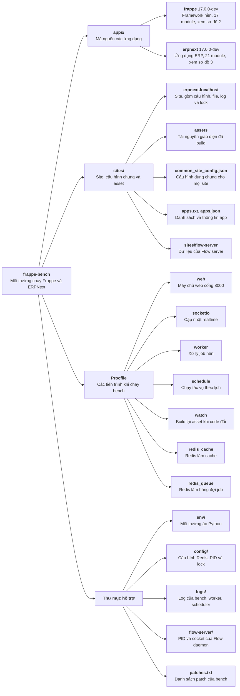

# Sơ đồ module frappe-bench

Sơ đồ theo cấp: bench → app → nhóm → module.

### Sơ đồ 1: Tổng quan frappe-bench

### Sơ đồ 2: frappe (Framework)

```mermaid
flowchart LR
    frappe["<b>frappe</b><br/>Framework nền của ERPNext"]

    frappe --> g1["<b>Lõi và dữ liệu nền</b>"]
    frappe --> g2["<b>Quy trình, tự động hóa và AI</b>"]
    frappe --> g3["<b>Giao diện và đầu ra</b>"]
    frappe --> g4["<b>Khu vực quản trị</b><br/>Chỉ có sidebar và workspace, không có DocType riêng"]

    g1 --> Core["<b>Core</b><br/>DocType, User, Role, phân quyền, File, Error Log<br/><i>Class: DocType, User, Role, DocPerm, File, ErrorLog</i>"]
    g1 --> Custom["<b>Custom</b><br/>Custom Field, Customize Form, Client Script<br/><i>Class: CustomField, CustomizeForm, ClientScript, PropertySetter</i>"]
    g1 --> Geo["<b>Geo</b><br/>Danh mục quốc gia và tiền tệ<br/><i>Class: Country, Currency</i>"]
    g1 --> Contacts["<b>Contacts</b><br/>Liên hệ, địa chỉ, giới tính, danh xưng<br/><i>Class: Contact, Address, Gender, Salutation</i>"]

    g2 --> Workflow["<b>Workflow</b><br/>Trạng thái, chuyển trạng thái và hành động duyệt<br/><i>Class: Workflow, WorkflowState, WorkflowTransition, WorkflowAction</i>"]
    g2 --> Automation["<b>Automation</b><br/>Assignment Rule, Auto Repeat, Automation Flow, Reminder<br/><i>Class: AssignmentRule, AutoRepeat, AutomationFlow, Reminder</i>"]
    g2 --> Integrations["<b>Integrations</b><br/>OAuth, LDAP, Google, Webhook<br/><i>Class: OAuthClient, OAuthBearerToken, LDAPSettings, GoogleSettings, Webhook</i>"]
    g2 --> Flow["<b>Flow</b><br/>AI agent, provider, skill, tool, memory, knowledge base<br/><i>Class: FlowAgent, FlowProvider, FlowAgentSkill, FlowAgentTool, FlowAgentMemory, FlowKnowledgeBase</i>"]

    g3 --> Desk["<b>Desk</b><br/>Workspace, Dashboard, Kanban, Calendar, ToDo, Note<br/><i>Class: Workspace, Dashboard, KanbanBoard, CalendarView, ToDo, Note</i>"]
    g3 --> Website["<b>Website</b><br/>Web Page, Web Form, Website Theme<br/><i>Class: WebPage, WebForm, WebsiteTheme</i>"]
    g3 --> Email["<b>Email</b><br/>Email Account, Email Queue, Template, Notification<br/><i>Class: EmailAccount, EmailQueue, EmailTemplate, Notification</i>"]
    g3 --> Printing["<b>Printing</b><br/>Print Format, Letter Head, Print Settings<br/><i>Class: PrintFormat, LetterHead, PrintSettings</i>"]
    g3 --> Studio["<b>Studio</b><br/>Dựng app, page và component, có phiên AI hỗ trợ<br/><i>Class: StudioApp, StudioPage, StudioComponent, StudioAISession</i>"]

    g4 --> Build["<b>Build</b><br/>Lối vào DocType, tùy biến, script, report, dashboard<br/><i>Class: không có</i>"]
    g4 --> Data["<b>Data</b><br/>Lối vào import, export, File, đặt tên chứng từ<br/><i>Class: không có</i>"]
    g4 --> System["<b>System</b><br/>Lối vào cài đặt, job nền, log, báo cáo sức khỏe<br/><i>Class: không có</i>"]
    g4 --> Users["<b>Users</b><br/>Lối vào User, Role, profile và phân quyền<br/><i>Class: không có</i>"]
```

### Sơ đồ 3: erpnext (Ứng dụng ERP)

```mermaid
flowchart LR
    erpnext["<b>erpnext</b><br/>Ứng dụng ERP"]

    erpnext --> g1["<b>Tài chính</b>"]
    erpnext --> g2["<b>Khách hàng và bán hàng</b>"]
    erpnext --> g3["<b>Mua hàng và kho</b>"]
    erpnext --> g4["<b>Sản xuất và chất lượng</b>"]
    erpnext --> g5["<b>Dự án</b>"]
    erpnext --> g6["<b>Nền tảng và cấu hình</b>"]
    erpnext --> g7["<b>Liên lạc và tích hợp</b>"]

    g1 --> Accounts["<b>Accounts</b><br/>GL, bút toán, hóa đơn, thanh toán, POS, ngân sách<br/><i>Class: GLEntry, JournalEntry, SalesInvoice, PurchaseInvoice, PaymentEntry, POSInvoice, Budget</i>"]
    g1 --> Assets["<b>Assets</b><br/>Tài sản, khấu hao, điều chuyển, sửa chữa<br/><i>Class: Asset, AssetDepreciationSchedule, AssetMovement, AssetRepair</i>"]

    g2 --> CRM["<b>CRM</b><br/>Lead, Opportunity, Prospect, Contract, Appointment<br/><i>Class: Lead, Opportunity, Prospect, Contract, Appointment</i>"]
    g2 --> Selling["<b>Selling</b><br/>Customer, Quotation, Sales Order, Product Bundle<br/><i>Class: Customer, Quotation, SalesOrder, ProductBundle</i>"]
    g2 --> Support["<b>Support</b><br/>Issue, SLA, Warranty Claim<br/><i>Class: Issue, ServiceLevelAgreement, WarrantyClaim</i>"]

    g3 --> Buying["<b>Buying</b><br/>Supplier, RFQ, Purchase Order, Supplier Scorecard<br/><i>Class: Supplier, RequestforQuotation, PurchaseOrder, SupplierScorecard</i>"]
    g3 --> Stock["<b>Stock</b><br/>Item, Warehouse, Stock Entry, Batch, Serial, Delivery Note<br/><i>Class: Item, Warehouse, StockEntry, Batch, SerialNo, DeliveryNote</i>"]
    g3 --> Subcontracting["<b>Subcontracting</b><br/>Đơn gia công, BOM gia công, phiếu nhận<br/><i>Class: SubcontractingOrder, SubcontractingBOM, SubcontractingReceipt</i>"]

    g4 --> Manufacturing["<b>Manufacturing</b><br/>BOM, Work Order, Job Card, Production Plan, Routing<br/><i>Class: BOM, WorkOrder, JobCard, ProductionPlan, Routing</i>"]
    g4 --> Quality["<b>Quality Management</b><br/>Quality Goal, Procedure, Review, Non Conformance<br/><i>Class: QualityGoal, QualityProcedure, QualityReview, NonConformance</i>"]
    g4 --> Maintenance["<b>Maintenance</b><br/>Lịch bảo trì và lượt bảo trì<br/><i>Class: MaintenanceSchedule, MaintenanceVisit</i>"]

    g5 --> Projects["<b>Projects</b><br/>Project, Task, Timesheet, chi phí hoạt động<br/><i>Class: Project, Task, Timesheet, ActivityCost</i>"]

    g6 --> Setup["<b>Setup</b><br/>Company, Department, Employee, Brand, tỷ giá<br/><i>Class: Company, Department, Employee, Brand, CurrencyExchange</i>"]
    g6 --> Utilities["<b>Utilities</b><br/>Rename Tool, Video, Portal User<br/><i>Class: RenameTool, Video, PortalUser</i>"]
    g6 --> Portal["<b>Portal</b><br/>Thuộc tính và bộ lọc trên website<br/><i>Class: WebsiteAttribute, WebsiteFilterField</i>"]
    g6 --> Regional["<b>Regional</b><br/>VAT Nam Phi, UAE và các tùy biến theo quốc gia<br/><i>Class: SouthAfricaVATSettings, UAEVATSettings, ImportSupplierInvoice</i>"]
    g6 --> Bulk["<b>Bulk Transaction</b><br/>Log giao dịch hàng loạt<br/><i>Class: BulkTransactionLog</i>"]

    g7 --> Communication["<b>Communication</b><br/>Kênh liên lạc và khung giờ<br/><i>Class: CommunicationMedium, CommunicationMediumTimeslot</i>"]
    g7 --> Telephony["<b>Telephony</b><br/>Call Log, cài đặt cuộc gọi đến và thoại<br/><i>Class: CallLog, IncomingCallSettings, VoiceCallSettings</i>"]
    g7 --> ERPInt["<b>ERPNext Integrations</b><br/>Cấu hình Plaid<br/><i>Class: PlaidSettings</i>"]
    g7 --> EDI["<b>EDI</b><br/>Code List và Common Code<br/><i>Class: CodeList, CommonCode</i>"]
```

## Lưu ý khi đọc sơ đồ

- Mũi tên nghĩa là "chứa", không phải phụ thuộc.
- Tên nhóm như "Tài chính" hay "Khu vực quản trị" được đặt để dễ đọc; Frappe và ERPNext không có cấp này trong code.
- Mô tả module dựa trên DocType và sidebar trong code.
- Vai trò của các tiến trình Procfile, `env/`, `sites/flow-server` và `flow-server/` được suy từ tên và file bên trong, chưa đọc code chi tiết.
- `Build`, `Data`, `System` và `Users` không có DocType riêng, chỉ gom các màn hình có sẵn vào một khu vực quản trị.
- Dòng `Class:` chỉ liệt kê các class controller chính của DocType trong module, không phải toàn bộ class. Tên được lấy trực tiếp từ file `apps/<app>/<app>/<module>/doctype/<doctype>/<doctype>.py`.
- `Build`, `Data`, `System` và `Users` không có class vì không có DocType riêng. Sơ đồ 1 không ghi class vì đó là thư mục, tiến trình và file cấu hình.
