# Module Assets

Quản lý vòng đời tài sản cố định: mua vào, khấu hao, vốn hóa, sửa chữa, di chuyển, đánh giá lại và thanh lý. Module ghi sổ qua `Journal Entry` và `GL Entry` (accounts), xuất kho qua `Stock Entry` và `Stock Ledger Entry` (stock), nhận tài sản từ `Purchase Receipt`/`Purchase Invoice` (buying) và bán qua `Sales Invoice` (accounts).

## Phạm vi

Đọc được 26 doctype trong `assets/doctype/`.

| Nhóm chức năng | Doctype/file chính | Sơ đồ |
| --- | --- | --- |
| Tài sản và khấu hao | `Asset`, `Asset Depreciation Schedule`, `Asset Finance Book`, `Asset Category`, `Asset Shift Allocation`; `asset/depreciation.py`, `asset_depreciation_schedule/deppreciation_schedule_controller.py` | Class: Tài sản và khấu hao. Sequence: Tạo Asset từ chứng từ mua, Lưu Asset và tạo lịch khấu hao, Submit Asset, Cancel Asset, Chuyển CWIP sang Fixed Asset, Ghi khấu hao định kỳ, Phân bổ ca khấu hao |
| Chứng từ làm đổi giá trị | `Asset Capitalization`, `Asset Repair`, `Asset Value Adjustment`; `services/gl_composer.py` của hai doctype đầu | Class: Chứng từ làm đổi giá trị. Sequence: Submit và Cancel Asset Capitalization, Asset Repair (lưu nháp, submit, cancel), Asset Value Adjustment |
| Thanh lý và tách | `asset/depreciation.py`, `asset/mapper.py`, `accounts/doctype/sales_invoice/services/fixed_assets.py`, `accounts/doctype/journal_entry/services/asset_service.py` | Sequence: Bán tài sản, Trả lại hoặc hủy hóa đơn bán, Scrap, Restore, Tách tài sản |
| Di chuyển và bảo trì | `Asset Movement`, `Location`, `Asset Maintenance`, `Asset Maintenance Log`, `Asset Maintenance Team` | Class: Di chuyển và bảo trì. Sequence: Asset Movement, Asset Maintenance và Log |

## Class diagram

### Tài sản và khấu hao

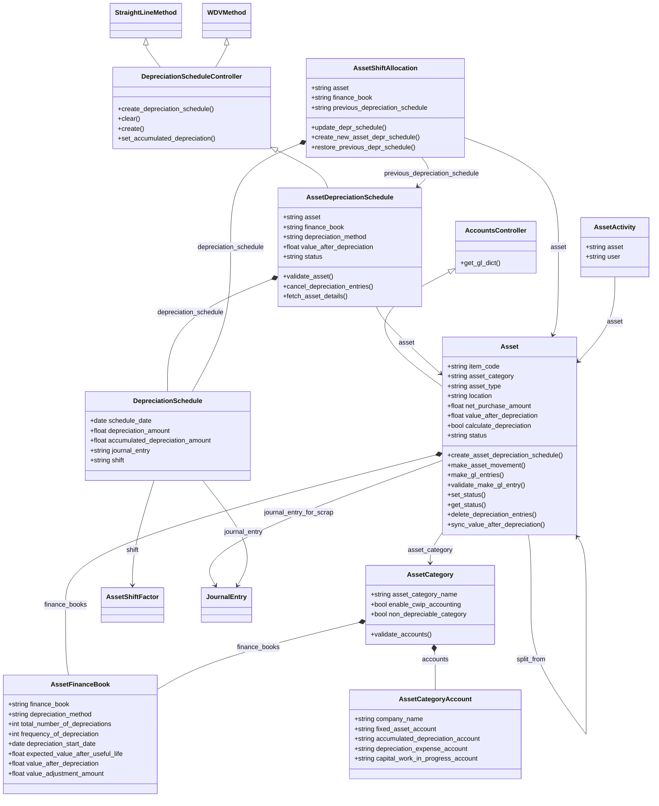

### Chứng từ làm đổi giá trị

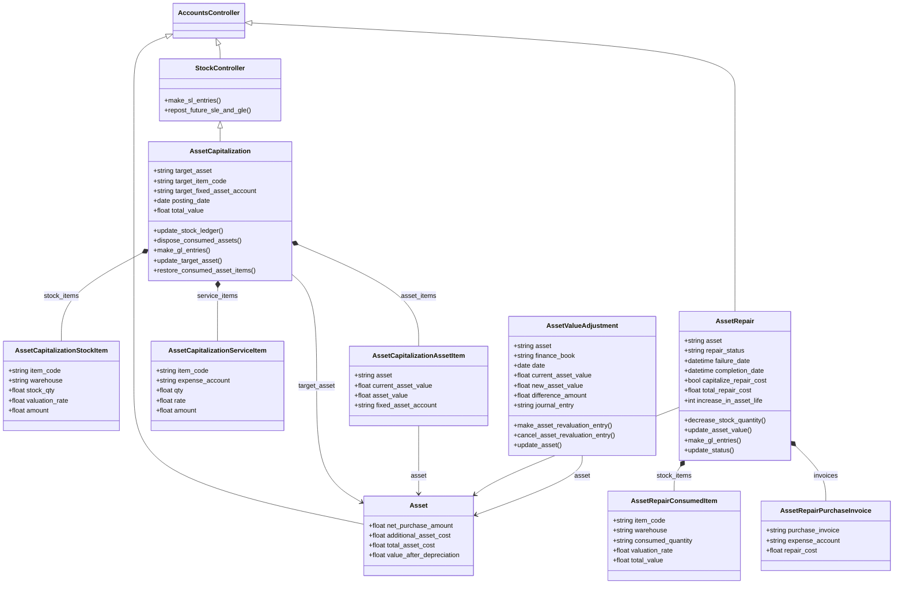

### Di chuyển và bảo trì

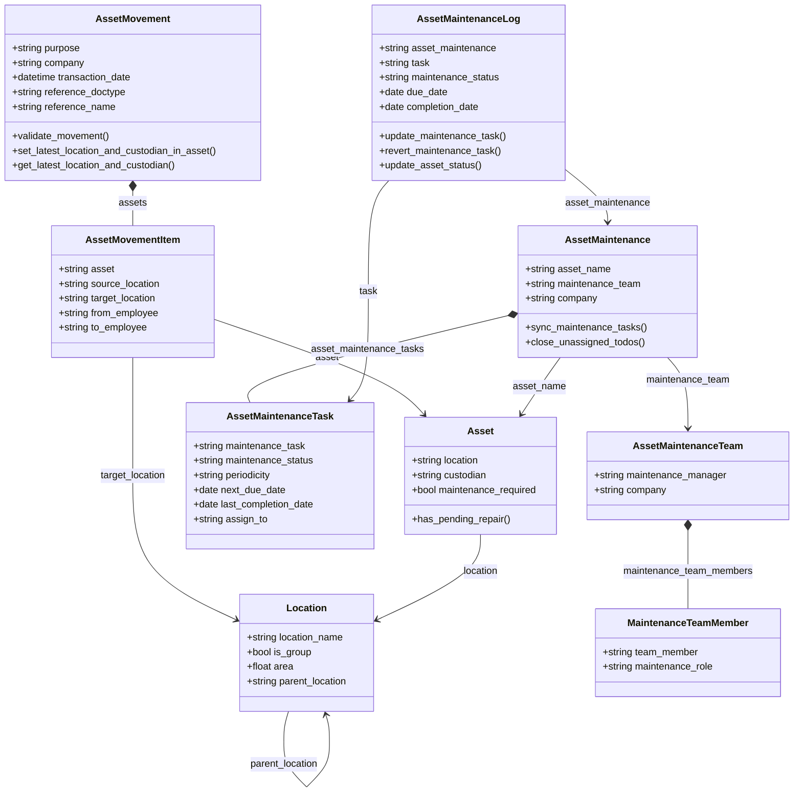

## Sequence diagram

### Tạo Asset từ chứng từ mua

Khi submit `Purchase Receipt` hoặc `Purchase Invoice` có `update_stock`, item bật `auto_create_assets` sinh Asset nháp bằng `db_insert`, bỏ qua `validate`.

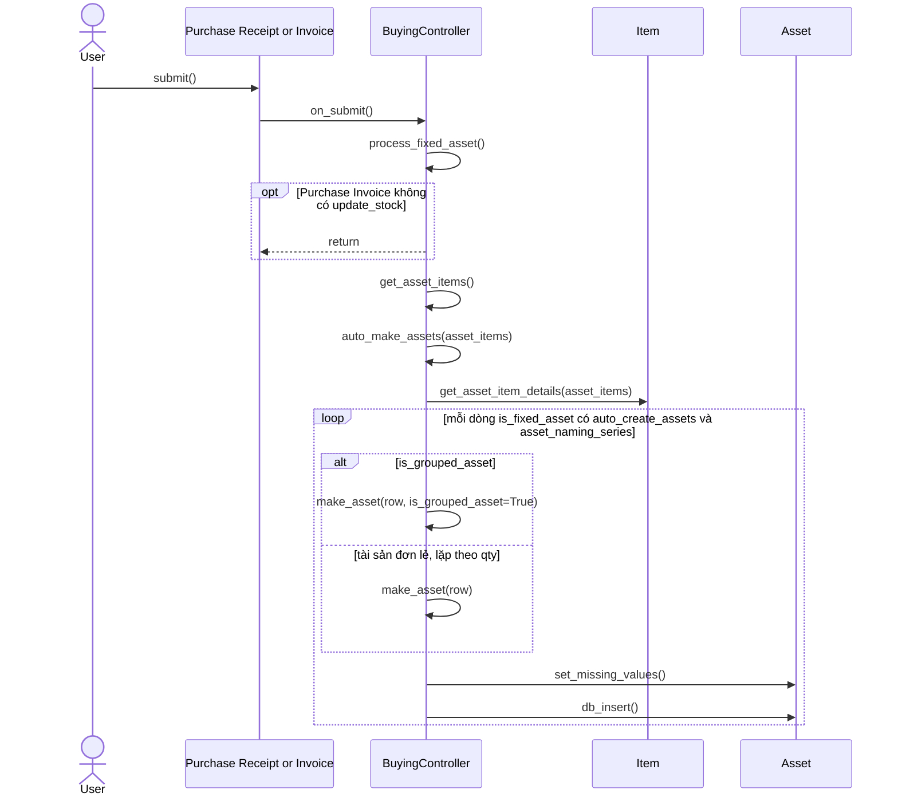

Nguồn: [buying_controller.py:1433](../../apps/erpnext/erpnext/controllers/buying_controller.py#L1433), [buying_controller.py:1497](../../apps/erpnext/erpnext/controllers/buying_controller.py#L1497)

### Lưu Asset và tạo lịch khấu hao

Mỗi lần lưu, `on_update` tạo hoặc tính lại một `Asset Depreciation Schedule` nháp cho từng dòng finance book.

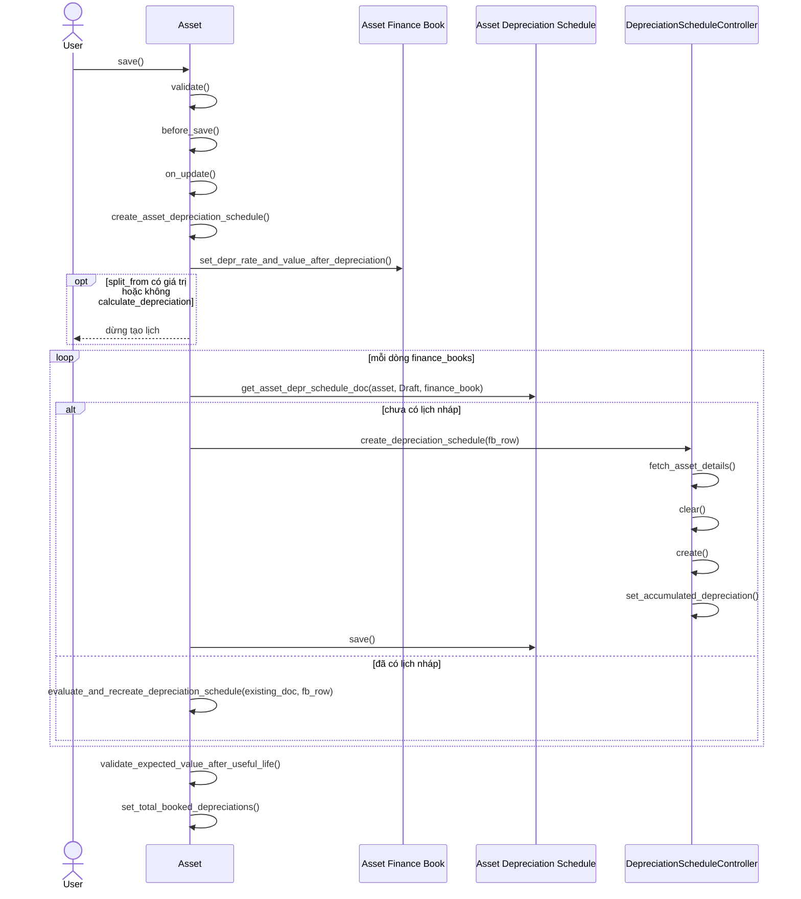

Nguồn: [asset.py:249](../../apps/erpnext/erpnext/assets/doctype/asset/asset.py#L249), [asset.py:146](../../apps/erpnext/erpnext/assets/doctype/asset/asset.py#L146), [deppreciation_schedule_controller.py:28](../../apps/erpnext/erpnext/assets/doctype/asset_depreciation_schedule/deppreciation_schedule_controller.py#L28)

### Submit Asset

Submit sinh `Asset Movement` loại Receipt, ghi sổ từ CWIP sang Fixed Asset nếu đủ điều kiện, rồi kích hoạt lịch khấu hao.

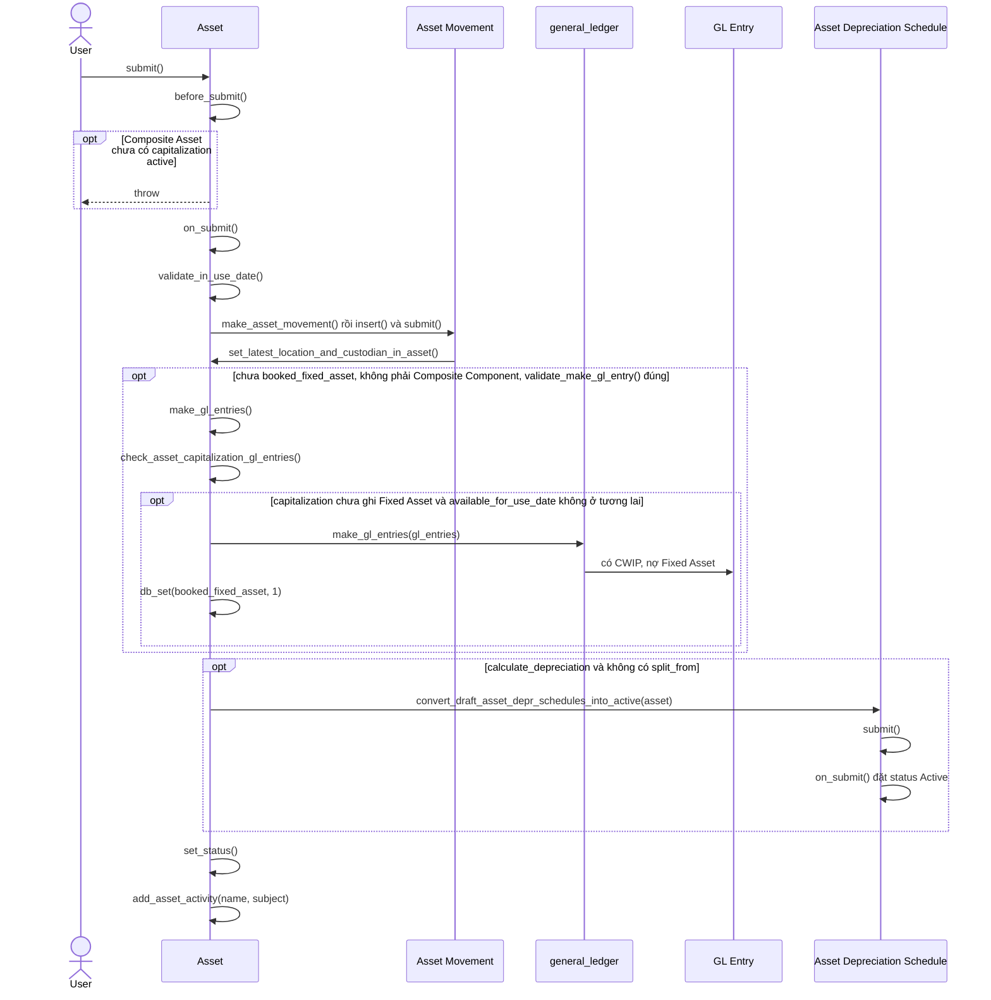

Nguồn: [asset.py:260](../../apps/erpnext/erpnext/assets/doctype/asset/asset.py#L260), [asset.py:1033](../../apps/erpnext/erpnext/assets/doctype/asset/asset.py#L1033)

### Cancel Asset

Cancel gỡ movement, hủy các bút toán khấu hao, hủy lịch khấu hao và đảo GL của chính Asset.

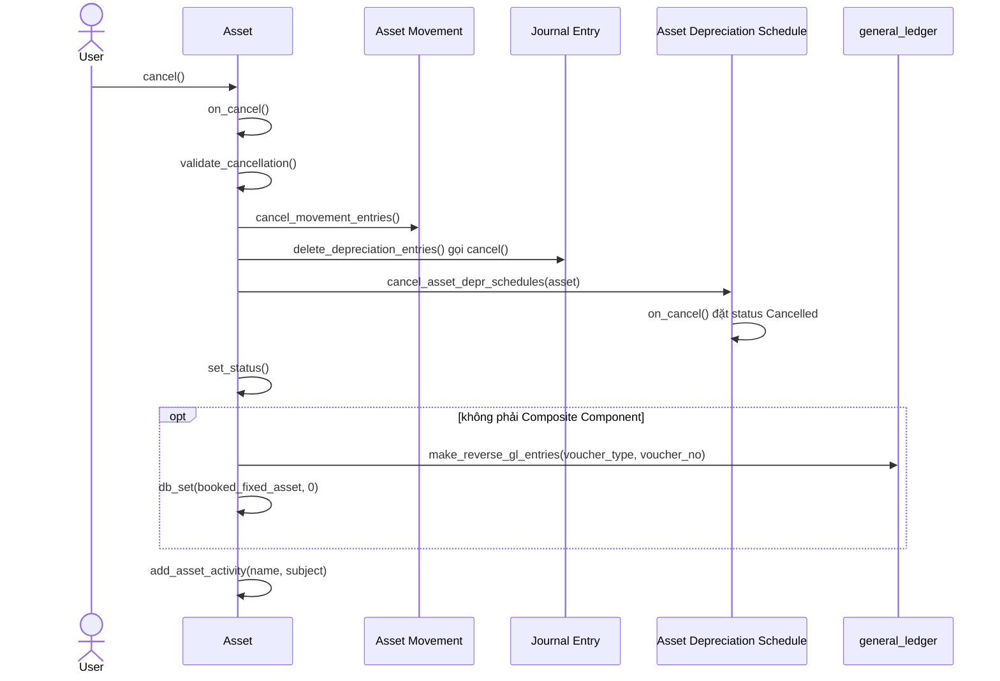

Nguồn: [asset.py:275](../../apps/erpnext/erpnext/assets/doctype/asset/asset.py#L275), [asset.py:818](../../apps/erpnext/erpnext/assets/doctype/asset/asset.py#L818)

### Chuyển CWIP sang Fixed Asset hằng ngày

Job `daily_maintenance` ghi sổ cho các Asset đã submit nhưng lúc submit chưa tới `available_for_use_date`. Mỗi Asset chạy trong savepoint riêng.

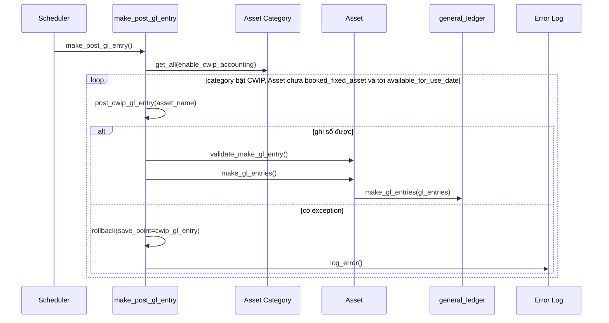

Nguồn: [asset.py:1218](../../apps/erpnext/erpnext/assets/doctype/asset/asset.py#L1218), [asset.py:1238](../../apps/erpnext/erpnext/assets/doctype/asset/asset.py#L1238)

### Ghi khấu hao định kỳ

Job `daily_maintenance` tạo `Journal Entry` loại Depreciation Entry cho các dòng lịch đến hạn. Cập nhật giá trị Asset diễn ra trong `AssetService` khi Journal Entry được submit.

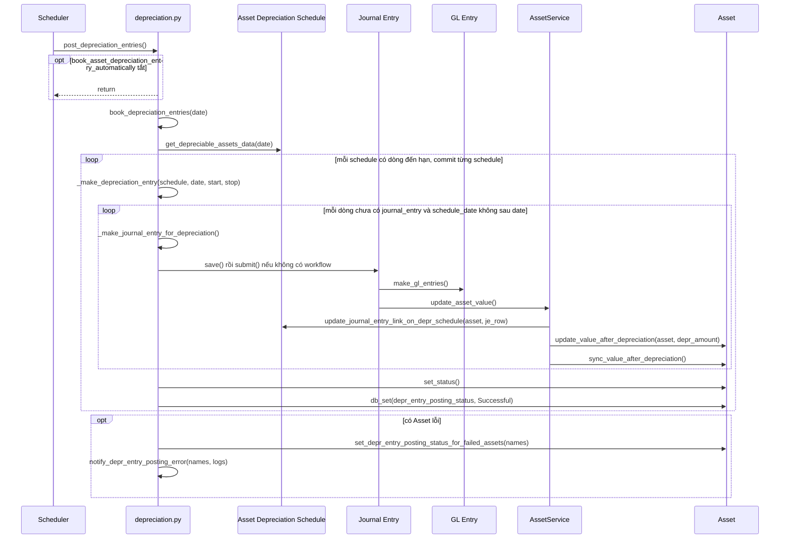

Nguồn: [depreciation.py:37](../../apps/erpnext/erpnext/assets/doctype/asset/depreciation.py#L37), [depreciation.py:182](../../apps/erpnext/erpnext/assets/doctype/asset/depreciation.py#L182), [asset_service.py:58](../../apps/erpnext/erpnext/accounts/doctype/journal_entry/services/asset_service.py#L58)

### Phân bổ ca khấu hao (Asset Shift Allocation)

Đổi số ca trên lịch shift-based. Submit thay lịch Active bằng bản sao mang các dòng mới, cancel khôi phục lịch cũ.

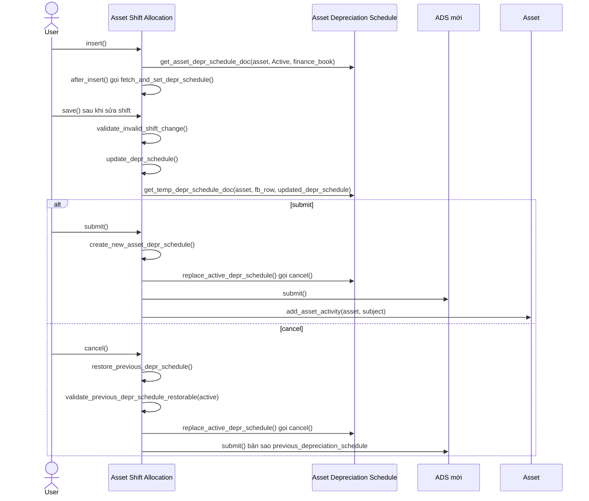

Nguồn: [asset_shift_allocation.py:44](../../apps/erpnext/erpnext/assets/doctype/asset_shift_allocation/asset_shift_allocation.py#L44), [asset_shift_allocation.py:227](../../apps/erpnext/erpnext/assets/doctype/asset_shift_allocation/asset_shift_allocation.py#L227), [asset_shift_allocation.py:261](../../apps/erpnext/erpnext/assets/doctype/asset_shift_allocation/asset_shift_allocation.py#L261)

### Submit Asset Capitalization

Gộp vật tư, tài sản khác và dịch vụ vào một Target Asset loại Composite Asset còn nháp. Tài sản tiêu thụ bị thanh lý, người dùng submit Target Asset ở bước sau.

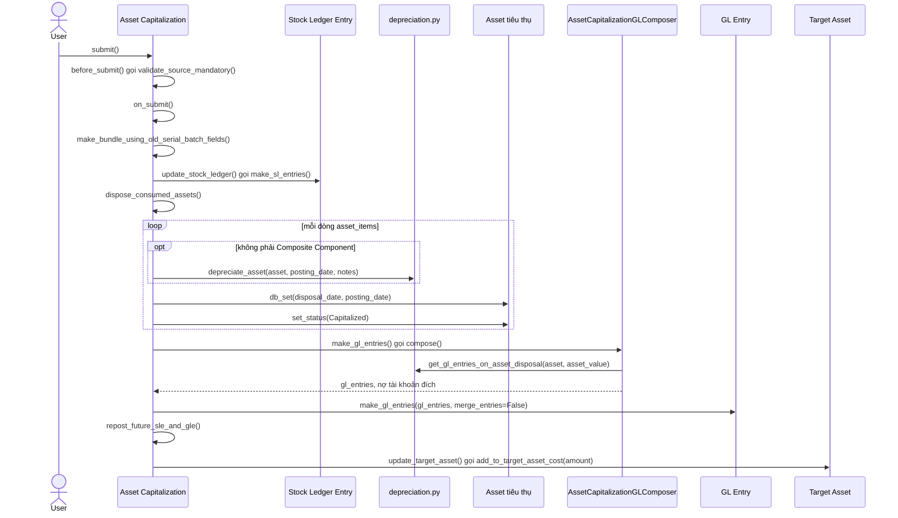

Nguồn: [asset_capitalization.py:113](../../apps/erpnext/erpnext/assets/doctype/asset_capitalization/asset_capitalization.py#L113), [asset_capitalization.py:524](../../apps/erpnext/erpnext/assets/doctype/asset_capitalization/asset_capitalization.py#L524), [gl_composer.py:20](../../apps/erpnext/erpnext/assets/doctype/asset_capitalization/services/gl_composer.py#L20)

### Cancel Asset Capitalization

Chỉ cancel được khi Target Asset chưa submit. Đảo sổ kho và GL, khôi phục tài sản tiêu thụ, trừ chi phí khỏi Target Asset.

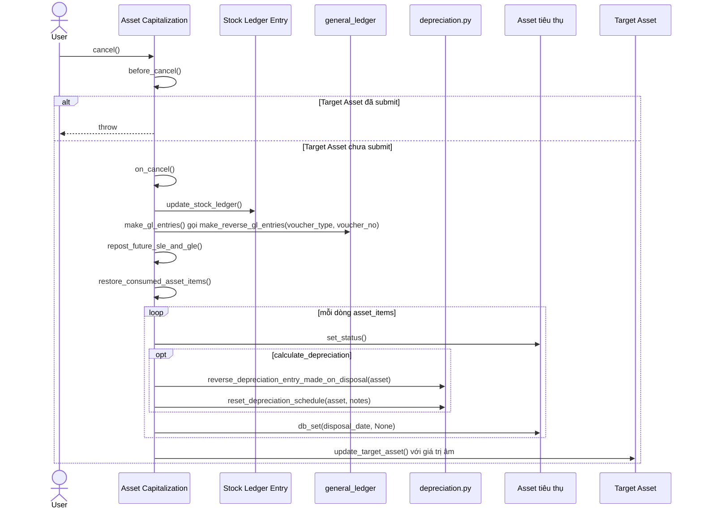

Nguồn: [asset_capitalization.py:121](../../apps/erpnext/erpnext/assets/doctype/asset_capitalization/asset_capitalization.py#L121), [asset_capitalization.py:129](../../apps/erpnext/erpnext/assets/doctype/asset_capitalization/asset_capitalization.py#L129), [asset_capitalization.py:542](../../apps/erpnext/erpnext/assets/doctype/asset_capitalization/asset_capitalization.py#L542)

### Lưu nháp Asset Repair và cập nhật trạng thái Asset

Mỗi lần lưu nháp, trạng thái Asset được tính lại bằng tác vụ nền sau commit: repair `Pending` làm Asset thành `Out of Order`.

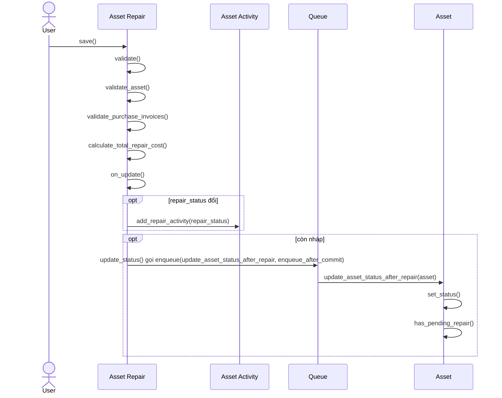

Nguồn: [asset_repair.py:80](../../apps/erpnext/erpnext/assets/doctype/asset_repair/asset_repair.py#L80), [asset_repair.py:208](../../apps/erpnext/erpnext/assets/doctype/asset_repair/asset_repair.py#L208), [asset_repair.py:443](../../apps/erpnext/erpnext/assets/doctype/asset_repair/asset_repair.py#L443)

### Submit Asset Repair

Chỉ submit được khi `repair_status` là Completed. Vật tư xuất qua `Stock Entry` Material Issue. Vốn hóa chi phí là tùy chọn và làm tính lại lịch khấu hao.

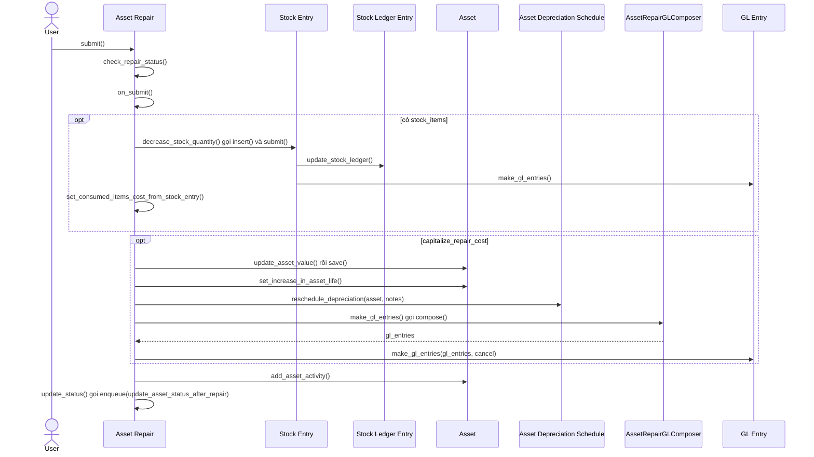

Nguồn: [asset_repair.py:229](../../apps/erpnext/erpnext/assets/doctype/asset_repair/asset_repair.py#L229), [asset_repair.py:326](../../apps/erpnext/erpnext/assets/doctype/asset_repair/asset_repair.py#L326), [gl_composer.py:20](../../apps/erpnext/erpnext/assets/doctype/asset_repair/services/gl_composer.py#L20)

### Cancel Asset Repair

Hủy `Stock Entry` đã sinh và, nếu đã vốn hóa, đảo giá trị Asset, GL và lịch khấu hao.

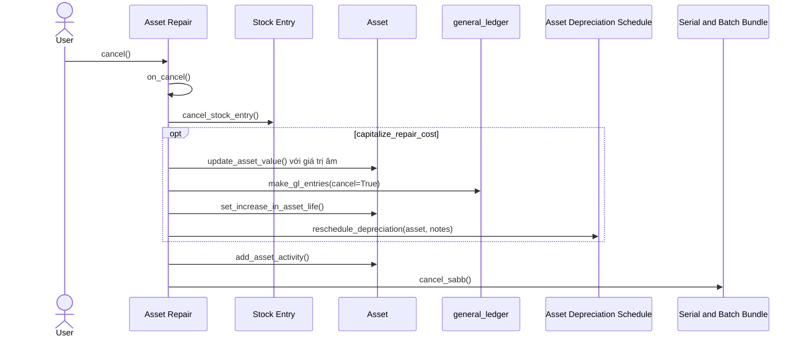

Nguồn: [asset_repair.py:252](../../apps/erpnext/erpnext/assets/doctype/asset_repair/asset_repair.py#L252), [asset_repair.py:268](../../apps/erpnext/erpnext/assets/doctype/asset_repair/asset_repair.py#L268)

### Asset Movement

Asset Movement không ghi sổ. Khi submit hoặc cancel, `location` và `custodian` của Asset được tính lại từ movement submit mới nhất.

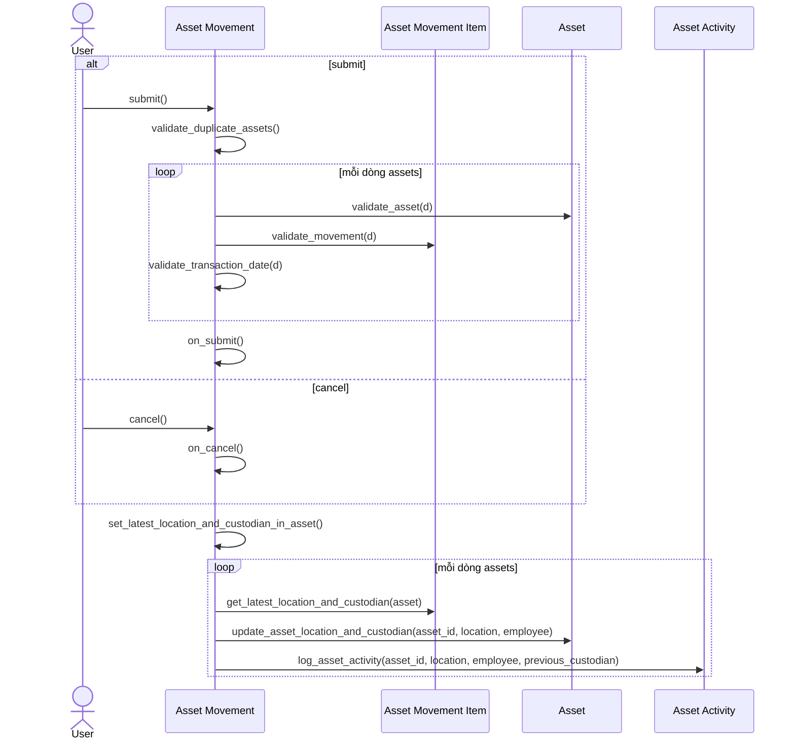

Nguồn: [asset_movement.py:37](../../apps/erpnext/erpnext/assets/doctype/asset_movement/asset_movement.py#L37), [asset_movement.py:134](../../apps/erpnext/erpnext/assets/doctype/asset_movement/asset_movement.py#L134)

### Asset Value Adjustment

Đánh giá lại tài sản bằng một `Journal Entry` giữa Fixed Asset và `difference_account`, sau đó tính lại lịch khấu hao.

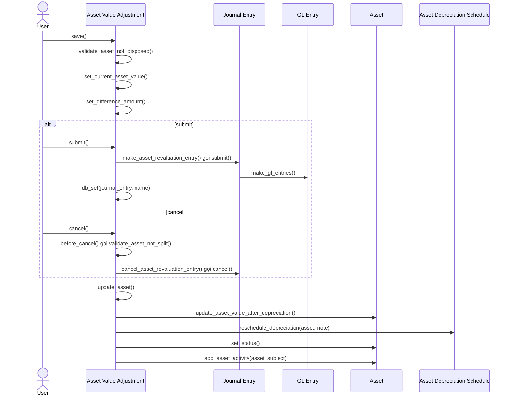

Nguồn: [asset_value_adjustment.py:150](../../apps/erpnext/erpnext/assets/doctype/asset_value_adjustment/asset_value_adjustment.py#L150), [asset_value_adjustment.py:170](../../apps/erpnext/erpnext/assets/doctype/asset_value_adjustment/asset_value_adjustment.py#L170), [asset_value_adjustment.py:268](../../apps/erpnext/erpnext/assets/doctype/asset_value_adjustment/asset_value_adjustment.py#L268)

### Thanh lý: bán tài sản qua Sales Invoice

Dòng hóa đơn có `is_fixed_asset`. Hóa đơn tách phần chưa bán, khấu hao đến ngày bán, rồi ghi sổ thanh lý cùng hóa đơn.

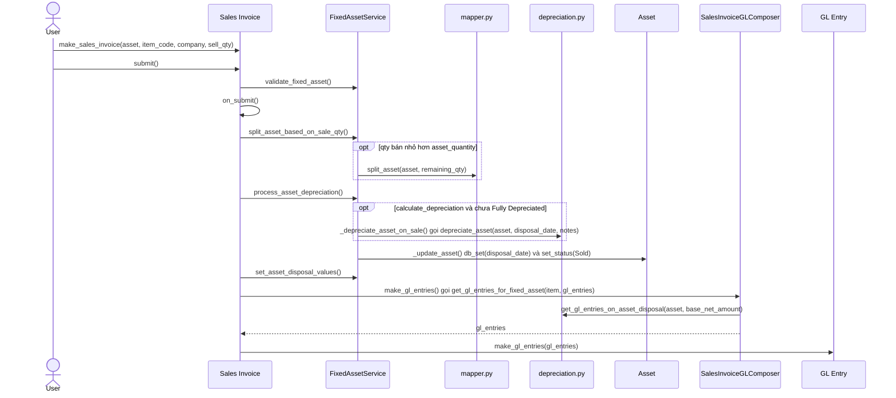

Nguồn: [sales_invoice.py:443](../../apps/erpnext/erpnext/accounts/doctype/sales_invoice/sales_invoice.py#L443), [fixed_assets.py:77](../../apps/erpnext/erpnext/accounts/doctype/sales_invoice/services/fixed_assets.py#L77), [gl_composer.py:408](../../apps/erpnext/erpnext/accounts/doctype/sales_invoice/services/gl_composer.py#L408), [depreciation.py:661](../../apps/erpnext/erpnext/assets/doctype/asset/depreciation.py#L661)

### Thanh lý: trả lại hoặc hủy hóa đơn bán

Hóa đơn trả hàng được submit, hoặc hóa đơn bán bị cancel, đều khôi phục tài sản. Với hóa đơn trả hàng, GL `get_gl_entries_on_asset_regain` được ghi trước khi đảo khấu hao.

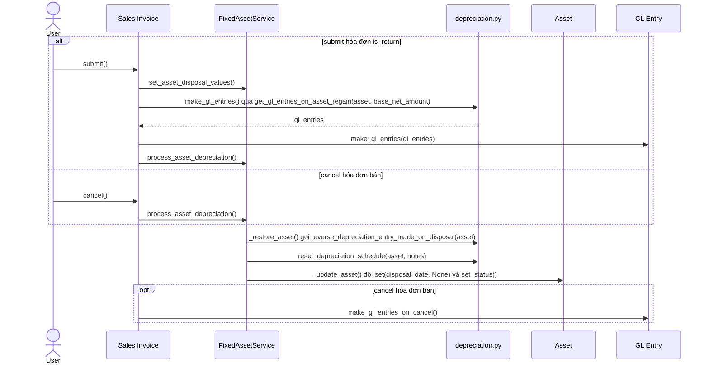

Nguồn: [sales_invoice.py:545](../../apps/erpnext/erpnext/accounts/doctype/sales_invoice/sales_invoice.py#L545), [fixed_assets.py:133](../../apps/erpnext/erpnext/accounts/doctype/sales_invoice/services/fixed_assets.py#L133), [depreciation.py:601](../../apps/erpnext/erpnext/assets/doctype/asset/depreciation.py#L601)

### Thanh lý: scrap tài sản

Scrap tính khấu hao đến ngày thanh lý rồi tạo `Journal Entry` loại Asset Disposal. `journal_entry_for_scrap` được đặt trong `AssetService`, không phải trong `create_journal_entry_for_scrap`.

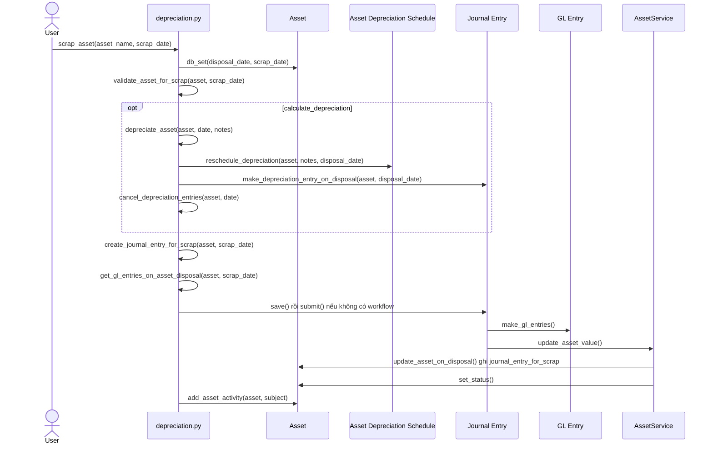

Nguồn: [depreciation.py:373](../../apps/erpnext/erpnext/assets/doctype/asset/depreciation.py#L373), [depreciation.py:493](../../apps/erpnext/erpnext/assets/doctype/asset/depreciation.py#L493), [depreciation.py:440](../../apps/erpnext/erpnext/assets/doctype/asset/depreciation.py#L440), [asset_service.py:108](../../apps/erpnext/erpnext/accounts/doctype/journal_entry/services/asset_service.py#L108)

### Thanh lý: restore tài sản đã scrap

Đảo bút toán khấu hao lúc thanh lý, tính lại lịch, rồi hủy bút toán scrap.

```mermaid
sequenceDiagram
    actor User
    participant Depr as depreciation.py
    participant Asset
    participant ADS as Asset Depreciation Schedule
    participant JE as Journal Entry
    participant GL as GL Entry
    User->>Depr: restore_asset(asset_name)
    Depr->>Depr: reverse_depreciation_entry_made_on_disposal(asset)
    loop dòng lịch có schedule_date bằng disposal_date và có journal_entry
        opt không trùng ngày lịch gốc, hoặc disposal_date ở tương lai
            Depr->>JE: create_reverse_depreciation_entry(asset_name, journal_entry)
            JE->>GL: make_gl_entries()
            Depr->>ADS: update_value_after_depreciation_on_asset_restore(schedule, row, journal_entry)
        end
    end
    Depr->>Asset: sync_value_after_depreciation()
    Depr->>ADS: reset_depreciation_schedule(asset, notes)
    Depr->>Asset: cancel_journal_entry_for_scrap(asset)
    Asset->>JE: cancel()
    JE->>GL: make_gl_entries(1)
    Depr->>Asset: set_status()
    Depr->>Asset: add_asset_activity(asset_name, subject)
```

Nguồn: [depreciation.py:466](../../apps/erpnext/erpnext/assets/doctype/asset/depreciation.py#L466), [depreciation.py:520](../../apps/erpnext/erpnext/assets/doctype/asset/depreciation.py#L520)

### Tách tài sản (split_asset)

Tách theo số lượng: tạo Asset mới có `split_from`, co giá trị Asset cũ theo tỷ lệ, chép lịch khấu hao và chia lại các `Journal Entry` đã ghi.

```mermaid
sequenceDiagram
    actor Caller as User hoặc FixedAssetService
    participant Map as mapper.py
    participant Old as Asset cũ
    participant New as Asset mới
    participant ADS as Asset Depreciation Schedule
    participant JE as Journal Entry
    participant GL as GL Entry
    Caller->>Map: split_asset(asset_name, split_qty)
    Map->>Map: validate_asset_split(existing_asset, split_qty)
    Map->>New: create_new_asset_from_split(existing_asset, split_qty)
    Map->>New: set_split_asset_values() rồi log_asset_activity() gọi insert() và submit()
    Map->>ADS: update_finance_books() gọi reschedule_depr_for_updated_asset() và submit() lịch mới
    loop dòng lịch đã có journal_entry của Asset mới
        Map->>JE: add_reference_in_jv_on_split(entry_name, new, old, amount)
        JE->>GL: make_gl_entries(1)
        JE->>GL: make_gl_entries()
    end
    Map->>Old: update_existing_asset_after_split(existing_asset, remaining_qty, splitted_asset)
    Map->>Old: set_split_asset_values() rồi save()
    Map->>ADS: reschedule_depr_for_updated_asset() gọi cancel() lịch cũ và submit() lịch mới
```

Nguồn: [mapper.py:195](../../apps/erpnext/erpnext/assets/doctype/asset/mapper.py#L195), [mapper.py:231](../../apps/erpnext/erpnext/assets/doctype/asset/mapper.py#L231), [mapper.py:361](../../apps/erpnext/erpnext/assets/doctype/asset/mapper.py#L361)

### Asset Maintenance và Maintenance Log

Lưu `Asset Maintenance` gán ToDo và sinh `Asset Maintenance Log` cho từng task. Submit log tính kỳ tiếp theo. Hai job hằng ngày cập nhật trạng thái.

```mermaid
sequenceDiagram
    actor User
    participant AM as Asset Maintenance
    participant Task as Asset Maintenance Task
    participant Log as Asset Maintenance Log
    participant Asset
    participant Sched as Scheduler
    User->>AM: save()
    AM->>AM: validate()
    AM->>AM: on_update()
    AM->>AM: assign_tasks(name, assign_to, task, next_due_date)
    AM->>AM: sync_maintenance_tasks()
    AM->>Log: update_maintenance_log(asset_maintenance, item_code, item_name, task)
    User->>Log: submit() với status Completed hoặc Cancelled
    Log->>Task: update_maintenance_task()
    opt Completed
        Log->>Task: calculate_next_due_date(periodicity, end_date, last_completion_date)
    end
    Log->>AM: save() để sinh log kỳ sau
    Log->>Asset: update_asset_status()
    Sched->>Log: update_asset_maintenance_log_status()
    Sched->>Asset: update_maintenance_status()
    Asset->>Asset: has_pending_repair()
    Asset->>Log: has_due_maintenance(asset_name)
    Asset->>Asset: set_status()
```

Nguồn: [asset_maintenance.py:80](../../apps/erpnext/erpnext/assets/doctype/asset_maintenance/asset_maintenance.py#L80), [asset_maintenance_log.py:69](../../apps/erpnext/erpnext/assets/doctype/asset_maintenance_log/asset_maintenance_log.py#L69), [asset_maintenance_log.py:136](../../apps/erpnext/erpnext/assets/doctype/asset_maintenance_log/asset_maintenance_log.py#L136), [asset.py:1189](../../apps/erpnext/erpnext/assets/doctype/asset/asset.py#L1189)

## Giới hạn

- Không có sequence riêng: `Asset Category`, `Asset Shift Factor`, `Asset Maintenance Team`, `Location` (chủ yếu là validate và tính diện tích địa lý), các bảng con. `Location` và `Asset Category` chỉ đọc danh sách method, chưa đọc kỹ thân hàm.
- `Linked Location` không xuất hiện trong sơ đồ: ngoài thư mục doctype của nó, tìm thấy trong `.py`/`.json` chỉ có một patch cũ `v11_0/merge_land_unit_with_location.py`.
- Thuật toán tính số tiền khấu hao (`StraightLineMethod`, `WDVMethod`, phần lớn `deppreciation_schedule_controller.py`) chỉ đọc lướt, sơ đồ dừng ở mức `create_depreciation_schedule`.
- `Asset Capitalization` chỉ đọc tới dòng khoảng 670; các hàm whitelisted lấy chi tiết dòng sau đó không đưa vào sơ đồ.
- Luồng `Stock Entry` và `Journal Entry` chỉ vẽ tới `update_stock_ledger`/`make_gl_entries`, không đi vào bên trong `stock_ledger.py` và `general_ledger.py`. Với `Stock Entry`, chỉ đọc lướt `on_submit`, chưa xác nhận các điều kiện quanh hai lời gọi này.
- Đáng lưu ý: [depreciation.py:450](../../apps/erpnext/erpnext/assets/doctype/asset/depreciation.py#L450) truyền `scrap_date` vào tham số vị trí thứ hai của `get_gl_entries_on_asset_disposal`, mà tham số đó là `selling_amount`. Theo code, `flt()` của một giá trị date trả `0.0` nên phần lãi lỗ vẫn tính với giá bán 0, còn `date` của hàm rơi về ngày hiện tại. Sơ đồ vẽ đúng lời gọi này; chưa chạy thử.
- `make_draft_asset_depr_schedule` ([asset_depreciation_schedule.py:212](../../apps/erpnext/erpnext/assets/doctype/asset_depreciation_schedule/asset_depreciation_schedule.py#L212)) không có nơi gọi trong `.py`/`.json` đã tìm, nên không vẽ.
- Thứ tự giữa hook `update_asset_value` và `make_gl_entries` trong `Journal Entry.on_submit` đã đọc; các bước khác của `on_submit` (`check_credit_limit`, inter-company, invoice discounting) được lược bỏ. Tương tự, `Sales Invoice.on_submit` chỉ vẽ phần liên quan đến tài sản.
- Điều kiện `doc.is_return` trong luồng trả hàng dựa trên `process_asset_depreciation`; luồng cancel một hóa đơn trả hàng (lại khấu hao và đặt `Sold`) không vẽ riêng.
