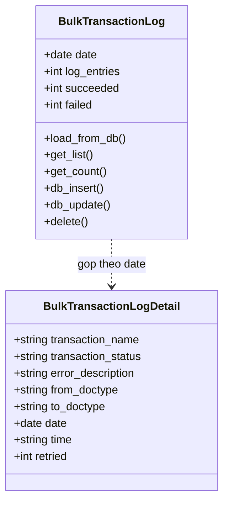
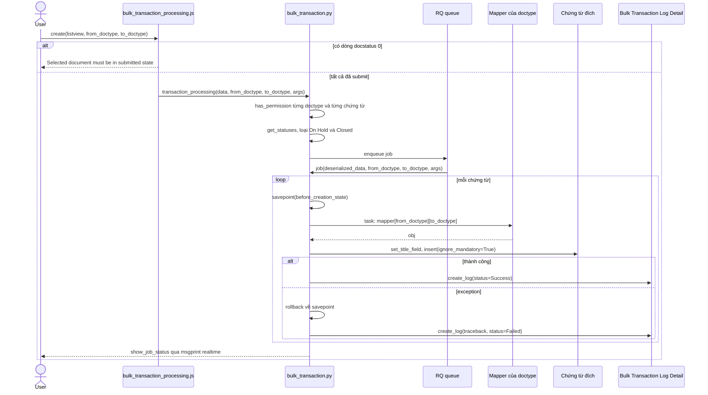
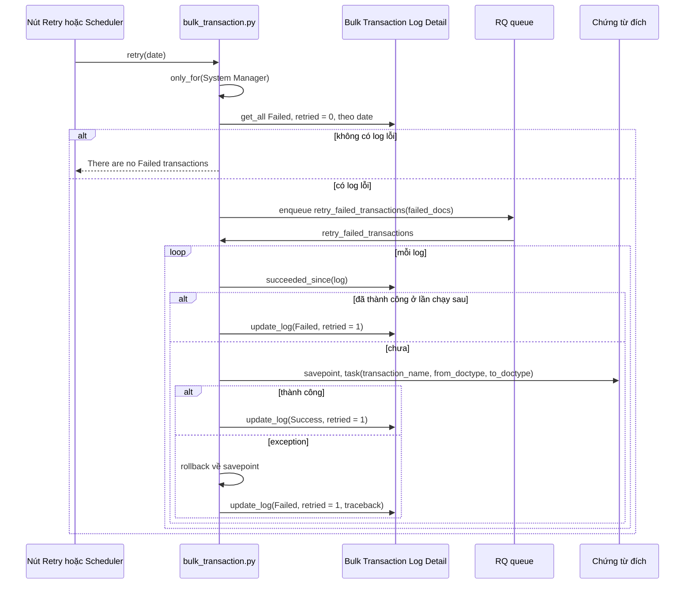
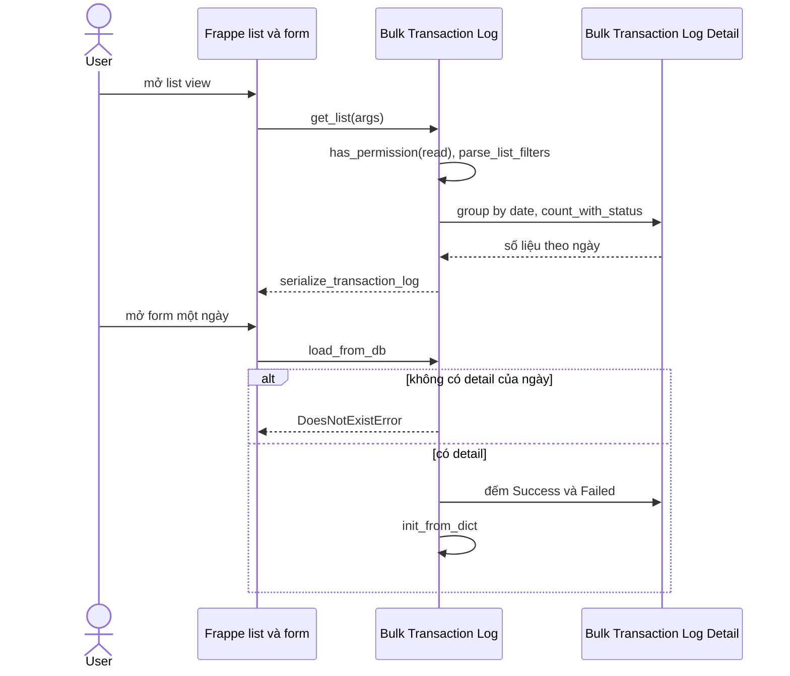

# Module Bulk Transaction

Module chỉ chứa nhật ký cho việc tạo chứng từ hàng loạt từ list view; logic xử lý nằm ở `erpnext/utilities/bulk_transaction.py`. Hàm `task` gọi các mapper của `selling`, `buying`, `stock`, `accounts` để chuyển đổi chứng từ.

## Phạm vi

Đọc được 2 doctype trong `bulk_transaction/doctype/`.

| Nhóm chức năng | Doctype/file chính | Sơ đồ |
|---|---|---|
| Tạo chứng từ hàng loạt | `utilities/bulk_transaction.py`, `public/js/bulk_transaction_processing.js` | Sequence: Tạo hàng loạt |
| Chạy lại phần lỗi | `utilities/bulk_transaction.py` (`retry`) | Sequence: Chạy lại giao dịch lỗi |
| Nhật ký | `Bulk Transaction Log` (virtual), `Bulk Transaction Log Detail` | Class. Sequence: Xem nhật ký |

## Class diagram

`Bulk Transaction Log` là virtual doctype, không có bảng riêng: mỗi "bản ghi" là số liệu gộp theo ngày từ `Bulk Transaction Log Detail`. Hai doctype không có Link với nhau, chỉ khớp qua field `date`.

## Sequence diagram

### Tạo hàng loạt

Người dùng chọn chứng từ đã submit trên list view; server kiểm tra quyền từng chứng từ, bỏ qua chứng từ On Hold hoặc Closed, rồi enqueue một job. Mỗi chứng từ chạy trong một savepoint riêng để lỗi không kéo theo các chứng từ khác.

Nguồn: [bulk_transaction.py:10](../../apps/erpnext/erpnext/utilities/bulk_transaction.py#L10), [bulk_transaction.py:140](../../apps/erpnext/erpnext/utilities/bulk_transaction.py#L140), [bulk_transaction.py:169](../../apps/erpnext/erpnext/utilities/bulk_transaction.py#L169)

### Chạy lại giao dịch lỗi

Được gọi từ nút trên form Bulk Transaction Log hoặc từ job `hourly_maintenance` (không truyền `date` thì lấy hôm nay). Log đã có bản Success sau đó thì chỉ đánh dấu `retried`.

Nguồn: [bulk_transaction.py:75](../../apps/erpnext/erpnext/utilities/bulk_transaction.py#L75), [bulk_transaction.py:100](../../apps/erpnext/erpnext/utilities/bulk_transaction.py#L100)

### Xem nhật ký

Danh sách và form của doctype virtual được tính trực tiếp bằng truy vấn gộp trên bảng detail.

Nguồn: [bulk_transaction_log.py:33](../../apps/erpnext/erpnext/bulk_transaction/doctype/bulk_transaction_log/bulk_transaction_log.py#L33), [bulk_transaction_log.py:65](../../apps/erpnext/erpnext/bulk_transaction/doctype/bulk_transaction_log/bulk_transaction_log.py#L65)

## Giới hạn

- Bảng mapper trong `task` có 8 doctype nguồn và có thể được mở rộng qua hook `bulk_transaction_task_mapper`; nội dung từng mapper thuộc tài liệu module tương ứng.
- Chứng từ đích được `insert` với `flags.ignore_validate = True` và ở trạng thái Draft; `task` không gọi `submit`.
- `retry_failed_transactions` không truyền `frappe.flags.args` như `job`, nên khi chạy lại `args` ban đầu không được áp dụng. Đây là suy ra từ code, chưa chạy thử.
- `retry` có `only_for("System Manager")`; khi chạy từ scheduler vẫn qua được nếu session là Administrator (`only_for` bỏ qua Administrator). Chưa xác nhận session user của scheduler trong site này.
- `retry` trên scheduler chỉ xử lý log của ngày hôm nay.
