# Module Buying

Module `buying` quản lý nhà cung cấp, hỏi giá, báo giá nhà cung cấp, đơn mua và chấm điểm nhà cung cấp. Module nhận yêu cầu từ `stock` (Material Request) và `crm` (Opportunity), đẩy luồng sang `stock` (Purchase Receipt, Bin), `accounts` (Purchase Invoice, budget) và nối ngược với `selling` qua drop ship.

## Phạm vi

Đọc được 19 doctype trong `buying/doctype/`. Mục "Sơ đồ" chỉ tới tiêu đề trong file này.

| Nhóm chức năng | Doctype/file chính | Sơ đồ |
|---|---|---|
| Nhà cung cấp | Supplier, Customer Number At Supplier, `supplier/supplier.py` | Class: Chứng từ mua. Sequence: Lưu Supplier |
| Hỏi giá | Request for Quotation, RFQ Item, RFQ Supplier, `request_for_quotation/mapper.py` | Class: Chứng từ mua. Sequence: Tạo và gửi RFQ, Nhà cung cấp báo giá qua portal |
| Báo giá nhà cung cấp | Supplier Quotation, Supplier Quotation Item, `supplier_quotation/mapper.py` | Class: Chứng từ mua. Sequence: Submit Supplier Quotation, Supplier Quotation sang Purchase Order |
| Đơn mua | Purchase Order, Purchase Order Item, `purchase_order/mapper.py`, `purchase_order/services/` | Class: Chứng từ mua. Sequence: Submit Purchase Order, Purchase Order sang Purchase Receipt và Purchase Invoice, Đổi trạng thái, Drop ship |
| Chấm điểm | Supplier Scorecard, Period, Criteria, Standing, Variable và ba bảng con Scoring | Class: Supplier Scorecard. Sequence: Làm mới Scorecard, Tính điểm Period |

## Class diagram

Class ngoài module (ví dụ `SalesOrder`, `MaterialRequest`) chỉ để đích của quan hệ nên để trống. Controller cha chỉ ghi method.

### Chứng từ mua

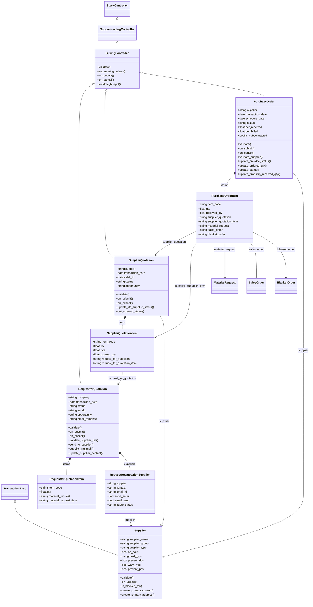

### Supplier Scorecard

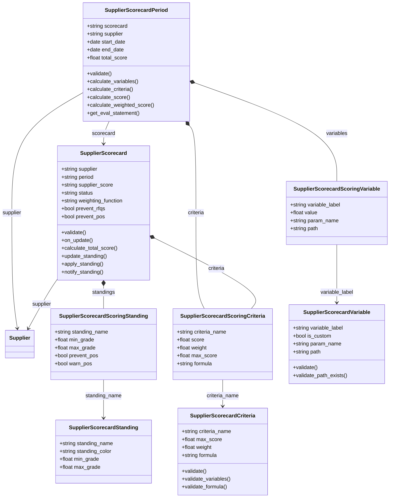

## Sequence diagram

### Lưu Supplier

Supplier là master, luồng đáng chú ý là tạo Contact, Address chính và gán role cho portal user.

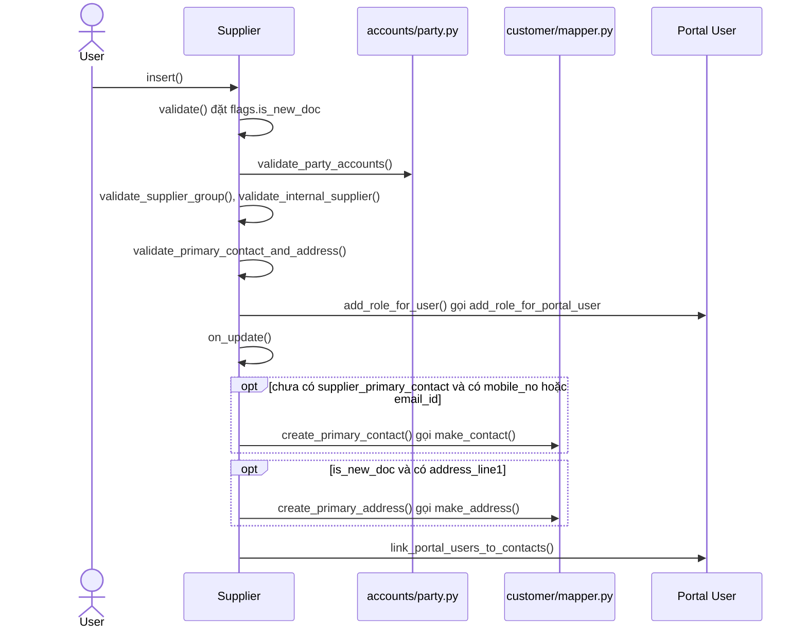

Nguồn: [supplier.py:154](../../apps/erpnext/erpnext/buying/doctype/supplier/supplier.py#L154), [supplier.py:125](../../apps/erpnext/erpnext/buying/doctype/supplier/supplier.py#L125)

### Tạo và gửi RFQ

RFQ lấy dòng từ Material Request và khi submit thì gửi mail, đồng thời tạo User và Contact cho nhà cung cấp nếu chưa có.

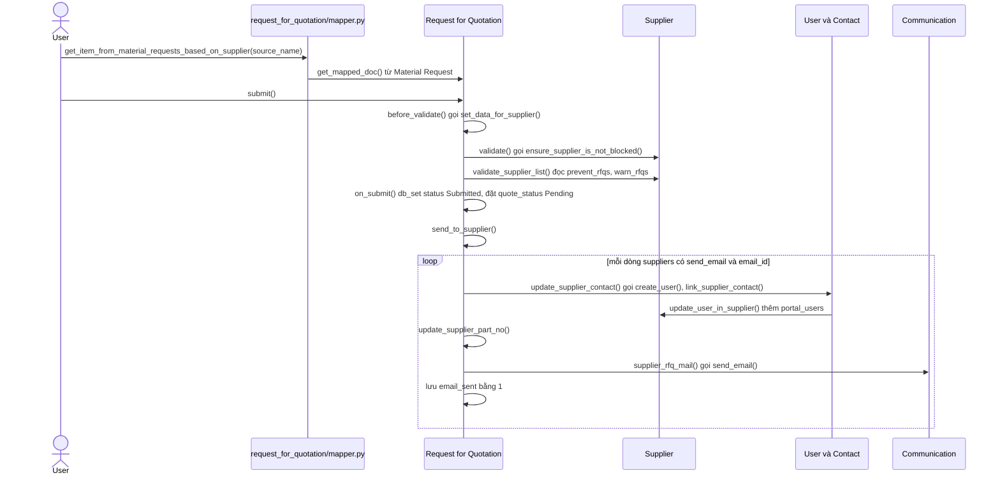

Nguồn: [mapper.py:180](../../apps/erpnext/erpnext/buying/doctype/request_for_quotation/mapper.py#L180), [request_for_quotation.py:169](../../apps/erpnext/erpnext/buying/doctype/request_for_quotation/request_for_quotation.py#L169), [request_for_quotation.py:200](../../apps/erpnext/erpnext/buying/doctype/request_for_quotation/request_for_quotation.py#L200)

### Nhà cung cấp báo giá qua portal

Portal user của Supplier gửi báo giá; item và UOM lấy từ dòng RFQ, chỉ `qty` và `rate` lấy từ nhà cung cấp.

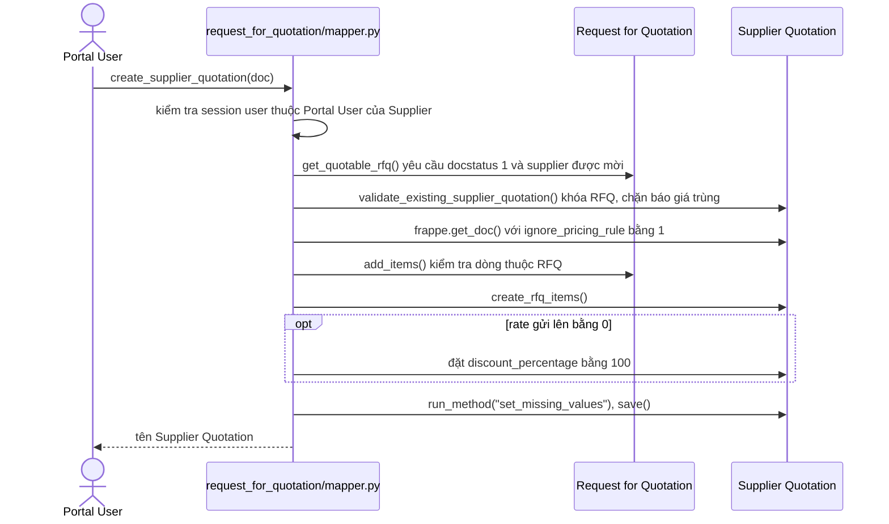

Nguồn: [mapper.py:60](../../apps/erpnext/erpnext/buying/doctype/request_for_quotation/mapper.py#L60), [mapper.py:142](../../apps/erpnext/erpnext/buying/doctype/request_for_quotation/mapper.py#L142)

### Submit Supplier Quotation

Submit cập nhật `quote_status` của nhà cung cấp trên RFQ; hết hạn do job daily đổi trực tiếp status.

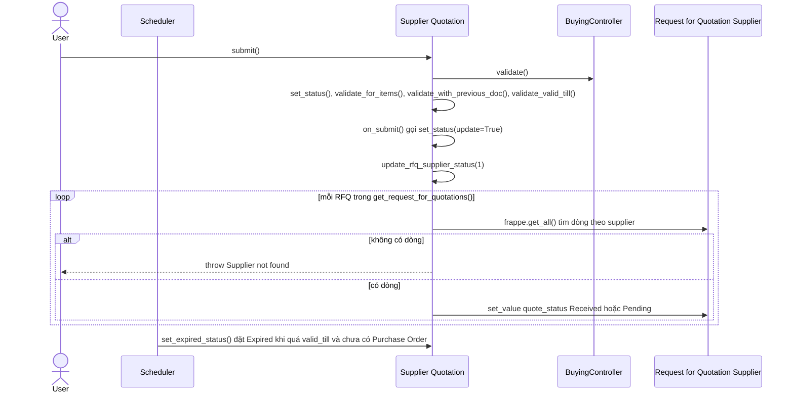

Nguồn: [supplier_quotation.py:138](../../apps/erpnext/erpnext/buying/doctype/supplier_quotation/supplier_quotation.py#L138), [supplier_quotation.py:201](../../apps/erpnext/erpnext/buying/doctype/supplier_quotation/supplier_quotation.py#L201), [supplier_quotation.py:273](../../apps/erpnext/erpnext/buying/doctype/supplier_quotation/supplier_quotation.py#L273)

### Supplier Quotation sang Purchase Order

Mapper chặn báo giá hết hạn và chỉ map dòng còn số lượng chưa đặt.

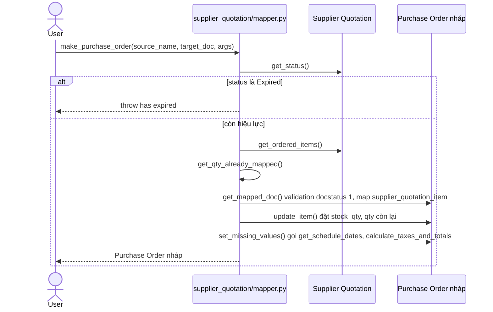

Nguồn: [mapper.py:17](../../apps/erpnext/erpnext/buying/doctype/supplier_quotation/mapper.py#L17)

### Submit Purchase Order

Validate kiểm tra cờ Scorecard của Supplier; submit cập nhật chứng từ trước và `Bin`, không ghi `GL Entry` hay `Stock Ledger Entry`.

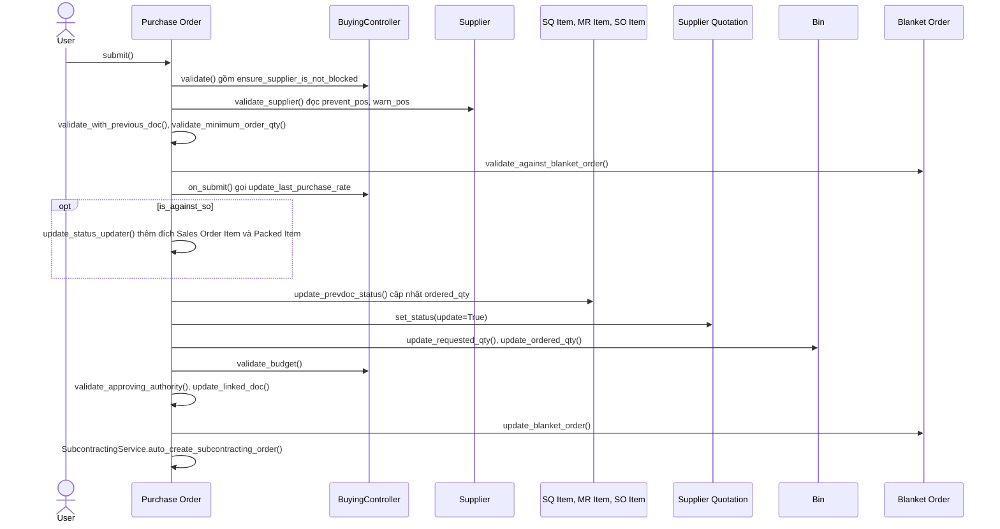

Nguồn: [purchase_order.py:200](../../apps/erpnext/erpnext/buying/doctype/purchase_order/purchase_order.py#L200), [purchase_order.py:450](../../apps/erpnext/erpnext/buying/doctype/purchase_order/purchase_order.py#L450), [purchase_order.py:434](../../apps/erpnext/erpnext/buying/doctype/purchase_order/purchase_order.py#L434)

### Purchase Order sang Purchase Receipt và Purchase Invoice

Hai mapper chỉ tạo bản nháp; Purchase Receipt và Purchase Invoice ghi sổ khi submit ở module `stock` và `accounts`.

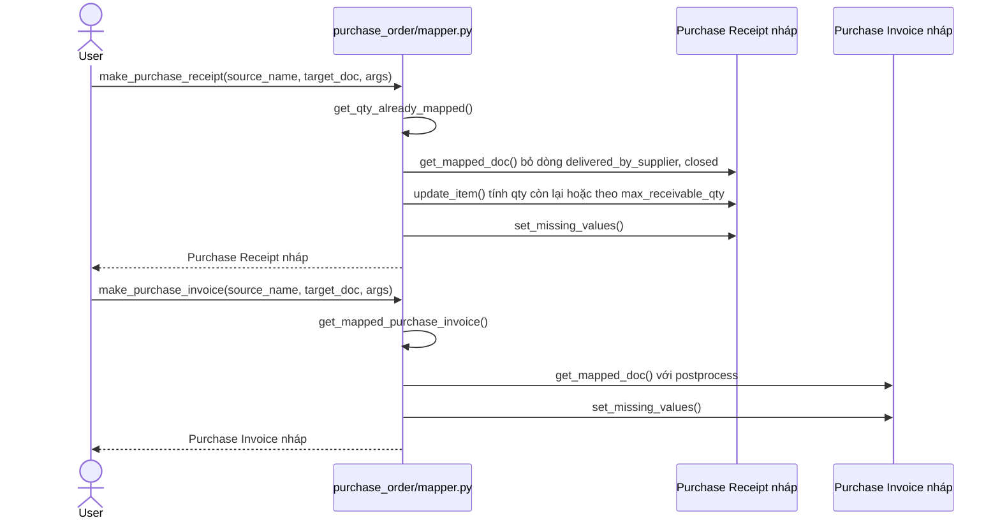

Nguồn: [mapper.py:31](../../apps/erpnext/erpnext/buying/doctype/purchase_order/mapper.py#L31), [mapper.py:128](../../apps/erpnext/erpnext/buying/doctype/purchase_order/mapper.py#L128)

### Đổi trạng thái Purchase Order

Close, On Hold và mở lại đi qua `StatusService` của Purchase Order.

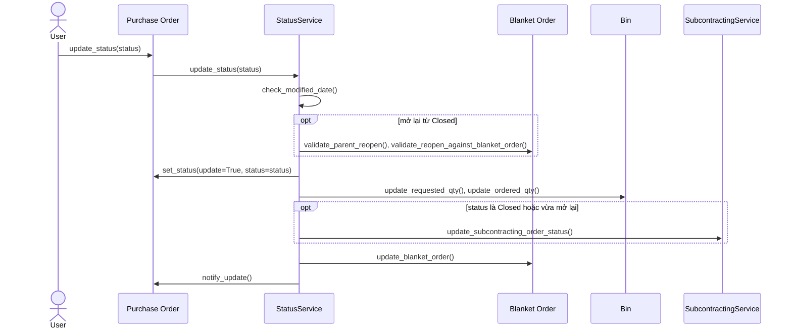

Nguồn: [status.py:24](../../apps/erpnext/erpnext/buying/doctype/purchase_order/services/status.py#L24)

### Cập nhật số lượng drop ship

Với dòng `delivered_by_supplier`, người dùng ghi nhận số đã giao trên Purchase Order và Sales Order được tính lại `delivered_qty`.

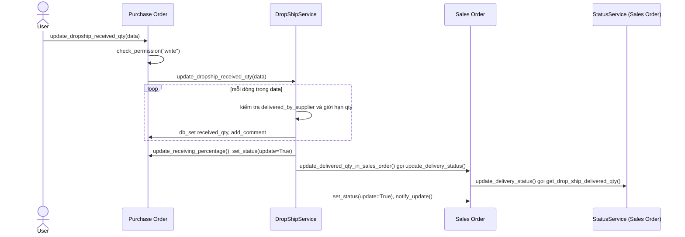

Nguồn: [drop_ship.py:14](../../apps/erpnext/erpnext/buying/doctype/purchase_order/services/drop_ship.py#L14), [drop_ship.py:81](../../apps/erpnext/erpnext/buying/doctype/purchase_order/services/drop_ship.py#L81)

### Làm mới Supplier Scorecard

Job `daily_maintenance` tạo các Period còn thiếu cho mỗi Scorecard rồi lưu lại để tính điểm, gán Standing và đẩy cờ sang Supplier.

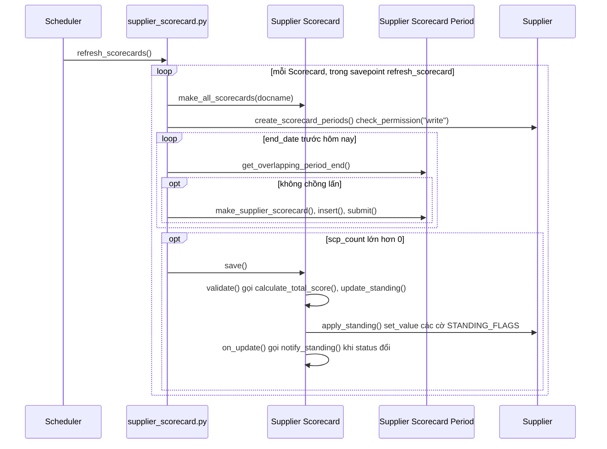

Nguồn: [supplier_scorecard.py:202](../../apps/erpnext/erpnext/buying/doctype/supplier_scorecard/supplier_scorecard.py#L202), [supplier_scorecard.py:228](../../apps/erpnext/erpnext/buying/doctype/supplier_scorecard/supplier_scorecard.py#L228), [supplier_scorecard.py:168](../../apps/erpnext/erpnext/buying/doctype/supplier_scorecard/supplier_scorecard.py#L168)

### Tính điểm Supplier Scorecard Period

`validate` của Period chạy hàm biến, thế vào công thức tiêu chí và tính `total_score`.

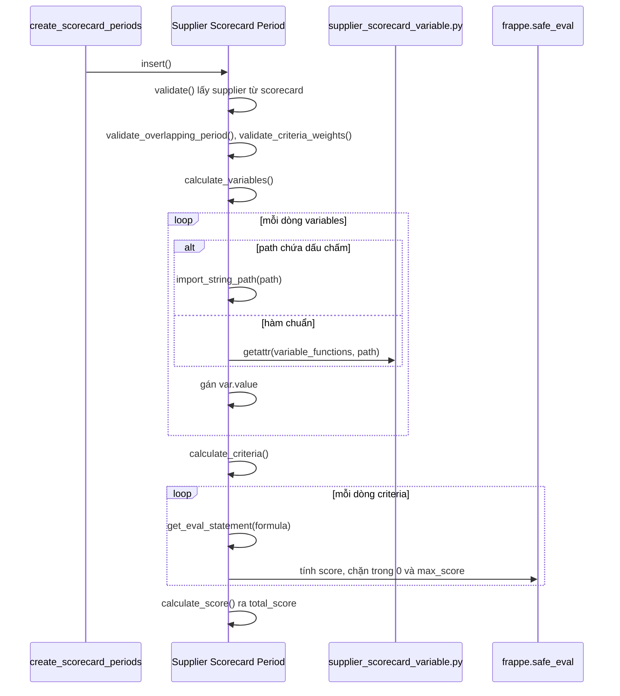

Nguồn: [supplier_scorecard_period.py:48](../../apps/erpnext/erpnext/buying/doctype/supplier_scorecard_period/supplier_scorecard_period.py#L48), [supplier_scorecard_period.py:73](../../apps/erpnext/erpnext/buying/doctype/supplier_scorecard_period/supplier_scorecard_period.py#L73), [supplier_scorecard_period.py:82](../../apps/erpnext/erpnext/buying/doctype/supplier_scorecard_period/supplier_scorecard_period.py#L82)

## Giới hạn

- Không vẽ: Buying Settings (cấu hình), Customer Number At Supplier (bảng con của Supplier, không có quan hệ nghiệp vụ khác), Purchase Receipt Item Supplied (Purchase Order hiện không có Table trỏ tới doctype này trong JSON).
- `PurchaseOrder.on_cancel` không có sơ đồ riêng; thêm phần `DropShipService.set_received_qty_to_zero_for_drop_ship_items` và `unlink_inter_company_doc`.
- `purchase_order/mapper.py` còn `make_inter_company_sales_order`, `make_subcontracting_order`, `make_purchase_invoice_from_portal` chưa vẽ; `supplier_quotation/mapper.py` còn `make_quotation` và `make_purchase_invoice` (đã đánh dấu deprecated). `make_supplier_quotation_from_rfq` chưa vẽ.
- Chỉ đọc lướt: `validate_budget`, `update_requested_qty`, `update_last_purchase_rate`, các hàm tính biến trong `supplier_scorecard_variable.py`, `supplier_overview.py`, `buying/report/`.
- Bước ghi sổ của Purchase Receipt và Purchase Invoice thuộc module `stock` và `accounts`, không vẽ ở đây.
- Trong "Làm mới Supplier Scorecard", `SupplierScorecard.on_update` cũng gọi `create_scorecard_periods` với cờ `in_rescore` để tránh lặp, sơ đồ không vẽ nhánh này.
