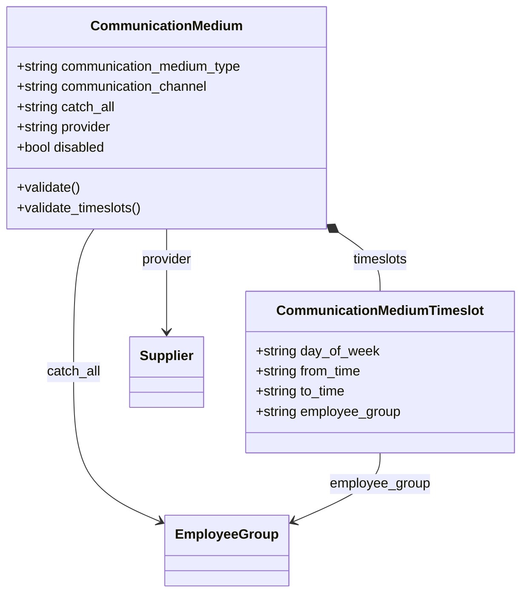

# Module Communication

Module chỉ khai báo `Communication Medium`: một kênh liên lạc kèm lịch trực theo Employee Group. Dữ liệu này được `crm/doctype/utils.py` đọc để quyết định nhân viên nào nhận popup cuộc gọi trong `telephony`.

## Phạm vi

Đọc được 2 doctype trong `communication/doctype/`.

| Nhóm chức năng | Doctype/file chính | Sơ đồ |
|---|---|---|
| Kênh và lịch trực | `Communication Medium`, `Communication Medium Timeslot` | Class |

## Class diagram

## Sequence diagram

Module không có luồng nghiệp vụ riêng nên không vẽ sequence diagram. Controller chỉ kiểm tra `from_time` nhỏ hơn `to_time` ([communication_medium.py:35](../../apps/erpnext/erpnext/communication/doctype/communication_medium/communication_medium.py#L35)).

Nơi dùng dữ liệu nằm ở `get_scheduled_employees_for_popup` ([utils.py:20](../../apps/erpnext/erpnext/crm/doctype/utils.py#L20)) và đã được vẽ trong [telephony.md](telephony.md).

## Giới hạn

- `Call Log.medium` là field Data, không phải Link tới Communication Medium; `get_scheduled_employees_for_popup` dùng giá trị này làm tên medium.
- `communication_channel` là Select không có options trong JSON; chưa xác định giá trị được nạp từ đâu.
