# Module CRM

Module `crm` quản lý giai đoạn trước bán hàng: Lead, Opportunity, Prospect, cùng Contract, Appointment và Email Campaign. Module đẩy luồng sang `selling` (Customer, Quotation) và `buying` (Request for Quotation, Supplier Quotation từ Opportunity), dùng `Contact`, `Address`, `Communication`, `Event` của Frappe và có API đồng bộ với app Frappe CRM.

## Phạm vi

Đọc được 28 doctype trong `crm/doctype/`. Mục "Sơ đồ" chỉ tới tiêu đề trong file này.

| Nhóm chức năng | Doctype/file chính | Sơ đồ |
|---|---|---|
| Lead | Lead, `lead/lead.py`, `lead/mapper.py` | Class: Lead, Opportunity, Prospect. Sequence: Lưu Lead, Lead sang Customer, Lead sang Prospect |
| Opportunity | Opportunity, Opportunity Item, Competitor Detail, `opportunity/opportunity.py`, `opportunity/mapper.py` | Class: Lead, Opportunity, Prospect. Sequence: Lưu Opportunity, Opportunity sang Quotation, Declare Lost, Email sang Opportunity |
| Prospect | Prospect, Prospect Lead, Prospect Opportunity, `prospect/prospect.py` | Class: Lead, Opportunity, Prospect. Sequence: Lead sang Prospect |
| Contract | Contract, Contract Template, Contract Fulfilment Checklist | Class: Contract. Sequence: Vòng đời Contract |
| Appointment | Appointment, Appointment Booking Settings, Appointment Booking Slots, `www/book_appointment/` | Class: Appointment và Email Campaign. Sequence: Đặt lịch qua portal |
| Email Campaign | Campaign, Campaign Email Schedule, Email Campaign | Class: Appointment và Email Campaign. Sequence: Gửi Email Campaign |
| Tích hợp Frappe CRM | `frappe_crm_api.py`, CRM Settings | Sequence: Đồng bộ từ Frappe CRM |

## Class diagram

Class ngoài module (ví dụ `Customer`, `SellingController`) chỉ để đích của quan hệ nên để trống. Controller cha chỉ ghi method.

### Lead, Opportunity, Prospect

`CRMNote` trong sơ đồ là class cơ sở ở `crm/utils.py`. Doctype con `CRM Note` cũng có Python class cùng tên ở `crm_note/crm_note.py`, đó là bảng `notes` của ba doctype này. `Opportunity.party_name` là Dynamic Link theo `opportunity_from`, sơ đồ vẽ hai trường hợp Lead và Prospect.

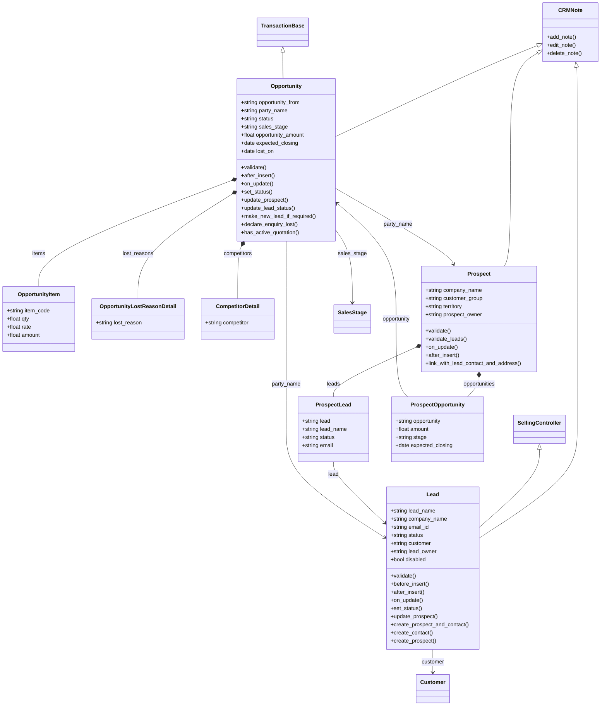

### Contract

`Contract.party_name` là Dynamic Link theo `party_type` (Customer, Supplier, Employee), nên không vẽ quan hệ tới party.

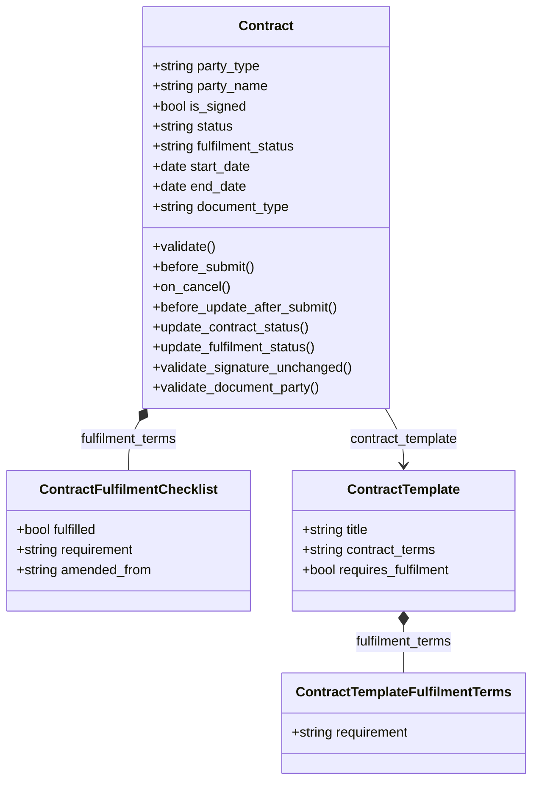

### Appointment và Email Campaign

`Appointment.party` và `EmailCampaign.recipient` là Dynamic Link. Sơ đồ vẽ `party` tới Lead và `recipient` tới Lead làm ví dụ.

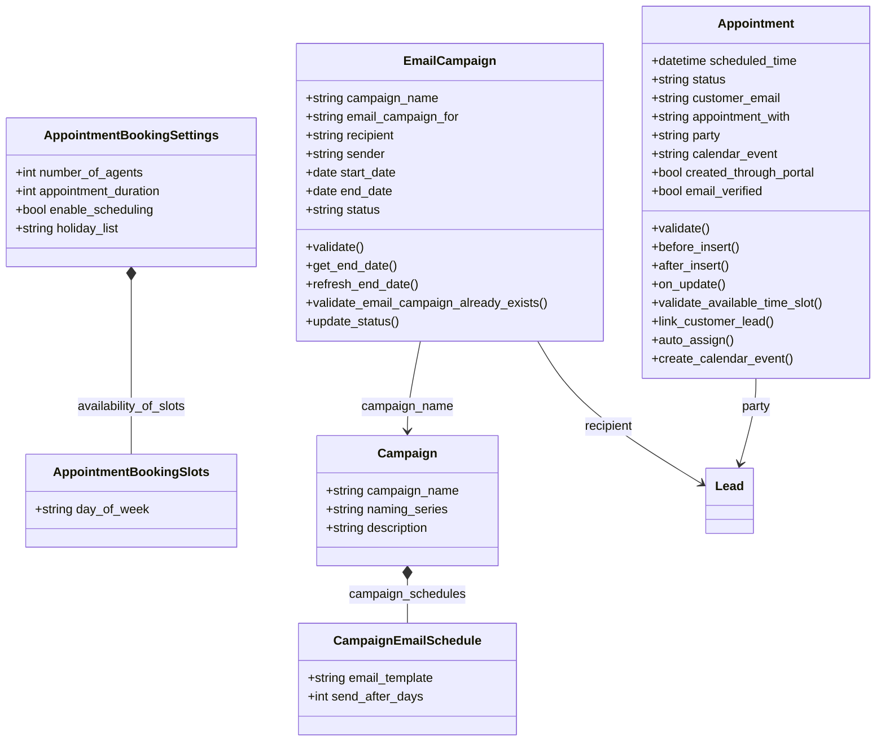

## Sequence diagram

### Lưu Lead

Lead có thể tự tạo Contact theo CRM Settings và luôn đồng bộ dòng tương ứng trên Prospect. `Lead.validate` không gọi `super().validate()`, nên không chạy validate của `SellingController`.

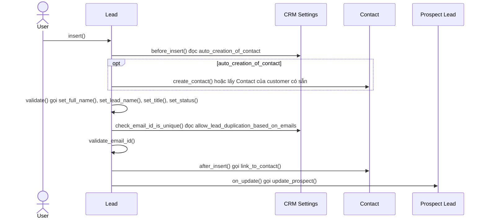

Nguồn: [lead.py:109](../../apps/erpnext/erpnext/crm/doctype/lead/lead.py#L109), [lead.py:91](../../apps/erpnext/erpnext/crm/doctype/lead/lead.py#L91), [lead.py:214](../../apps/erpnext/erpnext/crm/doctype/lead/lead.py#L214)

### Lead sang Customer

Mapper tạo Customer nháp từ Lead; lúc Customer được insert, Lead mới chuyển sang Converted.

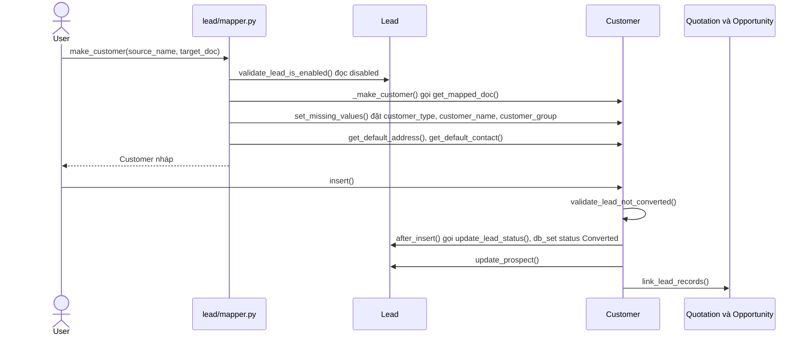

Nguồn: [mapper.py:16](../../apps/erpnext/erpnext/crm/doctype/lead/mapper.py#L16), [mapper.py:21](../../apps/erpnext/erpnext/crm/doctype/lead/mapper.py#L21), [customer.py:361](../../apps/erpnext/erpnext/selling/doctype/customer/customer.py#L361)

### Lead sang Prospect rồi Customer

Một Lead chỉ thuộc một Prospect. Prospect có thể sinh Opportunity hoặc Customer; khi Prospect có đúng một Lead chưa chuyển đổi, Customer nhận luôn `lead_name`.

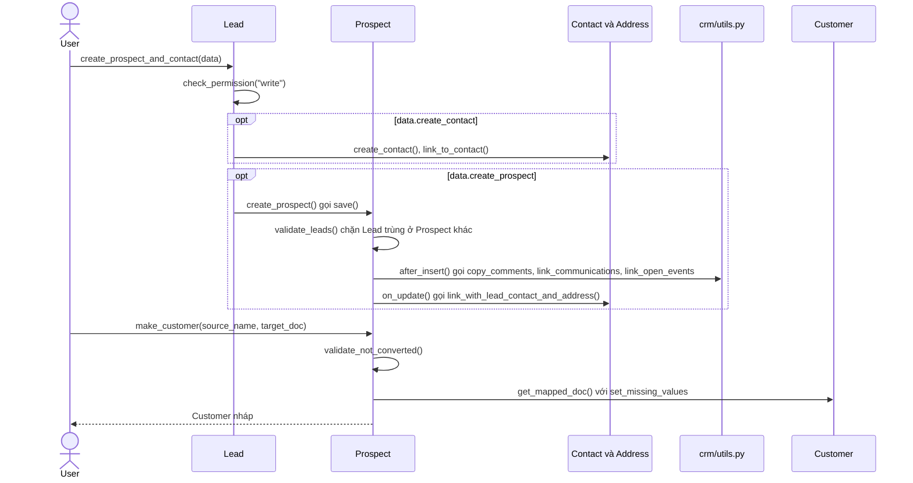

Nguồn: [lead.py:260](../../apps/erpnext/erpnext/crm/doctype/lead/lead.py#L260), [lead.py:303](../../apps/erpnext/erpnext/crm/doctype/lead/lead.py#L303), [prospect.py:121](../../apps/erpnext/erpnext/crm/doctype/prospect/prospect.py#L121)

### Lưu Opportunity

Opportunity tự tạo Lead từ `contact_email` khi chưa có party và giữ đồng bộ với Lead và Prospect.

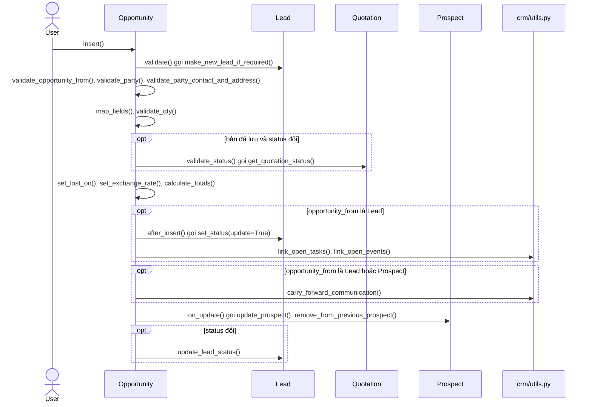

Nguồn: [opportunity.py:133](../../apps/erpnext/erpnext/crm/doctype/opportunity/opportunity.py#L133), [opportunity.py:116](../../apps/erpnext/erpnext/crm/doctype/opportunity/opportunity.py#L116), [opportunity.py:275](../../apps/erpnext/erpnext/crm/doctype/opportunity/opportunity.py#L275)

### Opportunity sang Quotation

Mapper tạo Quotation nháp, liên kết về Opportunity qua `prevdoc_docname` trên dòng, hoặc qua `opportunity` trên header khi Opportunity không có dòng. Trạng thái Opportunity đổi khi Quotation submit.

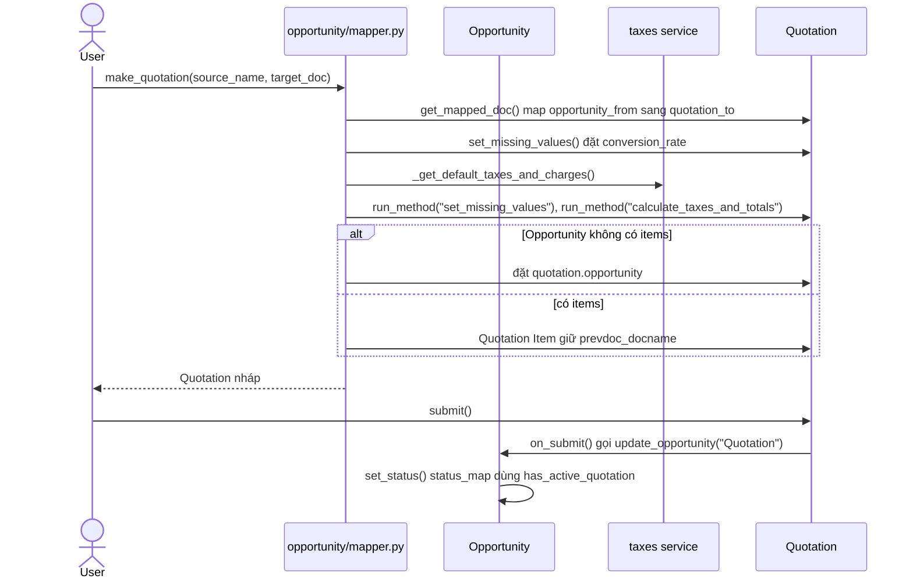

Nguồn: [mapper.py:16](../../apps/erpnext/erpnext/crm/doctype/opportunity/mapper.py#L16), [quotation.py:350](../../apps/erpnext/erpnext/selling/doctype/quotation/quotation.py#L350)

### Declare Lost cho Opportunity

Khi còn Quotation đang hoạt động thì không đánh dấu Lost được.

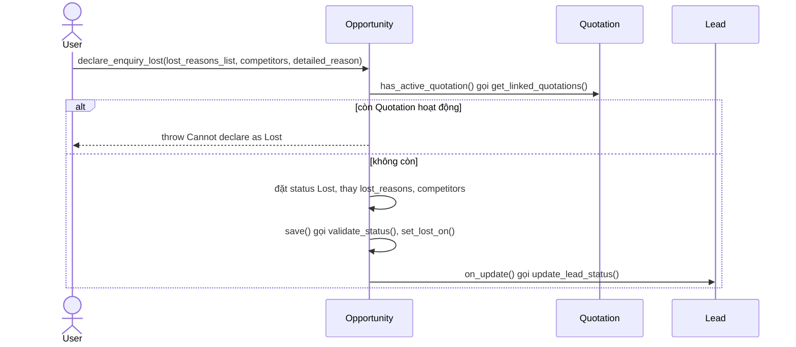

Nguồn: [opportunity.py:367](../../apps/erpnext/erpnext/crm/doctype/opportunity/opportunity.py#L367), [opportunity.py:190](../../apps/erpnext/erpnext/crm/doctype/opportunity/opportunity.py#L190)

### Email sang Opportunity

Từ một Communication, người dùng tạo Opportunity; nếu mail chưa gắn Lead thì tìm theo email hoặc số điện thoại, không có thì tạo Lead mới.

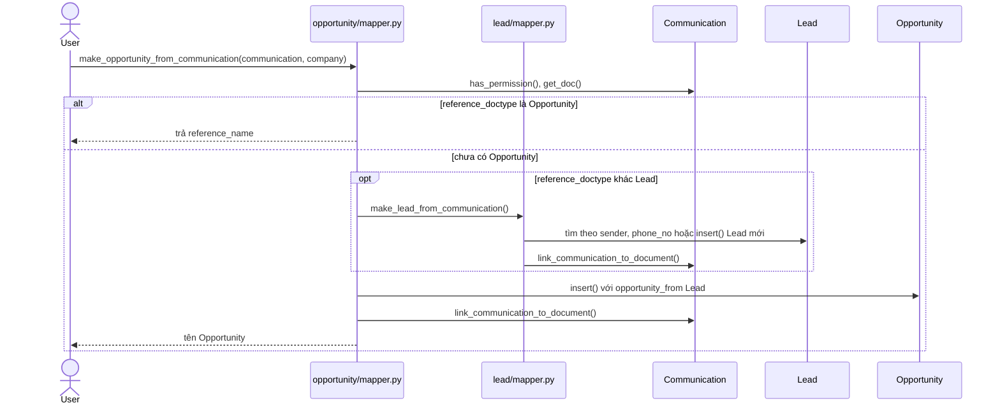

Nguồn: [mapper.py:147](../../apps/erpnext/erpnext/crm/doctype/opportunity/mapper.py#L147), [mapper.py:121](../../apps/erpnext/erpnext/crm/doctype/lead/mapper.py#L121)

### Vòng đời Contract

Contract submit được và vẫn ký hoặc tích điều khoản sau submit; job daily tính lại status và đánh dấu Lapsed.

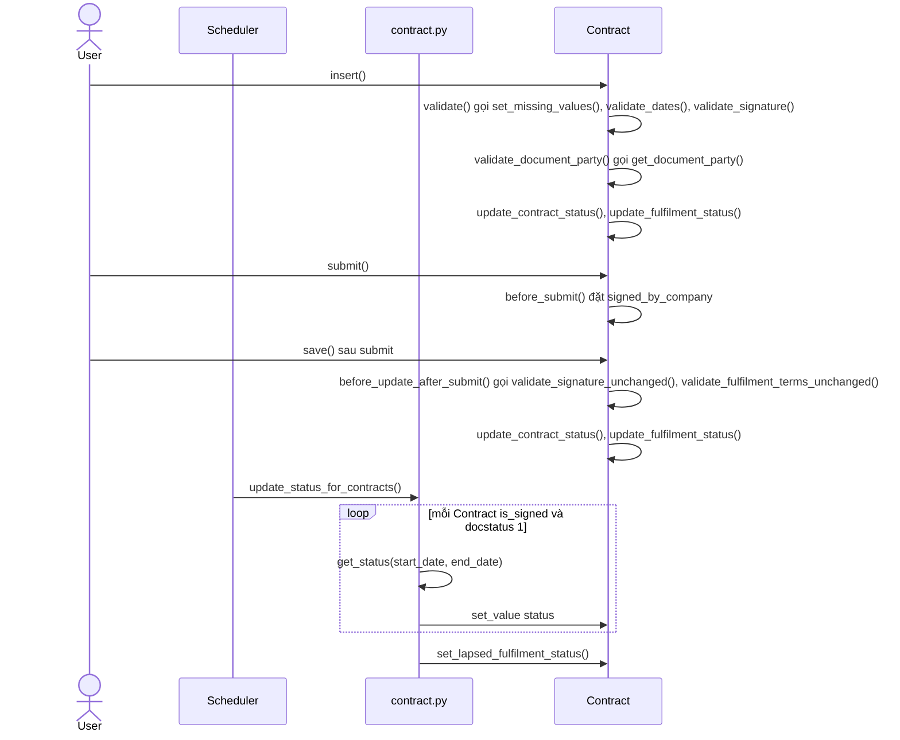

Nguồn: [contract.py:53](../../apps/erpnext/erpnext/crm/doctype/contract/contract.py#L53), [contract.py:80](../../apps/erpnext/erpnext/crm/doctype/contract/contract.py#L80), [contract.py:263](../../apps/erpnext/erpnext/crm/doctype/contract/contract.py#L263)

### Đặt lịch qua portal

Guest đặt lịch tạo Appointment trạng thái Unverified; chỉ khi bấm link xác minh thì mới gắn party, phân công agent và tạo Event. Job `hourly_maintenance` xử lý các lịch hết hạn xác minh.

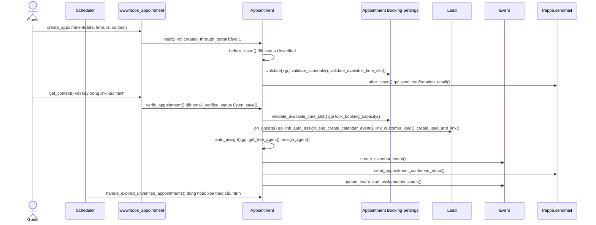

Nguồn: [index.py:114](../../apps/erpnext/erpnext/www/book_appointment/index.py#L114), [index.py:60](../../apps/erpnext/erpnext/www/book_appointment/verify/index.py#L60), [appointment.py:182](../../apps/erpnext/erpnext/crm/doctype/appointment/appointment.py#L182), [appointment.py:465](../../apps/erpnext/erpnext/crm/doctype/appointment/appointment.py#L465)

### Gửi Email Campaign

Job `daily_maintenance` gửi các bước Campaign rơi vào hôm nay. Khi người nhận hủy đăng ký, hook `Email Unsubscribe` cập nhật lại trạng thái.

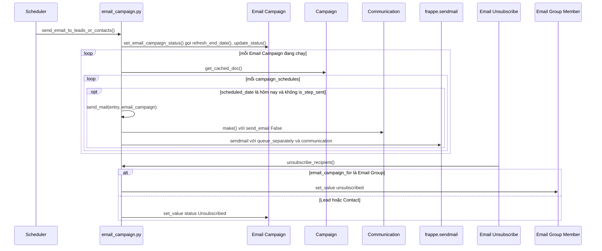

Nguồn: [email_campaign.py:132](../../apps/erpnext/erpnext/crm/doctype/email_campaign/email_campaign.py#L132), [email_campaign.py:190](../../apps/erpnext/erpnext/crm/doctype/email_campaign/email_campaign.py#L190), [email_campaign.py:272](../../apps/erpnext/erpnext/crm/doctype/email_campaign/email_campaign.py#L272)

### Đồng bộ từ Frappe CRM

App Frappe CRM gọi API để tạo Prospect hoặc Customer từ CRM Deal; lỗi tạo chứng từ được ghi log thay vì trả về lỗi cho caller.

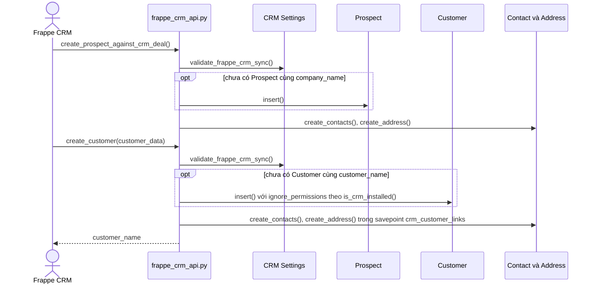

Nguồn: [frappe_crm_api.py:9](../../apps/erpnext/erpnext/crm/frappe_crm_api.py#L9), [frappe_crm_api.py:143](../../apps/erpnext/erpnext/crm/frappe_crm_api.py#L143)

## Giới hạn

- Không vẽ: Market Segment, Opportunity Type, Opportunity Lost Reason, Sales Stage, Competitor (danh mục, chỉ nêu qua quan hệ), CRM Settings (cấu hình), Frappe CRM Allowed User, Lost Reason Detail.
- `Availability Of Slots` có cấu trúc giống `Appointment Booking Slots`, nhưng field `availability_of_slots` của Appointment Booking Settings có `options` là `Appointment Booking Slots`. Grep trong erpnext không thấy nơi nào trỏ `options` tới doctype này, chưa xác nhận nó còn được dùng ngoài erpnext.
- Appointment tạo tay (không qua portal) không vẽ riêng: `before_insert` gọi `link_customer_lead`, `after_insert` gọi `auto_assign` và `create_calendar_event` khi đã có `party`, ngược lại gửi mail xác nhận.
- `opportunity/mapper.py` còn `make_request_for_quotation`, `make_supplier_quotation`, `make_customer` chưa vẽ; `lead/mapper.py` còn `make_opportunity`, `make_quotation`; `prospect.py` còn `make_opportunity`.
- `ContractPartyAccess` và hai hook `has_permission`, `get_permission_query_conditions` của Contract giới hạn quyền theo role và User Permission, không vẽ vì không phải luồng nghiệp vụ.
- Các hook khác chưa vẽ: `link_communications_with_prospect`, `update_modified_timestamp`, `link_events_with_prospect`, `update_lead_phone_numbers`, `auto_close_opportunity`, `open_leads_opportunities_based_on_todays_event`.
- Trong `make_quotation` của Opportunity, `field_map` có `"name": "enq_no"` nhưng `quotation.json` không có field `enq_no`, nên không vẽ. Chưa kiểm tra đó có phải field tùy chỉnh hay field cũ.
- Prospect không có field `crm_deal` trong `prospect.json` dù `create_prospect_against_crm_deal` gán `prospect.crm_deal`. Chưa xác nhận field này do app Frappe CRM thêm.
- `send_mail` trả `comm` sau khối `try`; nếu `make()` lỗi thì `comm` chưa được gán. Lỗi đó được khối `except` ở `send_email_to_leads_or_contacts` ghi log. Đây là nhận định từ đọc code, chưa chạy thử.
- Phần `www/book_appointment/index.py` chỉ đọc `create_appointment`; các hàm tính slot đọc lướt. `crm/report/` và `crm/doctype/utils.py` không đọc.
- Thứ tự `after_insert` trước `on_update` dựa trên vòng đời Frappe, không đọc lại trong `frappe/model/document.py`.
