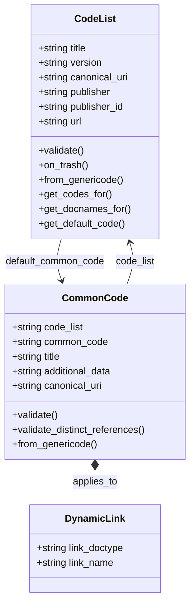
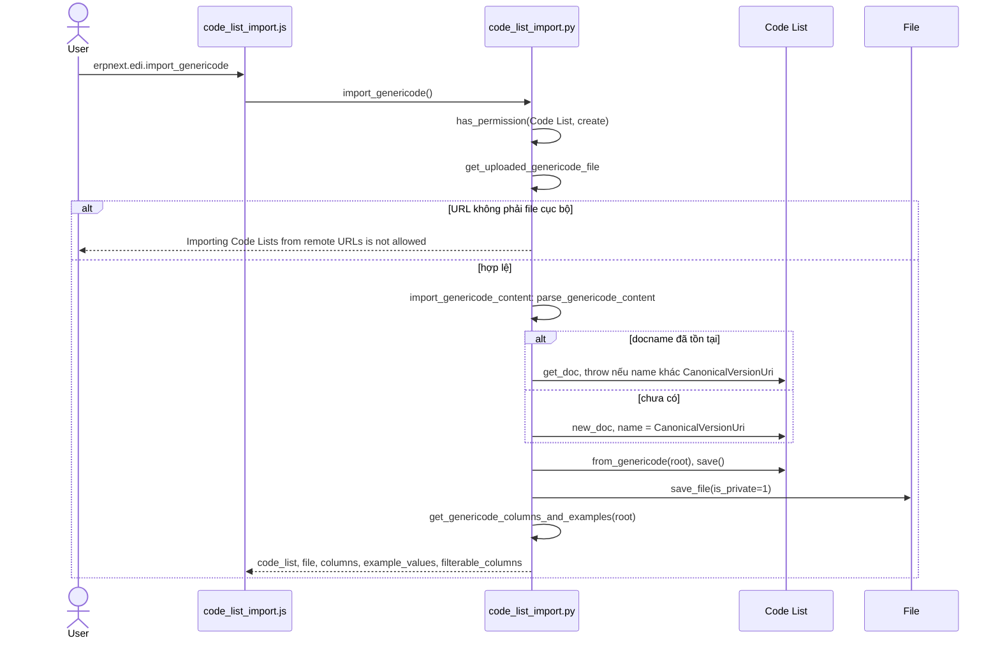
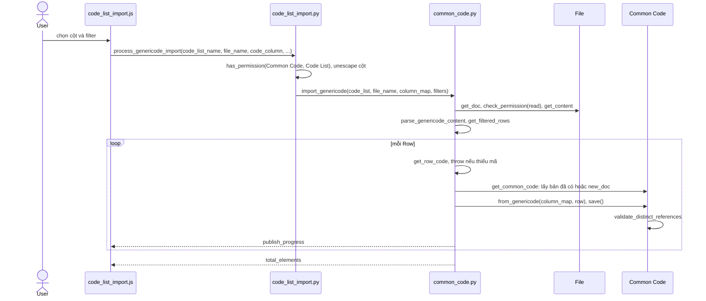

# Module EDI

Module lưu các bảng mã chuẩn (Code List) và từng mã (Common Code), nạp từ file genericode XML, đồng thời ánh xạ mã với bản ghi ERPNext qua `applies_to`. Trong `erpnext/` chưa có module nghiệp vụ nào gọi các hàm tra mã; hook chỉ nạp JS cho list view và form.

## Phạm vi

Đọc được 2 doctype trong `edi/doctype/`.

| Nhóm chức năng | Doctype/file chính | Sơ đồ |
|---|---|---|
| Danh mục mã | `Code List`, `Common Code` | Class |
| Import genericode | `code_list_import.py`, `code_list_import.js`, `common_code.py` | Sequence: Tải file, Tạo Common Code |
| Tra mã | `code_list.py` (`get_codes_for`, `get_docnames_for`, `get_default_code`) | Không vẽ, xem Giới hạn |

## Class diagram

## Sequence diagram

### Tải file genericode

Bước đầu đọc file, tạo hoặc cập nhật Code List theo `CanonicalVersionUri`, lưu file private rồi trả về danh sách cột để hộp thoại chọn cột. Không chấp nhận URL từ xa.

Nguồn: [code_list_import.py:29](../../apps/erpnext/erpnext/edi/doctype/code_list/code_list_import.py#L29), [code_list_import.py:105](../../apps/erpnext/erpnext/edi/doctype/code_list/code_list_import.py#L105)

### Tạo Common Code

Người dùng chọn cột mã, tiêu đề, mô tả và bộ lọc; server tạo hoặc cập nhật mỗi dòng thành một Common Code. Việc này chạy đồng bộ trong request, có báo tiến độ.

Nguồn: [code_list_import.py:161](../../apps/erpnext/erpnext/edi/doctype/code_list/code_list_import.py#L161), [common_code.py:89](../../apps/erpnext/erpnext/edi/doctype/common_code/common_code.py#L89)

## Giới hạn

- `get_codes_for`, `get_docnames_for`, `get_default_code`, `resolve_code_list` ([code_list.py:117](../../apps/erpnext/erpnext/edi/doctype/code_list/code_list.py#L117)) chỉ là truy vấn một bước và không có nơi gọi trong `erpnext/` ngoài test; có thể do app khác dùng, chưa xác nhận. `resolve_code_list` nhận tên document hoặc canonical URI; với URI thì lấy version mới nhất.
- `import_genericode_from_url` chỉ dành cho code backend tin cậy và không có whitelist; không vẽ vì không có nơi gọi trong `erpnext/` ngoài test.
- `CodeList.on_trash` xóa toàn bộ Common Code của list; không vẽ vì chỉ là một vòng lặp.
- Phần giao diện của `code_list_import.js` chỉ đọc đến các lệnh gọi server.
