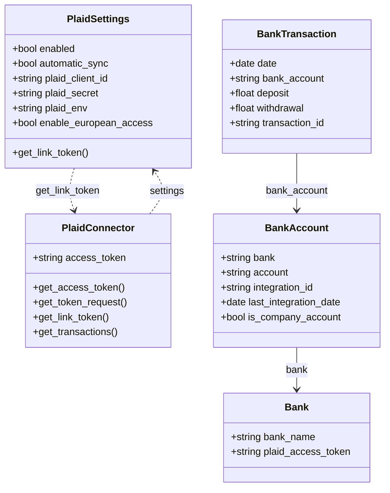
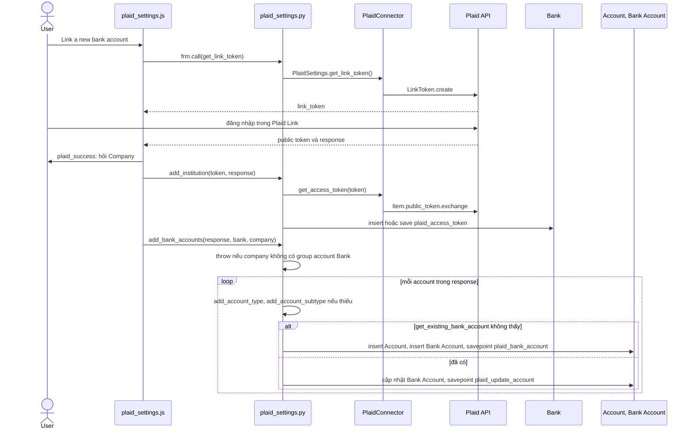
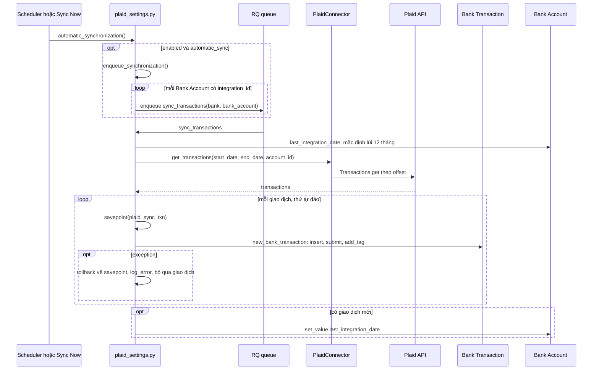
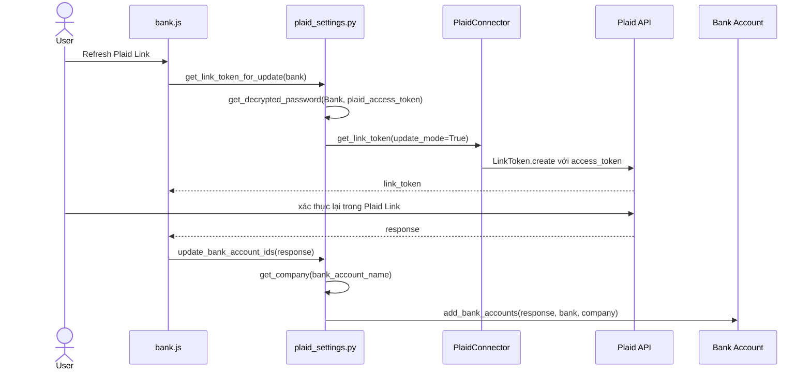

# Module ERPNext Integrations

Module hiện chỉ có một tích hợp thực sự là Plaid: liên kết tài khoản ngân hàng và tự nhập giao dịch thành `Bank Transaction` của `accounts`. Ngoài ra có `utils.py` với vài hàm tiện ích.

## Phạm vi

Đọc được 1 doctype trong `erpnext_integrations/doctype/`.

| Nhóm chức năng | Doctype/file chính | Sơ đồ |
|---|---|---|
| Cấu hình và kết nối Plaid | `Plaid Settings`, `plaid_connector.py` | Class |
| Liên kết ngân hàng | `plaid_settings.py`, `plaid_settings.js`, `accounts/doctype/bank/bank.js` | Sequence: Liên kết ngân hàng, Làm mới liên kết |
| Đồng bộ giao dịch | `plaid_settings.py` | Sequence: Đồng bộ giao dịch |
| Tiện ích | `utils.py` | Không vẽ, xem Giới hạn |

## Class diagram

`PlaidConnector` là class Python thường, không phải doctype. `Bank`, `Bank Account`, `Bank Transaction` thuộc `accounts`; quan hệ với chúng không phải Link từ Plaid Settings mà qua các hàm trong `plaid_settings.py`.

## Sequence diagram

### Liên kết ngân hàng

Form Plaid Settings mở Plaid Link; sau khi người dùng chọn ngân hàng, server đổi public token lấy access token, tạo `Bank` và mỗi tài khoản Plaid tạo một `Account` cùng một `Bank Account`.

Nguồn: [plaid_settings.py:60](../../apps/erpnext/erpnext/erpnext_integrations/doctype/plaid_settings/plaid_settings.py#L60), [plaid_settings.py:91](../../apps/erpnext/erpnext/erpnext_integrations/doctype/plaid_settings/plaid_settings.py#L91)

### Đồng bộ giao dịch

Job `hourly_maintenance` hoặc nút Sync Now enqueue một job cho mỗi Bank Account đã liên kết. Mỗi giao dịch có savepoint riêng, và chỉ giao dịch không pending, chưa tồn tại mới được tạo và submit.

Nguồn: [plaid_settings.py:353](../../apps/erpnext/erpnext/erpnext_integrations/doctype/plaid_settings/plaid_settings.py#L353), [plaid_settings.py:219](../../apps/erpnext/erpnext/erpnext_integrations/doctype/plaid_settings/plaid_settings.py#L219), [plaid_settings.py:294](../../apps/erpnext/erpnext/erpnext_integrations/doctype/plaid_settings/plaid_settings.py#L294)

### Làm mới liên kết

Khi Plaid báo `ITEM_LOGIN_REQUIRED`, `get_transactions` chỉ ghi log. Người dùng làm mới từ form Bank bằng link token ở chế độ update.

Nguồn: [plaid_settings.py:378](../../apps/erpnext/erpnext/erpnext_integrations/doctype/plaid_settings/plaid_settings.py#L378), [plaid_settings.py:407](../../apps/erpnext/erpnext/erpnext_integrations/doctype/plaid_settings/plaid_settings.py#L407)

## Giới hạn

- `utils.py` không vẽ: `validate_webhooks_request` và `get_webhook_address` không có nơi gọi trong `erpnext/`; `get_webhook_address` trỏ tới `erpnext_integrations.connectors`, thư mục này không tồn tại trong cây mã hiện tại. `get_tracking_url` chỉ render URL theo Parcel Service.
- Bên trong Plaid Link phía trình duyệt và các bước `Bank Transaction.on_submit` không đọc sâu. Phần giao diện của `plaid_settings.js`, `bank.js` chỉ đọc đến các lệnh gọi server.
- `get_plaid_configuration` được whitelist nhưng `plaid_settings.js` và `bank.js` không gọi; form lấy token bằng `frm.call("get_link_token")`.
- Chưa chắc: `PlaidConnector.get_token_request` đưa `self.settings.plaid_secret` trực tiếp vào request khi không ở chế độ update, trong khi hàm khởi tạo dùng `get_password`. Với field Password, giá trị đọc trực tiếp có thể là chuỗi che; chưa chạy thử với Plaid.
- Hàm `enqueue_synchronization` có `has_permission` nên khi scheduler chạy cũng phải qua kiểm tra quyền; chưa xác nhận session user của scheduler trong site này.
