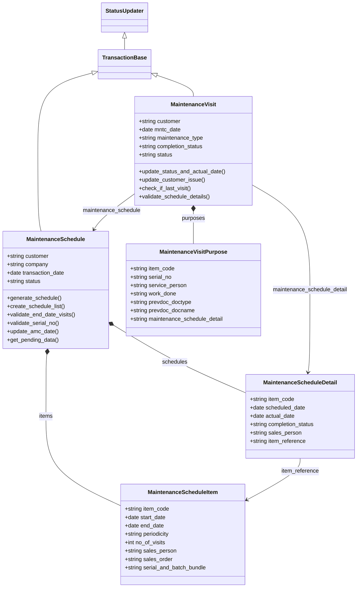
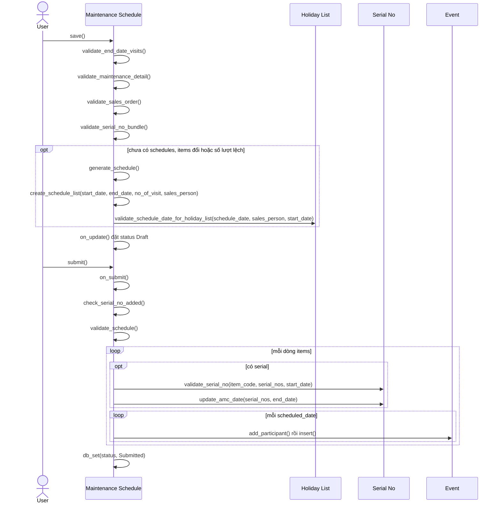
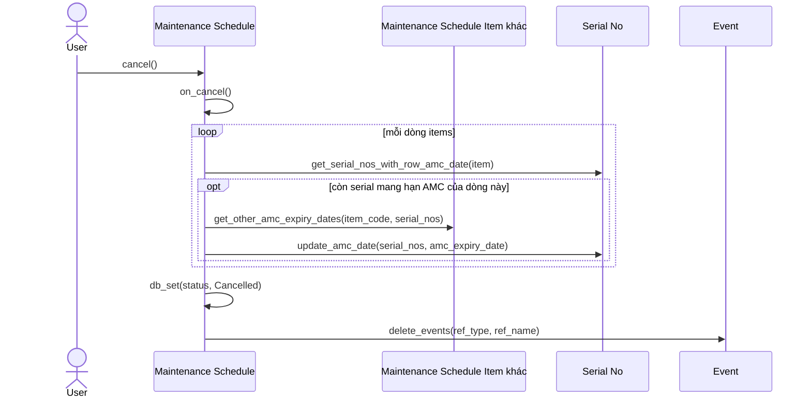
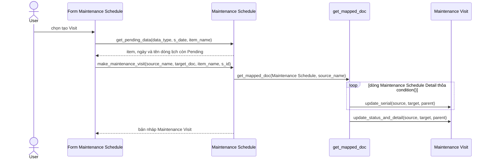
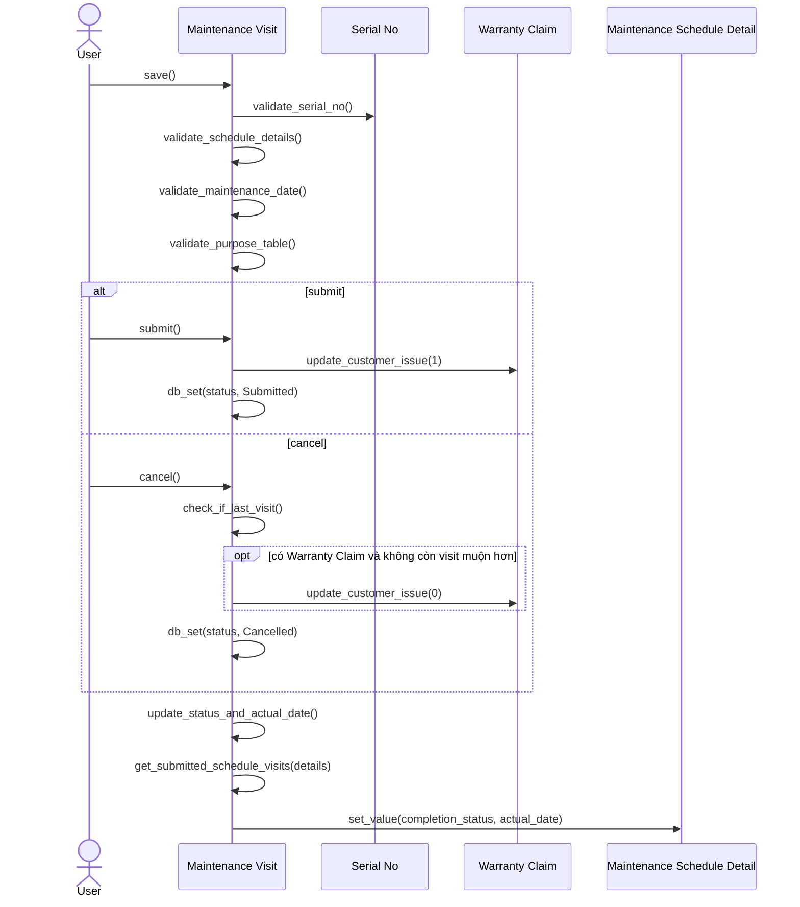

# Module Maintenance

Quản lý bảo trì sau bán cho khách hàng: lập lịch bảo trì theo item và ghi nhận các lần đi bảo trì. Module nối với `Sales Order` (selling) khi tạo chứng từ, `Serial No` (stock) cho hạn AMC, `Warranty Claim` (support) và `Event` (frappe). Module không ghi `GL Entry` hay `Stock Ledger Entry`.

## Phạm vi

Đọc được 5 doctype trong `maintenance/doctype/`.

| Nhóm chức năng | Doctype/file chính | Sơ đồ |
| --- | --- | --- |
| Lịch bảo trì | `Maintenance Schedule`, `Maintenance Schedule Item`, `Maintenance Schedule Detail` | Class diagram. Sequence: Tạo và submit Maintenance Schedule, Cancel Maintenance Schedule |
| Lần bảo trì | `Maintenance Visit`, `Maintenance Visit Purpose` | Class diagram. Sequence: Tạo Maintenance Visit từ lịch, Submit và cancel Maintenance Visit |

## Class diagram

## Sequence diagram

### Tạo và submit Maintenance Schedule

`validate` tự sinh các dòng `schedules` khi cần. Submit kiểm tra serial, cập nhật hạn AMC và tạo một `Event` cho mỗi ngày bảo trì.

Nguồn: [maintenance_schedule.py:275](../../apps/erpnext/erpnext/maintenance/doctype/maintenance_schedule/maintenance_schedule.py#L275), [maintenance_schedule.py:54](../../apps/erpnext/erpnext/maintenance/doctype/maintenance_schedule/maintenance_schedule.py#L54), [maintenance_schedule.py:104](../../apps/erpnext/erpnext/maintenance/doctype/maintenance_schedule/maintenance_schedule.py#L104)

### Cancel Maintenance Schedule

Trả hạn AMC của serial về ngày kết thúc mới nhất ở các lịch khác và xóa các `Event`.

Nguồn: [maintenance_schedule.py:457](../../apps/erpnext/erpnext/maintenance/doctype/maintenance_schedule/maintenance_schedule.py#L457), [maintenance_schedule.py:468](../../apps/erpnext/erpnext/maintenance/doctype/maintenance_schedule/maintenance_schedule.py#L468)

### Tạo Maintenance Visit từ lịch

Form lịch hỏi item và ngày qua `get_pending_data`, rồi map sang một Maintenance Visit nháp loại Scheduled.

Nguồn: [maintenance_schedule.py:607](../../apps/erpnext/erpnext/maintenance/doctype/maintenance_schedule/maintenance_schedule.py#L607), [maintenance_schedule.py:496](../../apps/erpnext/erpnext/maintenance/doctype/maintenance_schedule/maintenance_schedule.py#L496)

### Submit và cancel Maintenance Visit

Lần bảo trì cập nhật tiến độ dòng lịch và, khi đi từ `Warranty Claim` mà không gắn lịch, cập nhật trạng thái khiếu nại.

Nguồn: [maintenance_visit.py:147](../../apps/erpnext/erpnext/maintenance/doctype/maintenance_visit/maintenance_visit.py#L147), [maintenance_visit.py:317](../../apps/erpnext/erpnext/maintenance/doctype/maintenance_visit/maintenance_visit.py#L317), [maintenance_visit.py:202](../../apps/erpnext/erpnext/maintenance/doctype/maintenance_visit/maintenance_visit.py#L202), [maintenance_visit.py:153](../../apps/erpnext/erpnext/maintenance/doctype/maintenance_visit/maintenance_visit.py#L153)

## Giới hạn

- `update_customer_issue` chỉ tác động khi Visit không có `maintenance_schedule` và dòng `purposes` có `prevdoc_doctype` là `Warranty Claim`. Nó bỏ qua khiếu nại đã được một visit `Fully Completed` khác đóng (`is_superseded_by_completed_visit`). Luồng tạo Visit từ khiếu nại nằm ở `support.md`.
- Mapper `make_maintenance_schedule` và `make_maintenance_visit` trong `selling/doctype/sales_order/mapper.py` chỉ đọc phần map, không vẽ. Visit tạo từ `Sales Order` có `prevdoc_doctype` khác `Warranty Claim`.
- Thư mục `maintenance/report` chưa đọc. Job `update_maintenance_status` trong `stock/doctype/serial_no/serial_no.py` thuộc stock, không vẽ.
- File `.js` chỉ đọc đoạn gọi `make_maintenance_visit`; tên bước `chọn tạo Visit` là mô tả, không phải tên hàm.
