# Module Manufacturing

Module quản lý sản xuất, từ định mức (BOM), dự báo và lập kế hoạch (Sales Forecast, Master Production Schedule, Production Plan) đến thực thi (Work Order, Job Card, Workstation, Plant Floor). Module nối với `stock` (Stock Entry, Stock Reservation Entry, Bin, sổ kho), `selling` (Sales Order), `buying` (Purchase Order, Material Request), `subcontracting` và `accounts` (GL Entry qua Stock Entry).

## Phạm vi

Đọc được 51 doctype trong `manufacturing/doctype/`. Phần lớn logic của BOM, Production Plan và Work Order đã tách sang thư mục `services/`, class doctype chỉ gọi tiếp.

| Nhóm chức năng | Doctype / file chính | Sơ đồ |
|---|---|---|
| Định mức | BOM, Routing, Operation, BOM Creator (`bom/bom.py`, `bom/services/costing.py`, `bom_creator/bom_plan.py`) | Class: Định mức. Sequence: Submit BOM, Cập nhật giá một BOM, BOM Creator |
| Công cụ BOM | BOM Update Tool, BOM Update Log, BOM Update Batch (`bom_update_log.py`, `bom_updation_utils.py`) | Class: Định mức. Sequence: Replace BOM, Update Cost |
| Lập kế hoạch | Production Plan, Production Plan Schedule (`production_plan/services/*`, `scheduling/*`) | Class: Kế hoạch. Sequence: Lập và submit, Tạo Work Order, Tạo Material Request, Xếp lịch |
| Dự báo | Sales Forecast, Master Production Schedule, report `material_requirements_planning_report` | Class: Kế hoạch. Sequence: Dự báo đến MRP |
| Thực thi | Work Order (`work_order/services/*`, `work_order/mapper.py`) | Class: Thực thi. Sequence: Submit Work Order, Chuyển vật tư và nhập thành phẩm |
| Công đoạn | Job Card, Job Card Time Log (`job_card/job_card.py`, `job_card/mapper.py`, `page/shop_floor/shop_floor.py`) | Class: Thực thi. Sequence: Chấm công Job Card, Job Card bán thành phẩm và gia công |
| Xưởng | Workstation, Workstation Type, Plant Floor, Downtime Entry | Class: Thực thi. Sequence: Plant Floor |
| Khác | Blanket Order, Manufacturing Settings | Không vẽ, xem Giới hạn |

## Class diagram

Class không ghi cha đều kế thừa trực tiếp `Document`. Service class như `BOMCostingService`, `OperationsService` không phải doctype nên không vẽ ở đây, mà xuất hiện trong sequence.

### Định mức

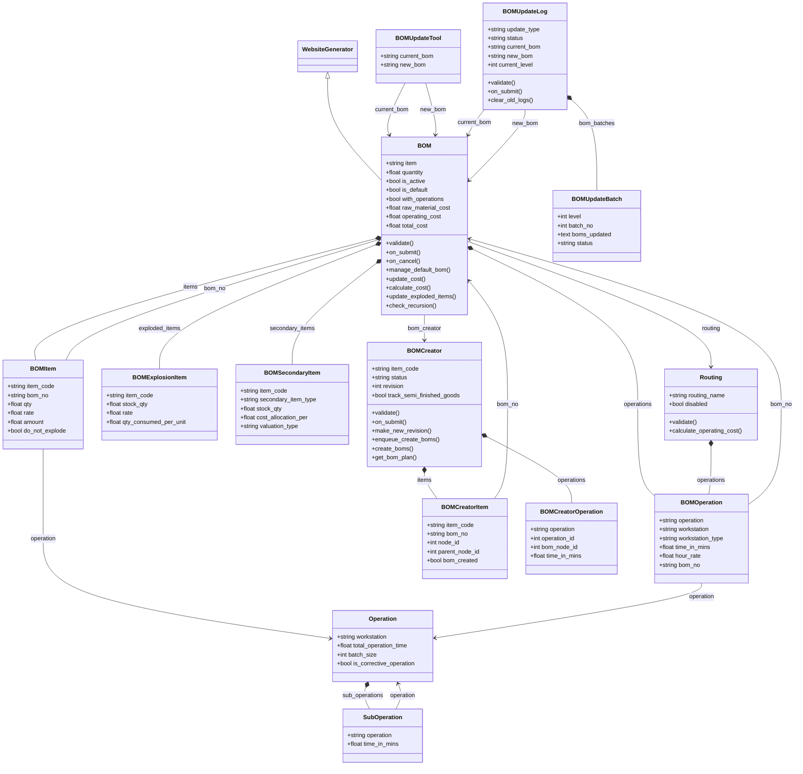

### Kế hoạch

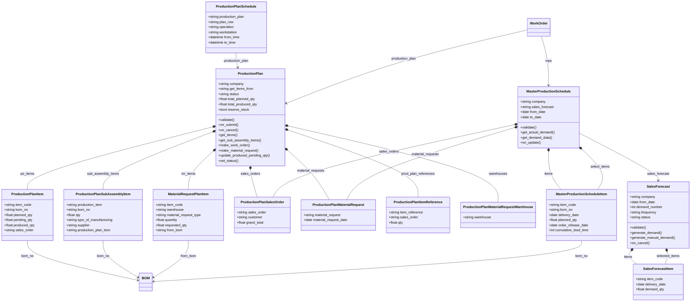

### Thực thi

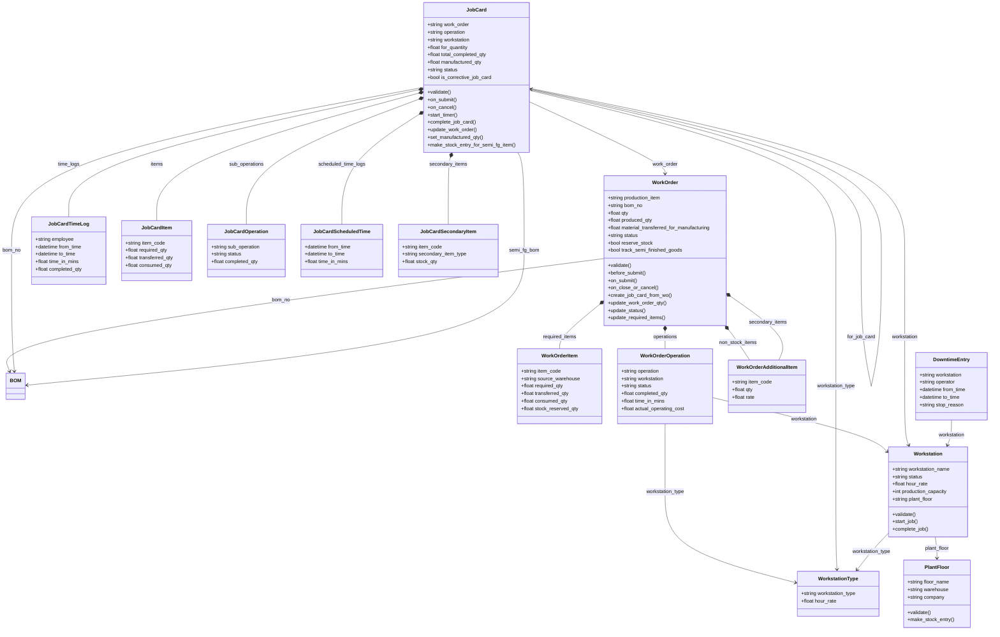

## Sequence diagram

### Submit BOM

Khi lưu, BOM kiểm tra và tính giá qua `BOMCostingService`, trải phẳng vật tư qua `BOMExplodedItemsService`. Khi submit, BOM quyết định BOM mặc định và ghi lại vào Item.

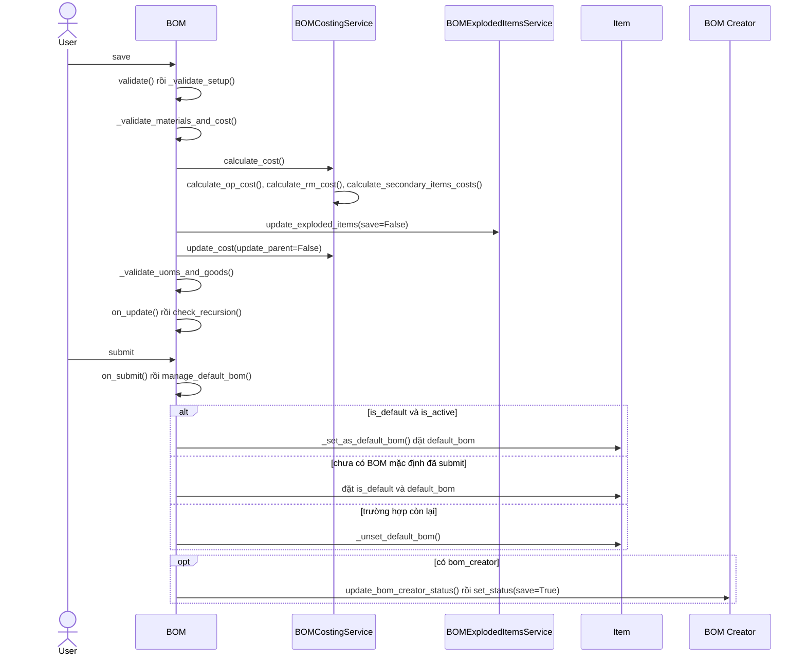

Nguồn: [bom.py:298](../../apps/erpnext/erpnext/manufacturing/doctype/bom/bom.py#L298), [bom.py:720](../../apps/erpnext/erpnext/manufacturing/doctype/bom/bom.py#L720), [costing.py:147](../../apps/erpnext/erpnext/manufacturing/doctype/bom/services/costing.py#L147)

### Cập nhật giá một BOM

`update_cost` chạy đồng bộ, tính lại giá và đi ngược lên các BOM cha đã submit khi `total_cost` thay đổi.

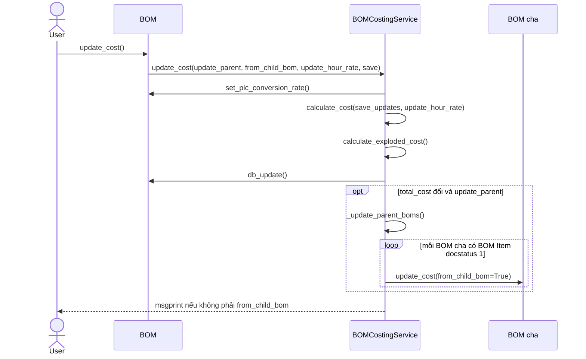

Nguồn: [costing.py:77](../../apps/erpnext/erpnext/manufacturing/doctype/bom/services/costing.py#L77), [bom.py:1264](../../apps/erpnext/erpnext/manufacturing/doctype/bom/bom.py#L1264)

### BOM Update Tool: Replace BOM

Công cụ tạo và submit một BOM Update Log. Hook `on_submit` đẩy job nền, job này thay `bom_no` trên BOM Item và BOM Operation rồi tính lại mọi BOM tổ tiên, con trước cha.

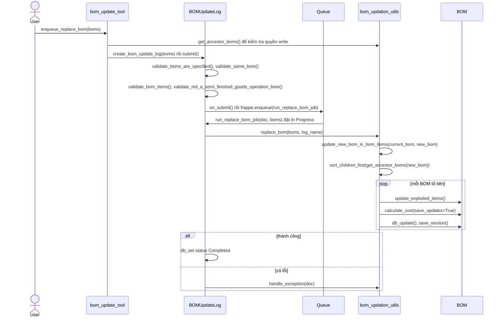

Nguồn: [bom_update_tool.py:35](../../apps/erpnext/erpnext/manufacturing/doctype/bom_update_tool/bom_update_tool.py#L35), [bom_update_log.py:167](../../apps/erpnext/erpnext/manufacturing/doctype/bom_update_log/bom_update_log.py#L167), [bom_updation_utils.py:17](../../apps/erpnext/erpnext/manufacturing/doctype/bom_update_log/bom_updation_utils.py#L17)

### BOM Update Tool: Update Cost

Cập nhật giá toàn bộ BOM theo từng cấp, từ BOM lá trở lên. Mỗi cấp chia batch 7.000 BOM vào queue `long`. Cron `0/15 * * * *` chuyển sang cấp kế tiếp khi mọi batch của cấp hiện tại xong.

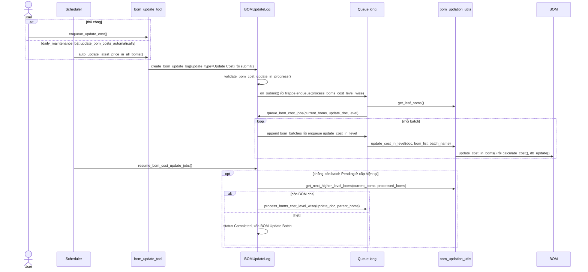

Nguồn: [bom_update_tool.py:66](../../apps/erpnext/erpnext/manufacturing/doctype/bom_update_tool/bom_update_tool.py#L66), [bom_update_log.py:191](../../apps/erpnext/erpnext/manufacturing/doctype/bom_update_log/bom_update_log.py#L191), [bom_update_log.py:257](../../apps/erpnext/erpnext/manufacturing/doctype/bom_update_log/bom_update_log.py#L257)

### BOM Creator: tạo BOM từ thiết kế

BOM Creator đã submit đẩy job vào queue `short`. Plan chọn theo `track_semi_finished_goods`, rồi tạo và submit từng BOM theo thứ tự node.

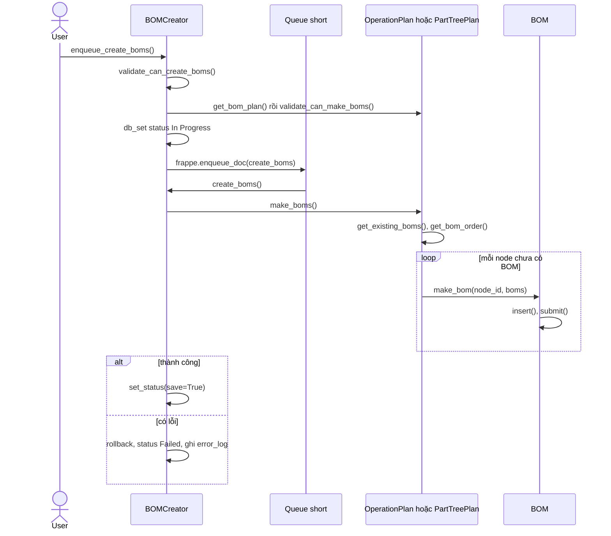

Nguồn: [bom_creator.py:438](../../apps/erpnext/erpnext/manufacturing/doctype/bom_creator/bom_creator.py#L438), [bom_creator.py:470](../../apps/erpnext/erpnext/manufacturing/doctype/bom_creator/bom_creator.py#L470), [bom_plan.py:42](../../apps/erpnext/erpnext/manufacturing/doctype/bom_creator/bom_plan.py#L42)

### Lập và submit Production Plan

Người dùng lấy Sales Order hoặc Material Request, sinh dòng thành phẩm, bán thành phẩm và nguyên vật liệu. Khi submit, kế hoạch cập nhật Bin, Sales Order Item và có thể giữ chỗ tồn kho.

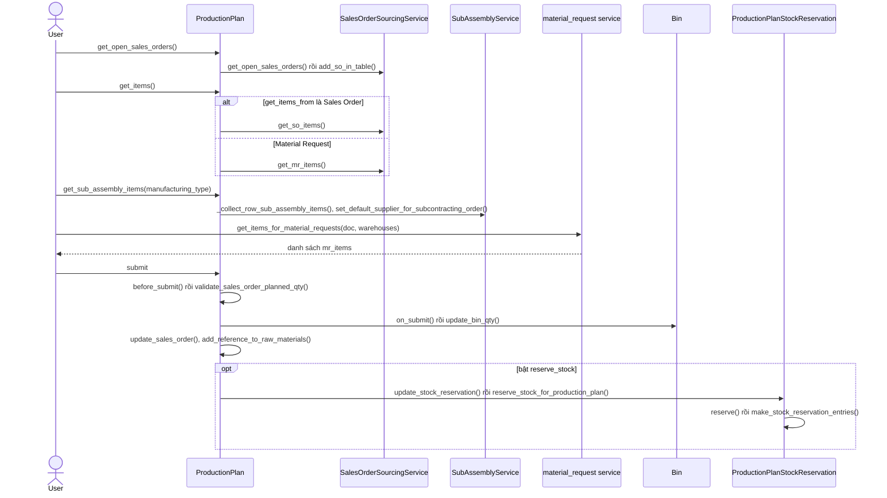

Nguồn: [production_plan.py:372](../../apps/erpnext/erpnext/manufacturing/doctype/production_plan/production_plan.py#L372), [sales_order_planning.py:121](../../apps/erpnext/erpnext/manufacturing/doctype/production_plan/services/sales_order_planning.py#L121), [sub_assembly.py:19](../../apps/erpnext/erpnext/manufacturing/doctype/production_plan/services/sub_assembly.py#L19), [material_request.py:168](../../apps/erpnext/erpnext/manufacturing/doctype/production_plan/services/material_request.py#L168)

### Production Plan tạo Work Order và Purchase Order gia công

Từ kế hoạch đã có, `make_work_order` tạo Work Order nháp cho thành phẩm và bán thành phẩm tự làm, gom dòng `Subcontract` thành Purchase Order theo nhà cung cấp.

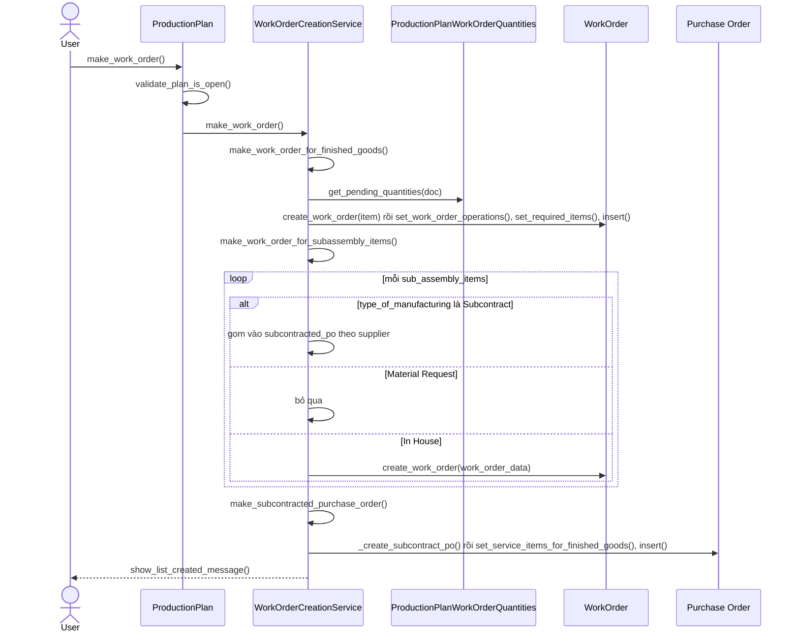

Nguồn: [work_order_planning.py:96](../../apps/erpnext/erpnext/manufacturing/doctype/production_plan/services/work_order_planning.py#L96), [work_order_quantities.py:84](../../apps/erpnext/erpnext/manufacturing/doctype/production_plan/services/work_order_quantities.py#L84)

### Production Plan tạo Material Request

`make_material_request` gom `mr_items` theo Sales Order và loại Material Request, trừ phần đã yêu cầu và phần đang nháp.

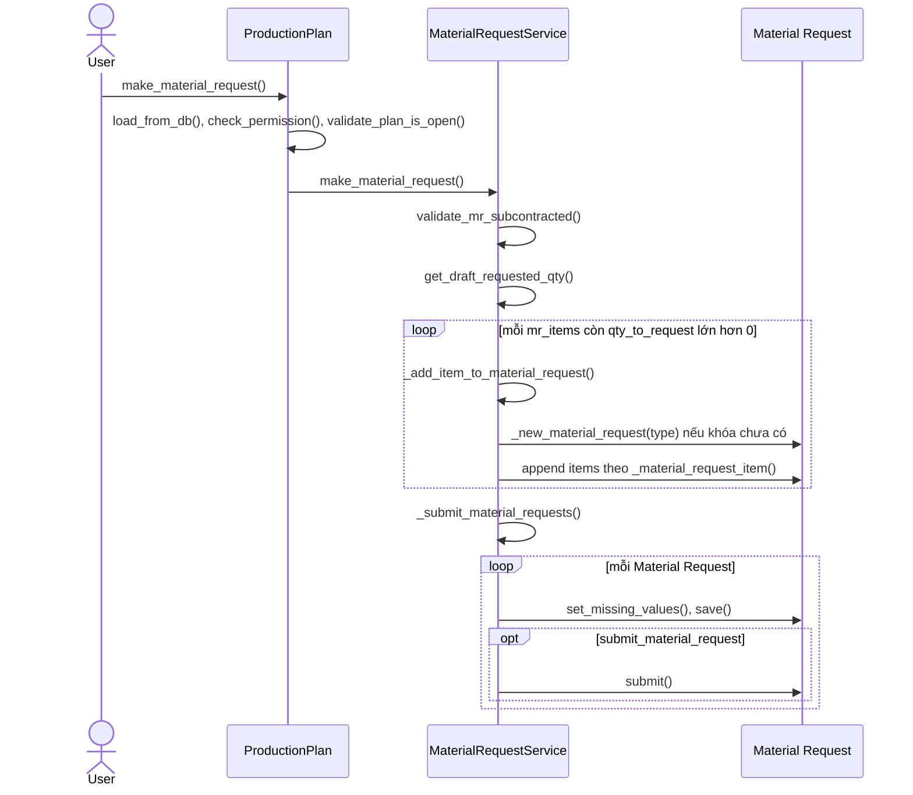

Nguồn: [production_plan.py:627](../../apps/erpnext/erpnext/manufacturing/doctype/production_plan/production_plan.py#L627), [material_request.py:58](../../apps/erpnext/erpnext/manufacturing/doctype/production_plan/services/material_request.py#L58)

### Xếp lịch Production Plan

`plan_adapter` dựng đồ thị công việc từ kế hoạch và chạy `SchedulingEngine`. `get_schedule_preview` chỉ trả đề xuất, `apply_schedule` mới ghi Production Plan Schedule. Job Card sau đó dùng các block này qua `get_plan_schedule_blocks`.

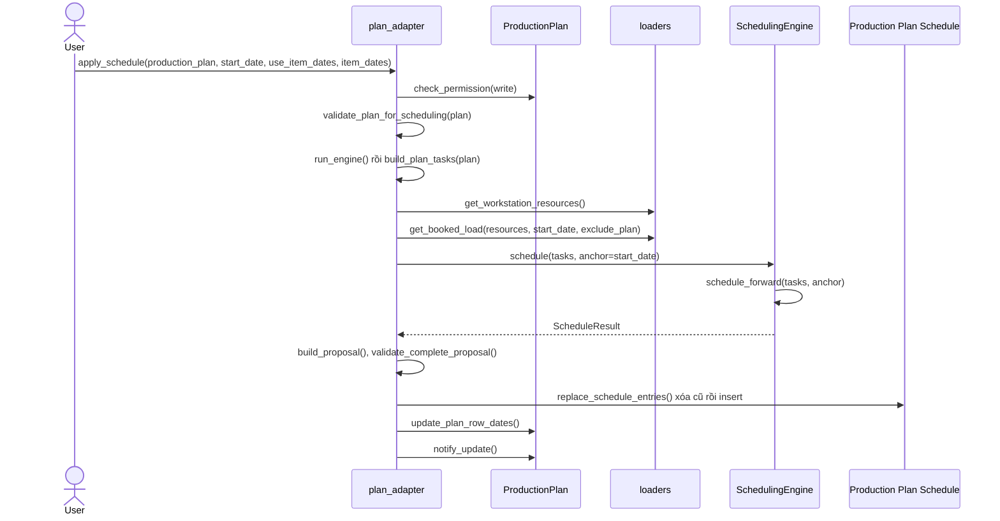

Nguồn: [plan_adapter.py:36](../../apps/erpnext/erpnext/manufacturing/scheduling/plan_adapter.py#L36), [plan_adapter.py:101](../../apps/erpnext/erpnext/manufacturing/scheduling/plan_adapter.py#L101), [engine.py:40](../../apps/erpnext/erpnext/manufacturing/scheduling/engine.py#L40)

### Submit Work Order

Khi submit, Work Order kiểm tra hạn mức theo kế hoạch, cập nhật Bin và Sales Order, sinh Job Card cho từng công đoạn và xử lý giữ chỗ tồn kho. Work Order chưa ghi sổ kho ở bước này.

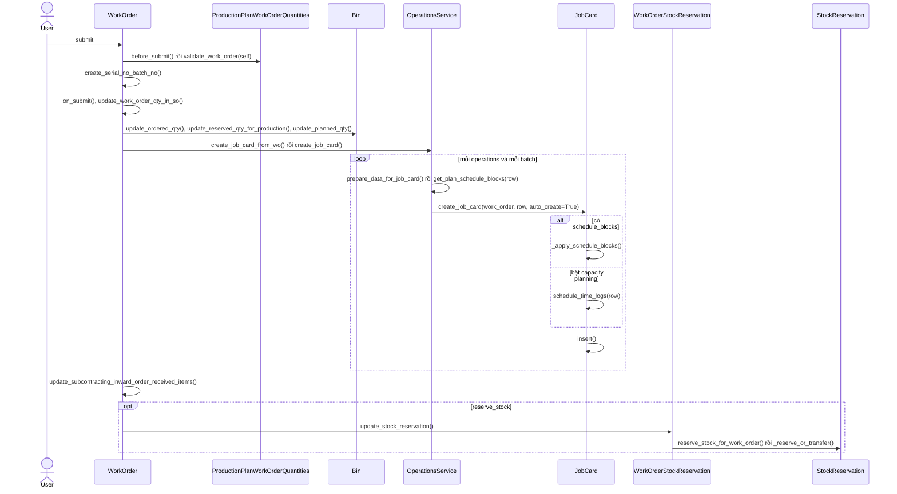

Nguồn: [work_order.py:675](../../apps/erpnext/erpnext/manufacturing/doctype/work_order/work_order.py#L675), [operations.py:116](../../apps/erpnext/erpnext/manufacturing/doctype/work_order/services/operations.py#L116), [mapper.py:475](../../apps/erpnext/erpnext/manufacturing/doctype/work_order/mapper.py#L475), [reservation.py:582](../../apps/erpnext/erpnext/manufacturing/doctype/work_order/services/reservation.py#L582)

### Chuyển vật tư và nhập thành phẩm

Đây là nơi Work Order đi vào sổ kho và sổ cái. `make_stock_entry` tạo Stock Entry, class theo `purpose` cập nhật Work Order, rồi `StockEntry` ghi Stock Ledger Entry và GL Entry.

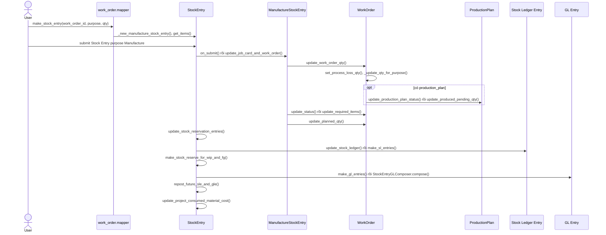

Nguồn: [mapper.py:232](../../apps/erpnext/erpnext/manufacturing/doctype/work_order/mapper.py#L232), [stock_entry.py:415](../../apps/erpnext/erpnext/stock/doctype/stock_entry/stock_entry.py#L415), [manufacturing.py:1175](../../apps/erpnext/erpnext/stock/doctype/stock_entry/services/manufacturing.py#L1175), [status.py:197](../../apps/erpnext/erpnext/manufacturing/doctype/work_order/services/status.py#L197)

### Chấm công Job Card và cập nhật Work Order

Người vận hành bắt đầu qua `start_timer`, kết thúc qua `complete_job_card`, có thể gọi từ trang Shop Floor. Khi submit, Job Card đẩy số lượng và thời gian vào dòng Work Order Operation.

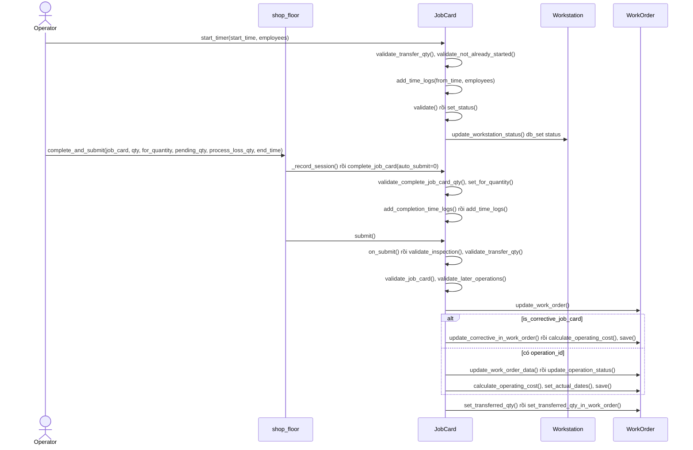

Nguồn: [job_card.py:2041](../../apps/erpnext/erpnext/manufacturing/doctype/job_card/job_card.py#L2041), [job_card.py:2076](../../apps/erpnext/erpnext/manufacturing/doctype/job_card/job_card.py#L2076), [job_card.py:1211](../../apps/erpnext/erpnext/manufacturing/doctype/job_card/job_card.py#L1211), [shop_floor.py:141](../../apps/erpnext/erpnext/manufacturing/page/shop_floor/shop_floor.py#L141)

### Job Card bán thành phẩm và gia công ngoài

Với Work Order `track_semi_finished_goods`, Job Card có `finished_good` tự sinh Stock Entry `Manufacture`, hoặc thuê ngoài qua Purchase Order khi `is_subcontracted`. Cả hai đường đều quay lại `set_manufactured_qty`.

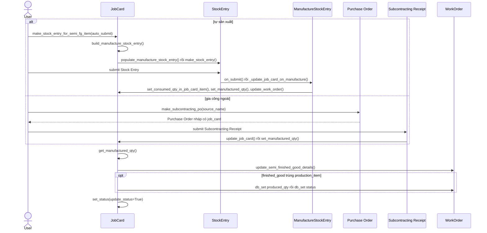

Nguồn: [job_card.py:2172](../../apps/erpnext/erpnext/manufacturing/doctype/job_card/job_card.py#L2172), [job_card.py:311](../../apps/erpnext/erpnext/manufacturing/doctype/job_card/job_card.py#L311), [mapper.py:17](../../apps/erpnext/erpnext/manufacturing/doctype/job_card/mapper.py#L17)

### Từ Sales Forecast đến đơn hàng theo MRP

Sales Forecast sinh dòng nhu cầu và map sang Master Production Schedule. MPS lấy nhu cầu thực tế và lead time. Report MRP đọc MPS và tạo Purchase Order, Work Order qua `make_order`.

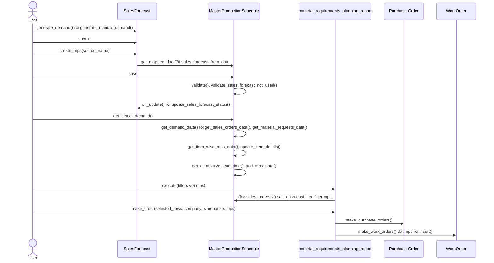

Nguồn: [sales_forecast.py:151](../../apps/erpnext/erpnext/manufacturing/doctype/sales_forecast/sales_forecast.py#L151), [master_production_schedule.py:50](../../apps/erpnext/erpnext/manufacturing/doctype/master_production_schedule/master_production_schedule.py#L50), [material_requirements_planning_report.py:1411](../../apps/erpnext/erpnext/manufacturing/report/material_requirements_planning_report/material_requirements_planning_report.py#L1411)

### Plant Floor

Plant Floor chỉ là lớp xem và tiện ích. Trang hiển thị máy theo `plant_floor` và tồn kho kho xưởng, `make_stock_entry` trả về Stock Entry chưa lưu. Trạng thái Workstation do Job Card đổi.

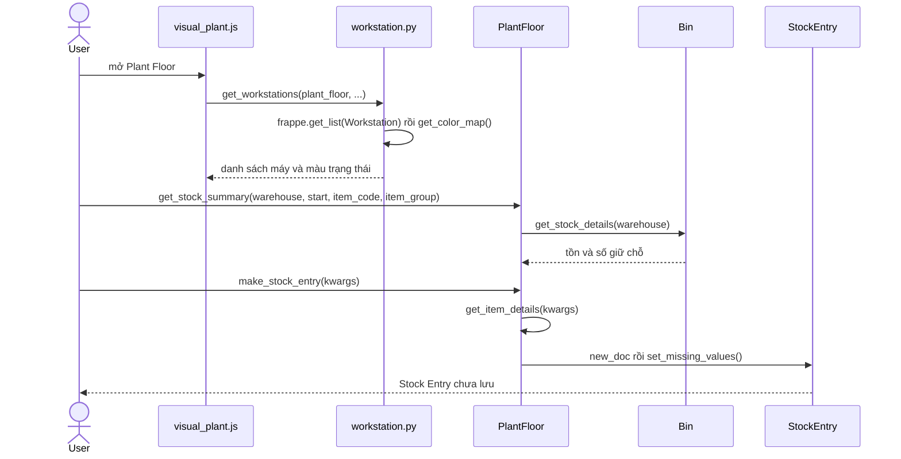

Nguồn: [plant_floor.py:46](../../apps/erpnext/erpnext/manufacturing/doctype/plant_floor/plant_floor.py#L46), [plant_floor.py:90](../../apps/erpnext/erpnext/manufacturing/doctype/plant_floor/plant_floor.py#L90), [workstation.py:411](../../apps/erpnext/erpnext/manufacturing/doctype/workstation/workstation.py#L411)

## Giới hạn

- **Master Production Schedule:** `on_submit` gọi `enqueue_mrp_creation`, và hàm này enqueue method `make_mrp`. Không tìm thấy định nghĩa `make_mrp` trong `erpnext/`. Doctype JSON cũng không có `is_submittable`, nên hook này có vẻ không chạy, vì vậy không đưa vào sơ đồ.
- **Blanket Order, Manufacturing Settings:** không vẽ. Blanket Order là thỏa thuận khung, liên quan chính đến selling và buying. Manufacturing Settings chỉ chứa cấu hình.
- **Doctype bảng con hoặc danh mục không có trong class diagram:** BOM Creator Material, BOM Website Item, BOM Website Operation, Workstation Cost, Workstation Operating Component, Workstation Operating Component Account, Workstation Working Hour.
- **Report và dashboard:** chỉ đọc `make_order`, `make_purchase_orders`, `make_work_orders` của report MRP. Thân `execute` và các truy vấn theo filter `mps` chỉ đọc lướt, nên bước đọc MPS trong sơ đồ có thể chưa đủ. Các report khác không đọc.
- **Trang frontend:** không đọc `shop_floor.js`, nên chưa xác nhận nút nào gọi hàm nào. `page/production_plan_visualizer`, `page/bom_comparison_tool` không đọc. `visual_plant.js` chỉ đọc đoạn gọi `get_workstations`.
- **Đọc lướt:** `work_order/services/required_items.py`, `reservation.py`, `production_plan/services/bom_explosion.py`, `sub_assembly_queries.py`, `planning_queries.py`, `scheduling/engine.py`, `loaders.py`, phần lớn `plan_adapter.py`, `bom_creator/operation_plan.py`, `part_tree_plan.py`, và phần tính toán của `job_card.py`. `stock/doctype/stock_entry/services/material_transfer.py` chỉ đọc phần `on_submit`.
- **Luồng chuyển vật tư:** sơ đồ vẽ nhánh `Manufacture`. Nhánh `Material Transfer for Manufacture` đi qua `MaterialTransferForManufactureStockEntry.update_job_card_and_work_order`, thêm `add_additional_items`, không gọi `update_planned_qty`.
- **Hủy và đóng:** `on_cancel`, `on_close_or_cancel`, `close_work_order`, `stop_unstop` không vẽ riêng.
- **Comment lệch code:** `resume_bom_cost_update_jobs` ghi "every 5 minutes" nhưng `hooks.py` dùng cron `0/15 * * * *`. `queue_bom_cost_jobs` ghi 20k nhưng `batch_size` là 7.000. Tài liệu theo code.
- **Rút gọn service:** `WorkOrder.update_status` và `update_work_order_qty` chỉ gọi tiếp `StatusService`. Sơ đồ ghi theo class doctype để dễ theo dõi.
