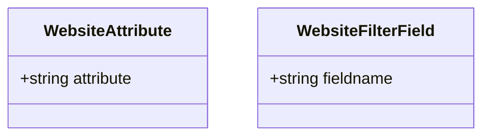
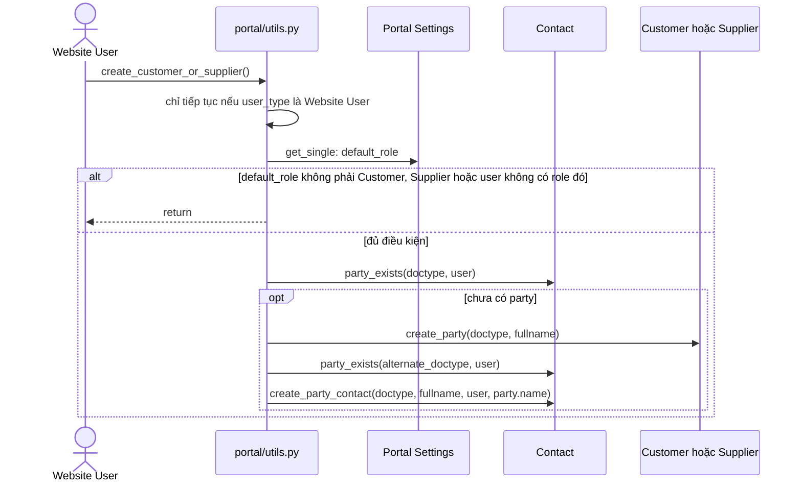

# Module Portal

Module rất nhỏ: 2 bảng con không có logic và một file `utils.py` tự gán role, tự tạo Customer/Supplier cho người dùng portal. File này nối với `selling`, `buying` qua Customer, Supplier và với Frappe qua `Portal Settings`, `Contact`.

## Phạm vi

Đọc được 2 doctype trong `portal/doctype/`.

| Nhóm chức năng | Doctype/file chính | Sơ đồ |
|---|---|---|
| Party cho người dùng portal | `portal/utils.py` | Sequence: Tạo party khi đăng nhập |
| Gán role theo Contact | `portal/utils.py` (`set_default_role`) | Mô tả ngắn trong Giới hạn |
| Bảng con website | `Website Attribute`, `Website Filter Field` | Class |
| Sidebar | `sidebar/portal/portal.json` | Không vẽ, chỉ là cấu hình |

## Class diagram

Hai class này không có field Link liên quan đến nhau và không có method nghiệp vụ.

## Sequence diagram

### Tạo party khi đăng nhập

Hook `on_session_creation` tạo Customer hoặc Supplier cho Website User nếu user đó có `default_role` trong Portal Settings và chưa có Contact liên kết tới loại party đó.

Nguồn: [utils.py:22](../../apps/erpnext/erpnext/portal/utils.py#L22)

## Giới hạn

- `set_default_role` ([utils.py:4](../../apps/erpnext/erpnext/portal/utils.py#L4), hook `User.on_update`) chỉ tìm Contact theo email rồi thêm role Customer hoặc Supplier theo `contact.links`; luồng quá ngắn nên không vẽ.
- `Website Attribute`, `Website Filter Field`: grep trong `erpnext/` (`.py`, `.json`) không thấy doctype nào khác tham chiếu. Có thể là phần còn lại của tính năng website cũ, chưa xác nhận lịch sử.
