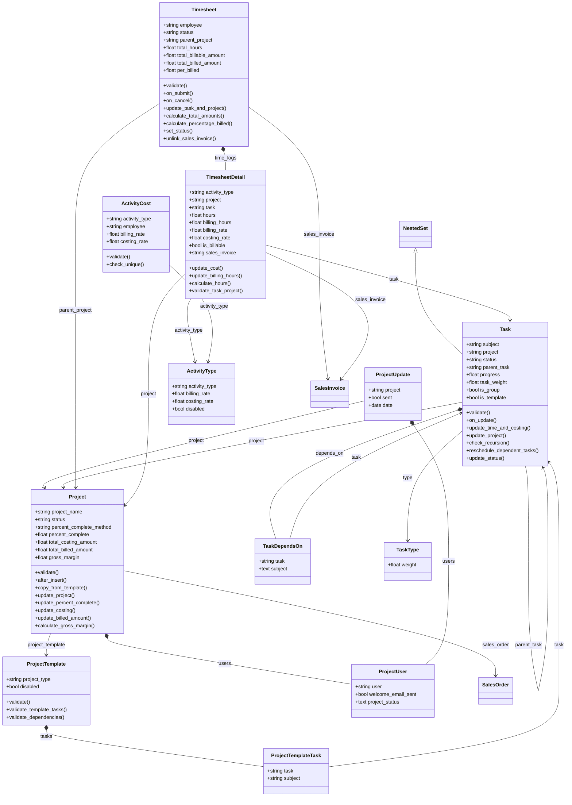
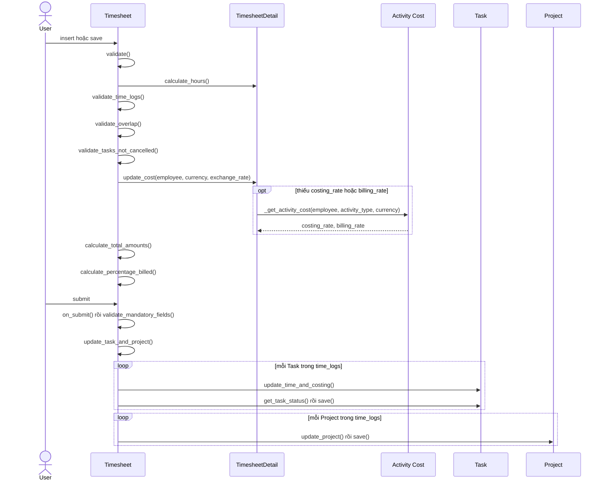
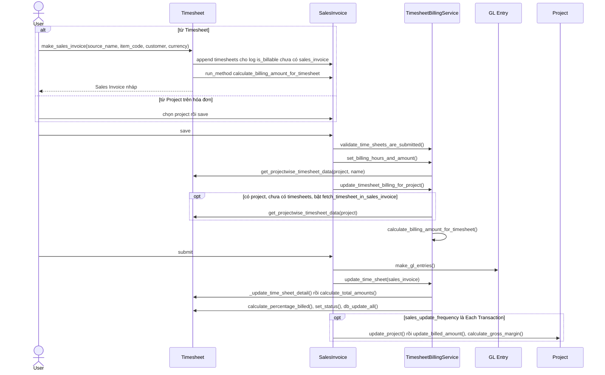
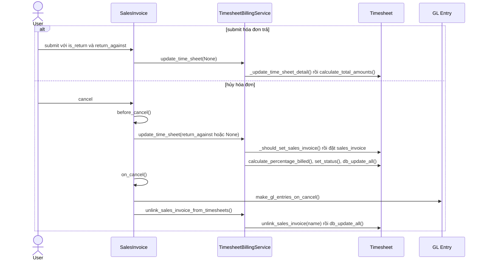
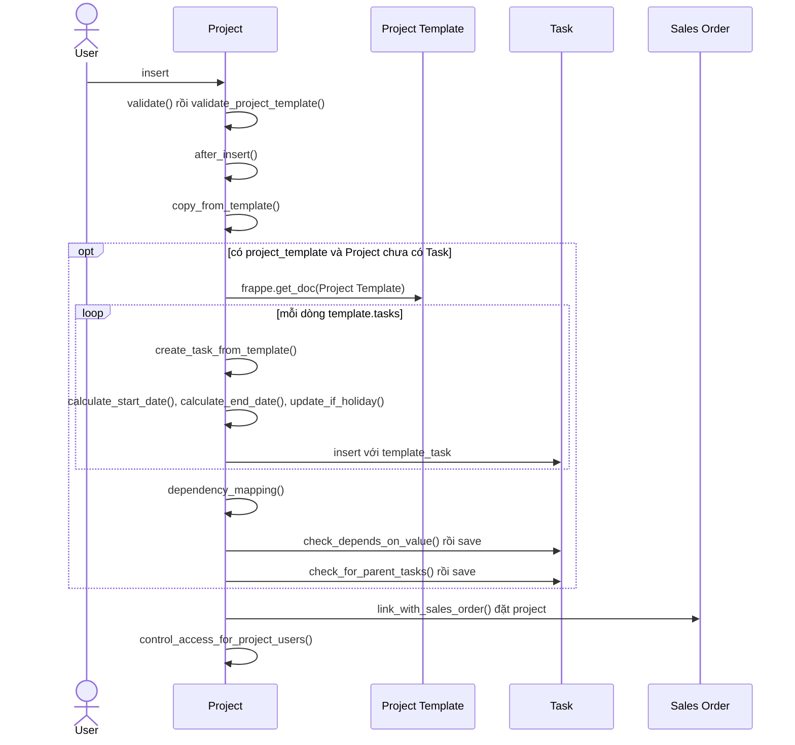
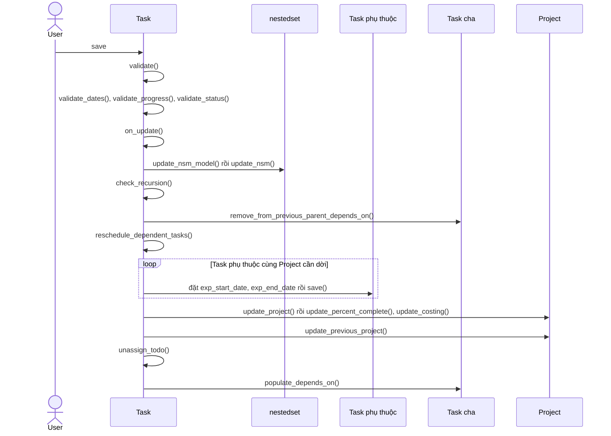
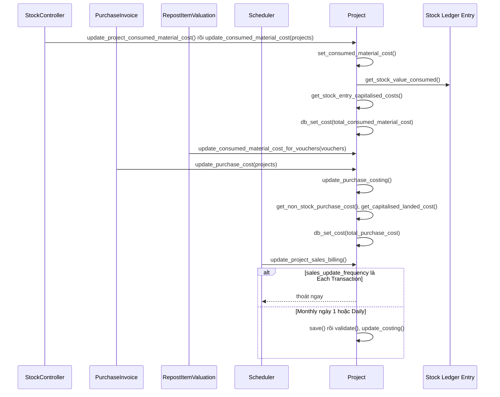
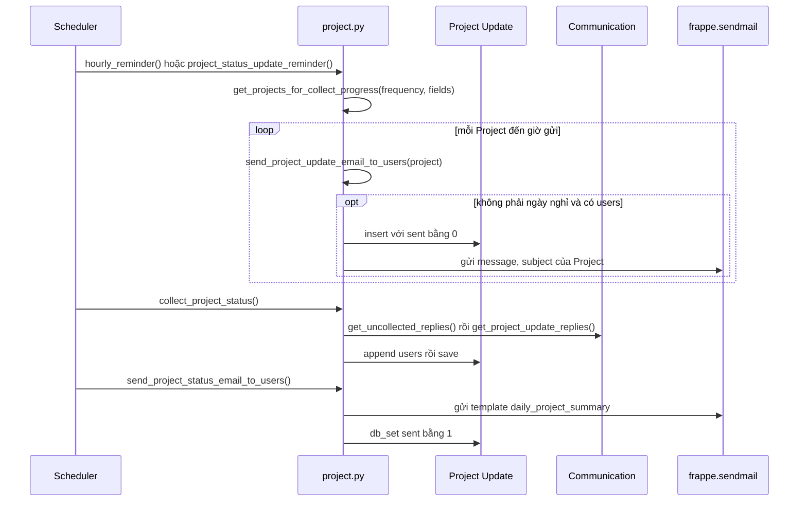

# Module Projects

Module quản lý dự án, công việc và thời gian làm việc: Project, Task, Timesheet, đơn giá theo Activity Cost và tổng hợp chi phí, doanh thu, biên lợi nhuận của dự án. Module nối với `accounts` (lập hóa đơn từ Timesheet, Purchase Invoice), `selling` (Sales Order), `stock` (vật tư tiêu hao qua Stock Ledger Entry) và `setup` (Employee, Holiday List).

## Phạm vi

Đọc được 15 doctype trong `projects/doctype/`.

| Nhóm chức năng | Doctype / file chính | Sơ đồ |
|---|---|---|
| Dự án | Project, Project Template, Project Template Task, Project Type, Project User (`project/project.py`) | Class diagram; Sequence: tạo Project từ Project Template, cập nhật chi phí |
| Công việc | Task, Task Depends On, Dependent Task, Task Type (`task/task.py`) | Class diagram; Sequence: lưu Task |
| Chấm công | Timesheet, Timesheet Detail, Activity Cost, Activity Type, Projects Settings (`timesheet/timesheet.py`) | Class diagram; Sequence: submit Timesheet |
| Lập hóa đơn | `timesheet.make_sales_invoice`, `accounts/doctype/sales_invoice/services/timesheet_billing.py` | Sequence: lập hóa đơn, hủy hoặc trả hóa đơn |
| Thu thập tiến độ | Project Update, các hàm reminder trong `project.py` | Class diagram; Sequence: thu thập tiến độ |

## Class diagram

Class không ghi cha đều kế thừa trực tiếp `frappe.model.document.Document`. `SalesInvoice`, `SalesOrder` chỉ xuất hiện để thể hiện Link ra ngoài module.

## Sequence diagram

### Submit Timesheet và cập nhật Task, Project

Khi lưu, Timesheet tính giờ và đơn giá theo thứ tự Activity Cost của nhân viên, Activity Cost mặc định, rồi Activity Type. Khi submit, nó cộng dồn số liệu sang Task và Project. Timesheet không ghi GL Entry.

Nguồn: [timesheet.py:69](../../apps/erpnext/erpnext/projects/doctype/timesheet/timesheet.py#L69), [timesheet.py:186](../../apps/erpnext/erpnext/projects/doctype/timesheet/timesheet.py#L186), [timesheet_detail.py:74](../../apps/erpnext/erpnext/projects/doctype/timesheet_detail/timesheet_detail.py#L74)

### Lập hóa đơn từ Timesheet

Có hai đường vào: tạo Sales Invoice từ Timesheet, hoặc chọn `project` trên Sales Invoice khi bật `fetch_timesheet_in_sales_invoice`. Khi submit hóa đơn, các dòng Timesheet Detail được gắn `sales_invoice` và Timesheet tính lại `per_billed`, `status`.

Nguồn: [timesheet.py:488](../../apps/erpnext/erpnext/projects/doctype/timesheet/timesheet.py#L488), [timesheet_billing.py:47](../../apps/erpnext/erpnext/accounts/doctype/sales_invoice/services/timesheet_billing.py#L47), [sales_invoice.py:443](../../apps/erpnext/erpnext/accounts/doctype/sales_invoice/sales_invoice.py#L443)

### Hủy hoặc trả hóa đơn đã lập từ Timesheet

Hóa đơn trả phải có `return_against`. Khi submit hóa đơn trả, link trên time log bị xóa. Khi hủy hóa đơn trả, link trở lại hóa đơn gốc. Khi hủy hóa đơn thường, link bị xóa.

Nguồn: [sales_invoice.py:536](../../apps/erpnext/erpnext/accounts/doctype/sales_invoice/sales_invoice.py#L536), [timesheet_billing.py:58](../../apps/erpnext/erpnext/accounts/doctype/sales_invoice/services/timesheet_billing.py#L58), [timesheet.py:313](../../apps/erpnext/erpnext/projects/doctype/timesheet/timesheet.py#L313)

### Tạo Project từ Project Template

Sau khi insert, Project sao chép các Task template thành Task thật, tính ngày tránh ngày nghỉ, nối phụ thuộc và cha con, rồi liên kết ngược Sales Order.

Nguồn: [project.py:276](../../apps/erpnext/erpnext/projects/doctype/project/project.py#L276), [project.py:132](../../apps/erpnext/erpnext/projects/doctype/project/project.py#L132)

### Lưu Task

Task là cây `NestedSet`. Khi lưu, nó kiểm tra ngày và trạng thái, sau đó đẩy lùi Task phụ thuộc, cập nhật % hoàn thành của Project và đồng bộ `depends_on` của Task cha.

Nguồn: [task.py:84](../../apps/erpnext/erpnext/projects/doctype/task/task.py#L84), [task.py:316](../../apps/erpnext/erpnext/projects/doctype/task/task.py#L316), [project.py:308](../../apps/erpnext/erpnext/projects/doctype/project/project.py#L308)

### Cập nhật chi phí Project từ chứng từ khác

Chi phí Project không chỉ đến từ Timesheet. Stock Controller, Purchase Invoice, Landed Cost Voucher và Repost Item Valuation gọi các hàm cấp module, còn tác vụ định kỳ lưu lại Project.

Nguồn: [project.py:1089](../../apps/erpnext/erpnext/projects/doctype/project/project.py#L1089), [project.py:1082](../../apps/erpnext/erpnext/projects/doctype/project/project.py#L1082), [project.py:934](../../apps/erpnext/erpnext/projects/doctype/project/project.py#L934)

### Thu thập tiến độ qua email

Với Project bật `collect_progress`, tác vụ định kỳ tạo Project Update và gửi email hỏi tiến độ, gom trả lời vào bảng `users`, rồi gửi tổng hợp cho hôm trước. Trong `hooks.py`, `hourly_reminder` chạy `hourly`, `project_status_update_reminder` và `collect_project_status` chạy `hourly_maintenance`, `send_project_status_email_to_users` chạy `daily_maintenance`.

Nguồn: [project.py:699](../../apps/erpnext/erpnext/projects/doctype/project/project.py#L699), [project.py:824](../../apps/erpnext/erpnext/projects/doctype/project/project.py#L824), [project.py:855](../../apps/erpnext/erpnext/projects/doctype/project/project.py#L855), [project.py:912](../../apps/erpnext/erpnext/projects/doctype/project/project.py#L912)

## Giới hạn

- Không vẽ sequence cho Activity Cost, Activity Type, Project Type, Task Type, Projects Settings vì chỉ là danh mục. Activity Cost chỉ có `check_unique` và `set_title`, phần dùng đơn giá nằm ở luồng Timesheet.
- `Dependent Task` có doctype và class nhưng không đưa vào sơ đồ. Chưa xác định chỗ dùng.
- Không vẽ: `create_duplicate_project`, `set_project_status`, `create_kanban_board_if_not_exists`, `project_overview*.py` (đọc lướt), `web_form/tasks`, các report trong `projects/report` (không đọc).
- Trong luồng lập hóa đơn, chỉ đọc phần Sales Invoice liên quan đến Timesheet. `make_gl_entries` của Sales Invoice không được đọc sâu, nên không vẽ chi tiết bút toán.
- `get_uncollected_replies` lọc theo Communication nhận về, sơ đồ gộp thành một bước.
- `Timesheet.set_status` đặt `Completed` khi trường đầu phiếu `sales_invoice` có giá trị. Không thấy luồng Python nào trong các file đã đọc ghi trường này, nên chưa chắc nguồn của nó.
