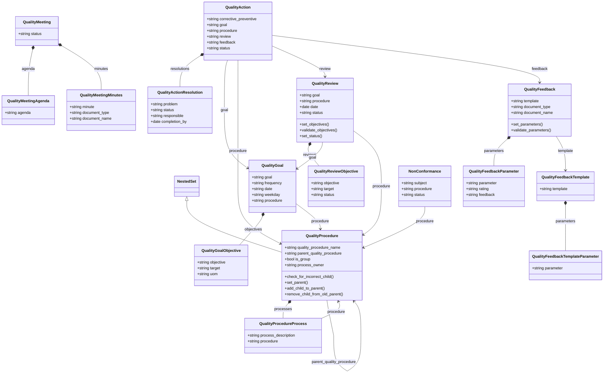
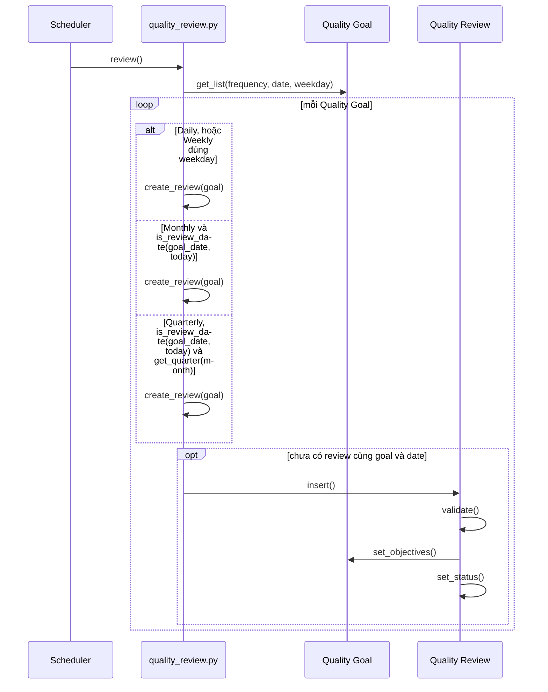
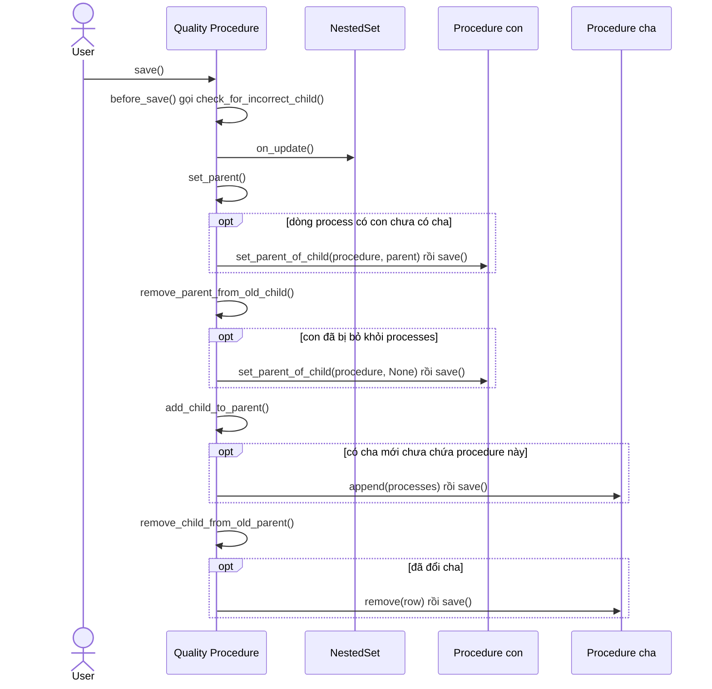
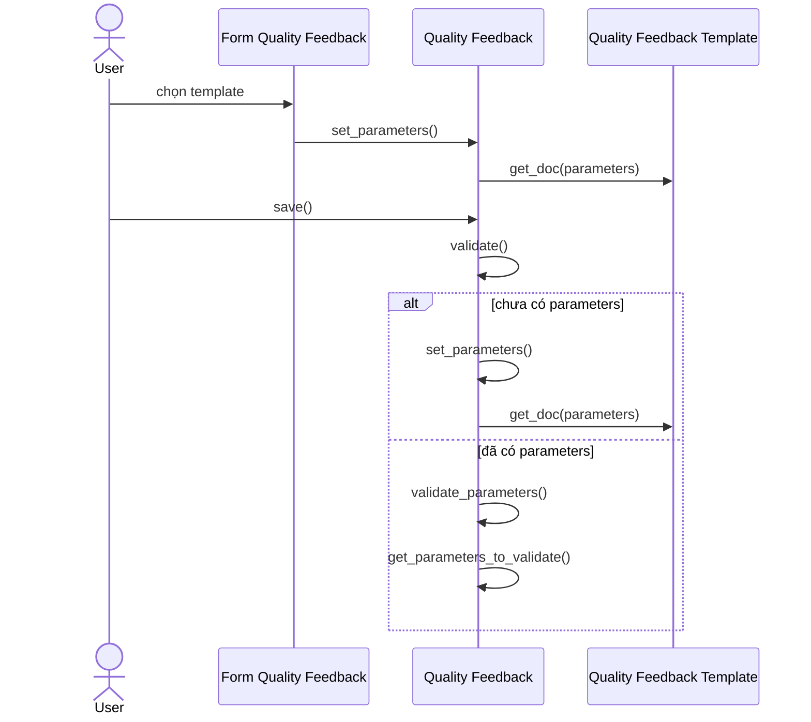

# Module Quality Management

Lưu mục tiêu chất lượng, quy trình dạng cây, đánh giá định kỳ, hành động khắc phục, biên bản họp và phản hồi. Phần lớn là tài liệu nội bộ, không phải chứng từ submit được và không ghi sổ. Module chỉ nối với phần còn lại qua Link tới `User`, `UOM`, `Customer` và các job trong `hooks.py`.

## Phạm vi

Đọc được 16 doctype trong `quality_management/doctype/`.

| Nhóm chức năng | Doctype/file chính | Sơ đồ |
| --- | --- | --- |
| Mục tiêu và đánh giá | `Quality Goal`, `Quality Goal Objective`, `Quality Review`, `Quality Review Objective` | Class diagram. Sequence: Tạo Quality Review định kỳ |
| Quy trình | `Quality Procedure`, `Quality Procedure Process`, `Non Conformance` | Class diagram. Sequence: Đồng bộ cây Quality Procedure |
| Hành động | `Quality Action`, `Quality Action Resolution` | Class diagram |
| Họp | `Quality Meeting`, `Quality Meeting Agenda`, `Quality Meeting Minutes` | Class diagram |
| Phản hồi | `Quality Feedback`, `Quality Feedback Parameter`, `Quality Feedback Template`, `Quality Feedback Template Parameter` | Class diagram. Sequence: Tạo Quality Feedback từ template |

## Class diagram

## Sequence diagram

### Tạo Quality Review định kỳ

Job `daily_maintenance` duyệt từng `Quality Goal` theo `frequency` và tạo review. Trạng thái review được tính từ các dòng objective khi `validate`.

Nguồn: [quality_review.py:75](../../apps/erpnext/erpnext/quality_management/doctype/quality_review/quality_review.py#L75), [quality_review.py:98](../../apps/erpnext/erpnext/quality_management/doctype/quality_review/quality_review.py#L98), [quality_review.py:32](../../apps/erpnext/erpnext/quality_management/doctype/quality_review/quality_review.py#L32)

### Đồng bộ cây Quality Procedure

`parent_quality_procedure` và bảng con `processes` là hai cách biểu diễn cùng một cây, nên mỗi lần lưu phải đồng bộ hai chiều.

Nguồn: [quality_procedure.py:39](../../apps/erpnext/erpnext/quality_management/doctype/quality_procedure/quality_procedure.py#L39), [quality_procedure.py:52](../../apps/erpnext/erpnext/quality_management/doctype/quality_procedure/quality_procedure.py#L52)

### Tạo Quality Feedback từ template

Thông số phản hồi được chép từ template, và mọi thông số người dùng sửa phải có trong template. Thiếu `document_name` thì mặc định là người dùng hiện tại.

Nguồn: [quality_feedback.py:30](../../apps/erpnext/erpnext/quality_management/doctype/quality_feedback/quality_feedback.py#L30), [quality_feedback.py:38](../../apps/erpnext/erpnext/quality_management/doctype/quality_feedback/quality_feedback.py#L38)

## Giới hạn

- `Quality Goal` có `validate` rỗng. `Quality Meeting` và `Non Conformance` không có logic Python. `Quality Action` chỉ đặt `status` trong `validate` từ các dòng `resolutions`. Vì vậy các doctype này không có sequence.
- Không có mã tự sinh `Quality Action` từ `Quality Review` hay `Quality Feedback`: các field `review`, `feedback` chỉ là Link điền tay trên những gì đã đọc được trong `.py` và `.js` của `quality_action`.
- `get_children` và `add_node` của `Quality Procedure` phục vụ tree view, không vẽ. Báo cáo `report/review`, thư mục `sidebar`, `workspace`, `onboarding_step` chưa đọc nội dung.
- Bước `chọn template` là mô tả thao tác form, không phải tên hàm. Trigger đọc từ `quality_feedback.js`.
