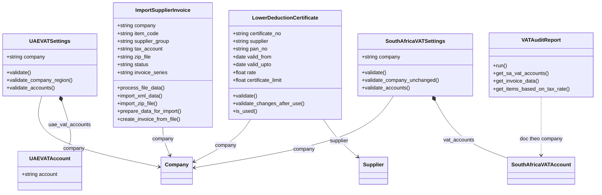
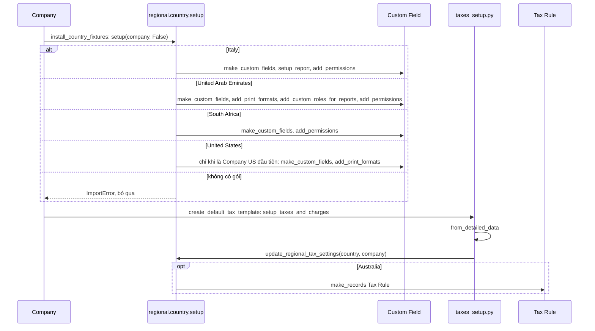
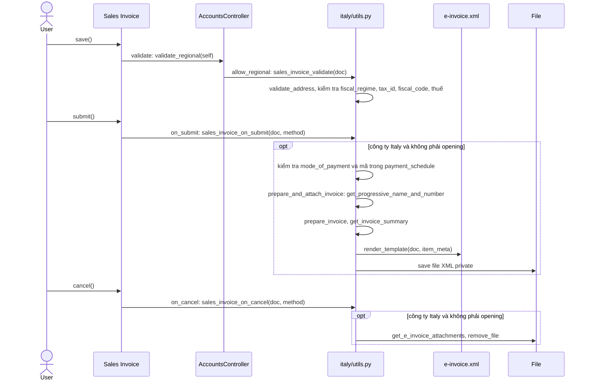
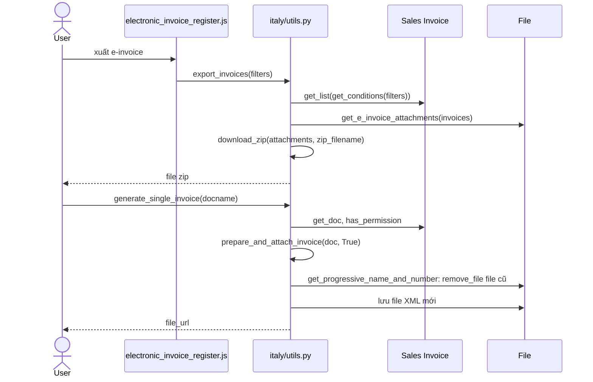
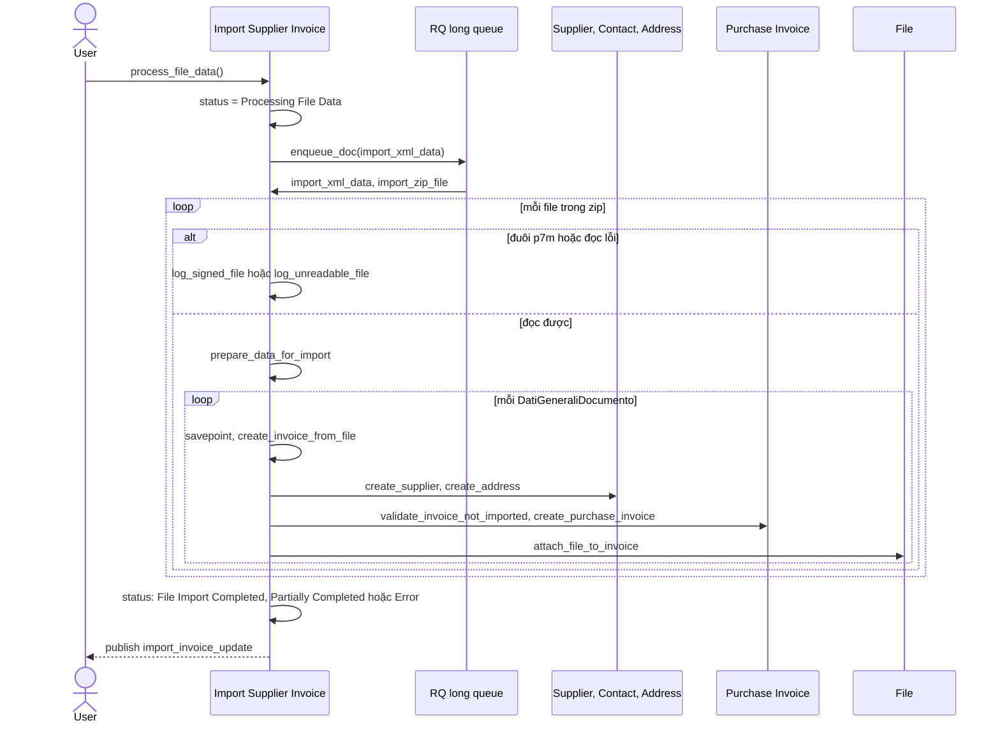
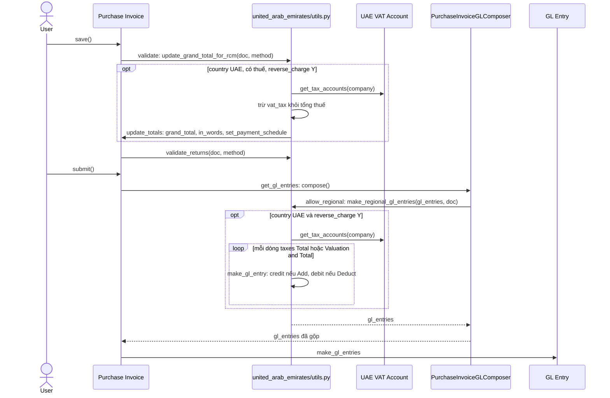
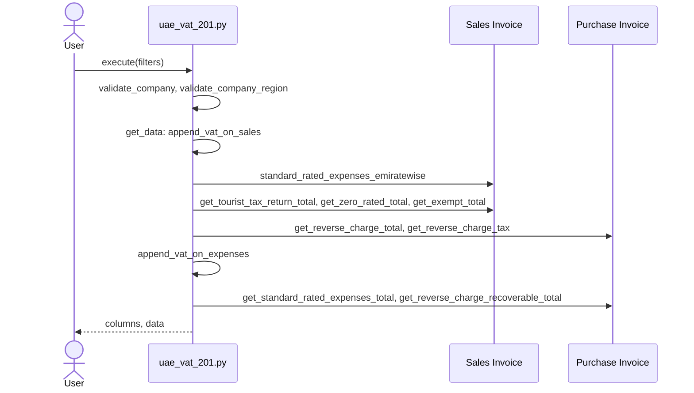
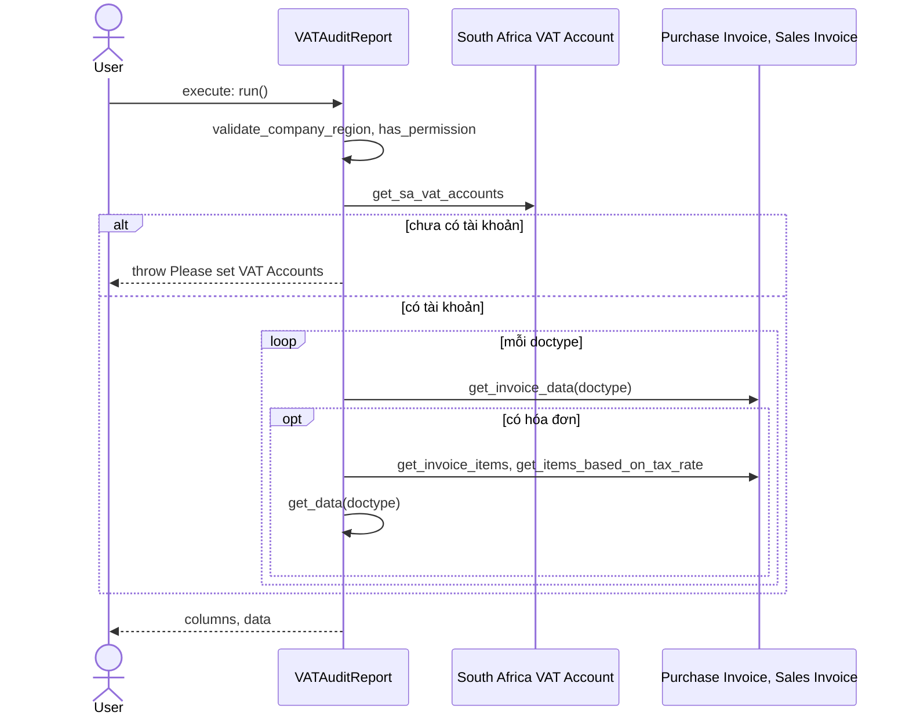
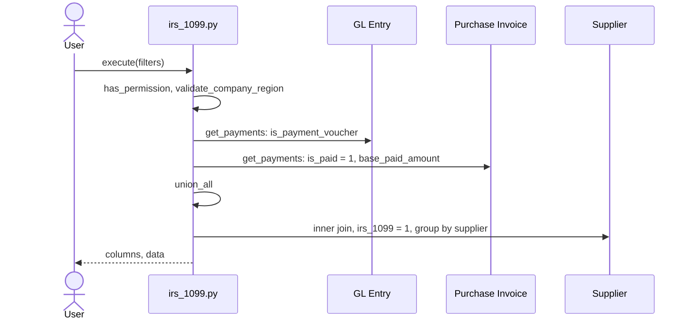

# Module Regional

Module `regional` chứa phần riêng theo quốc gia. Code cắm vào hệ thống qua ba đường: `doc_events` và `regional_overrides` trong `hooks.py`, hàm `setup` được `Company.install_country_fixtures` gọi động theo tên nước, và các report. Có nghiệp vụ thực sự ở Italy (e-invoice) và UAE (reverse charge, VAT 201); South Africa và United States chủ yếu là custom field cộng một report.

## Phạm vi

Đọc được 5 doctype trong `regional/doctype/`.

| Gói quốc gia | File chính | Nội dung | Sơ đồ |
|---|---|---|---|
| `italy` | `utils.py`, `setup.py`, `e-invoice.xml`, doctype `Import Supplier Invoice`, report `electronic_invoice_register` | Kiểm tra, sinh, xuất XML e-invoice, nhập hóa đơn nhà cung cấp | Class. 2 sequence e-invoice, 1 sequence import |
| `united_arab_emirates` | `utils.py`, `setup.py`, doctype `UAE VAT Settings`, report `uae_vat_201` | Reverse charge trên Purchase Invoice, báo cáo VAT 201 | Class. 2 sequence |
| `south_africa` | `setup.py`, doctype `South Africa VAT Settings`, report `vat_audit_report` | Custom field, báo cáo VAT Audit | Class. 1 sequence |
| `united_states` | `setup.py`, report `irs_1099`, print format `irs_1099_form` | Custom field, báo cáo 1099 | 1 sequence |
| `australia` | `setup.py` | Chỉ tạo Tax Rule trong `update_regional_tax_settings` | Gộp vào sequence fixture |
| `turkey` | `setup.py` | `setup` chỉ có `pass`, không có nghiệp vụ | Không vẽ |

Phần không theo gói quốc gia: `Lower Deduction Certificate` (class), `address_template/setup.py`, `check_deletion_permission` và `rename_vat_settings` trong `regional/__init__.py`.

## Class diagram

`VATAuditReport` là class Python của report, không phải doctype. `SouthAfricaVATAccount` nằm ở `accounts/doctype/`.

## Sequence diagram

### Cài fixture theo quốc gia

Khi Company đổi hoặc nhận nước lần đầu, controller tìm hàm `setup` theo tên module rút từ `country`. Nước không có gói thì `ImportError` được bỏ qua.

Nguồn: [company.py:995](../../apps/erpnext/erpnext/setup/doctype/company/company.py#L995), [taxes_setup.py:120](../../apps/erpnext/erpnext/setup/setup_wizard/operations/taxes_setup.py#L120)

### Italy: kiểm tra và sinh e-invoice

`validate_regional` là hàm rỗng có `allow_regional`; với Italy, hook `regional_overrides` thay bằng `sales_invoice_validate`. Khi submit, hook `doc_events` sinh file XML và đính vào Sales Invoice; khi cancel thì xóa file.

Nguồn: [utils.py:221](../../apps/erpnext/erpnext/regional/italy/utils.py#L221), [utils.py:321](../../apps/erpnext/erpnext/regional/italy/utils.py#L321), [accounts_controller.py:1996](../../apps/erpnext/erpnext/controllers/accounts_controller.py#L1996)

### Italy: xuất và sinh lại e-invoice

Report Electronic Invoice Register gọi API để tải zip các file XML đã đính kèm; `generate_single_invoice` thay file cũ bằng file mới nhưng giữ số progressive.

Nguồn: [utils.py:34](../../apps/erpnext/erpnext/regional/italy/utils.py#L34), [utils.py:379](../../apps/erpnext/erpnext/regional/italy/utils.py#L379)

### Italy: Import Supplier Invoice

Người dùng đính kèm file zip XML; job nền tạo Supplier, Address và Purchase Invoice nháp cho từng hóa đơn. Mỗi hóa đơn có savepoint riêng, file `.p7m` đã ký không được hỗ trợ.

Nguồn: [import_supplier_invoice.py:194](../../apps/erpnext/erpnext/regional/doctype/import_supplier_invoice/import_supplier_invoice.py#L194), [import_supplier_invoice.py:133](../../apps/erpnext/erpnext/regional/doctype/import_supplier_invoice/import_supplier_invoice.py#L133)

### UAE: reverse charge trên Purchase Invoice

Khi `reverse_charge` là Y, thuế trên tài khoản VAT được trừ khỏi tổng phải trả lúc validate, còn lúc ghi sổ thì thêm dòng GL cho tài khoản VAT đó.

Nguồn: [utils.py:91](../../apps/erpnext/erpnext/regional/united_arab_emirates/utils.py#L91), [utils.py:148](../../apps/erpnext/erpnext/regional/united_arab_emirates/utils.py#L148), [gl_composer.py:42](../../apps/erpnext/erpnext/accounts/doctype/purchase_invoice/services/gl_composer.py#L42)

### UAE: báo cáo VAT 201

Script report chỉ chạy cho công ty UAE, gom số liệu đầu ra theo Emirate và số liệu đầu vào theo từng ô của tờ khai.

Nguồn: [uae_vat_201.py:12](../../apps/erpnext/erpnext/regional/report/uae_vat_201/uae_vat_201.py#L12)

### South Africa: VAT Audit Report

Report lấy danh sách tài khoản VAT từ `South Africa VAT Settings` (đặt tên theo company), rồi xử lý lần lượt Purchase Invoice và Sales Invoice.

Nguồn: [vat_audit_report.py:24](../../apps/erpnext/erpnext/regional/report/vat_audit_report/vat_audit_report.py#L24)

### United States: IRS 1099

Report cộng khoản đã trả cho Supplier có `irs_1099 = 1` trong một fiscal year, lấy từ GL Entry của phiếu thanh toán và Purchase Invoice đã trả ngay.

Nguồn: [irs_1099.py:22](../../apps/erpnext/erpnext/regional/report/irs_1099/irs_1099.py#L22), [irs_1099.py:67](../../apps/erpnext/erpnext/regional/report/irs_1099/irs_1099.py#L67)

## Giới hạn

- `hooks.py` có `regional_overrides` cho `France`, trỏ tới `erpnext.regional.france.utils.test_method`, nhưng thư mục `regional/france` không tồn tại trong cây mã này. Khóa override `erpnext.tests.test_regional.test_method` chỉ dùng cho `tests/test_regional.py`, và test đó chạy với country khác nên không chạm tới đường dẫn này.
- `Saudi Arabia` chỉ dùng lại `update_itemised_tax_data` của UAE qua hook, không có gói riêng. `check_deletion_permission` chỉ chặn với `Nepal`, cũng không có gói riêng.
- `update_itemised_tax_data` (Italy, UAE) chỉ gán `tax_rate`, `tax_amount`, `total_amount` lên từng dòng, được `controllers/taxes_and_totals.py` gọi khi dựng phần thuế chi tiết; không vẽ riêng.
- Override chọn theo `get_region()`, dựa trên `frappe.local.flags.company`. `validate_regional` và `update_itemised_tax_data` được bọc `temporary_flag("company", ...)`, còn lệnh gọi `make_regional_gl_entries` trong `PurchaseInvoiceGLComposer.compose` thì không, và grep không thấy nơi nào khác đặt cờ này trên đường gọi đó. Theo code, override GL của UAE vì thế chọn theo `frappe.flags.country` hoặc country của System Settings, không theo Company. Site có System Settings khác UAE thì dòng GL reverse charge có thể không được thêm dù Company ở UAE. Chưa chạy thử.
- `Lower Deduction Certificate` chỉ có validate, không gắn với gói quốc gia. Việc dùng nó nằm ở `accounts/doctype/tax_withholding_entry/`, xem tài liệu `accounts`.
- `uae_vat_201.py` và `vat_audit_report.py` chỉ đọc đến mức hàm và doctype được truy vấn, không đọc từng điều kiện lọc.
- Print format (`tax_invoice`, `detailed_tax_invoice`, `simplified_tax_invoice`, `purchase_einvoice`, `irs_1099_form`), `address_template/setup.py` (cập nhật Address Template từ file HTML, gọi trong `install_fixtures.install`) và `rename_vat_settings` (hook `Company.after_rename`) không vẽ.
- `italy/setup.py` phần lớn là khai báo custom field (`get_custom_fields`), chỉ đọc đầu và cuối.
