# Module Selling

Module `selling` quản lý khách hàng, báo giá, đơn bán và các chứng từ phụ trợ như Proforma Invoice, Installation Note, Product Bundle. Module nhận đầu vào từ `crm` (Lead, Prospect, Opportunity), đẩy luồng sang `stock` (Delivery Note, Packed Item, Stock Reservation Entry, Bin), `accounts` (Sales Invoice, GL Entry) và `buying` (Purchase Order cho drop ship). Blanket Order không nằm ở đây mà ở `manufacturing`, module này chỉ gọi tới.

## Phạm vi

Đọc được 20 doctype trong `selling/doctype/`. Mục "Sơ đồ" chỉ tới tiêu đề trong file này.

| Nhóm chức năng | Doctype/file chính | Sơ đồ |
|---|---|---|
| Khách hàng và hạn mức tín dụng | Customer, Customer Credit Limit, Sales Team, `customer/customer.py`, `customer/mapper.py` | Class: Khách hàng. Sequence: Lưu Customer, Kiểm tra hạn mức tín dụng |
| Báo giá | Quotation, Quotation Item, `quotation/quotation.py`, `quotation/mapper.py` | Class: Báo giá và đơn bán. Sequence: Submit Quotation, Tạo revision, Declare Lost, Hết hạn Quotation |
| Đơn bán | Sales Order, Sales Order Item, Delivery Schedule Item, `sales_order/sales_order.py`, `sales_order/mapper.py`, `sales_order/services/` | Class: Báo giá và đơn bán. Sequence: Quotation sang Sales Order, Submit Sales Order, Đổi trạng thái |
| Luồng sang chứng từ sau | `sales_order/mapper.py`, Delivery Note, Sales Invoice (ngoài module) | Sequence: Sales Order sang Delivery Note, Sales Order sang Sales Invoice, Sales Order sang Purchase Order |
| Chứng từ phụ trợ | Proforma Invoice, Installation Note, Product Bundle, Party Specific Item, Selling Settings | Class: Chứng từ phụ trợ. Sequence: Proforma Invoice |

## Class diagram

Class ngoài module (ví dụ `Opportunity`, `BlanketOrder`) chỉ để đích của quan hệ nên để trống. Controller cha chỉ ghi method.

### Khách hàng

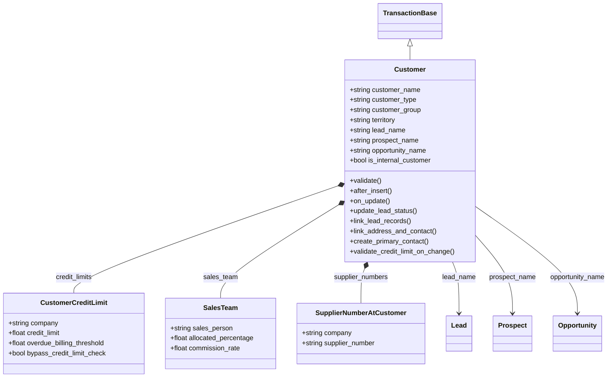

### Báo giá và đơn bán

`Quotation.party_name` là Dynamic Link theo `quotation_to`, sơ đồ chỉ vẽ trường hợp Customer.

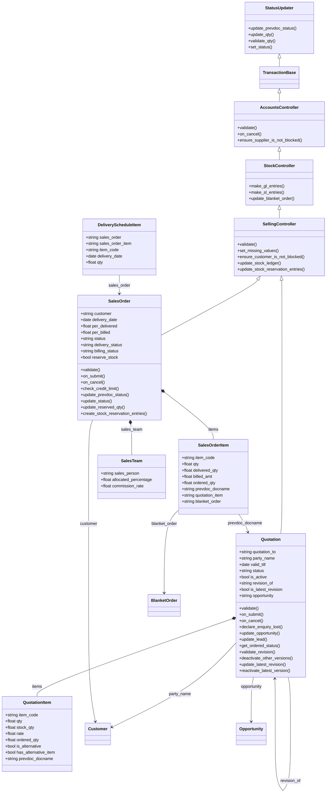

### Chứng từ phụ trợ

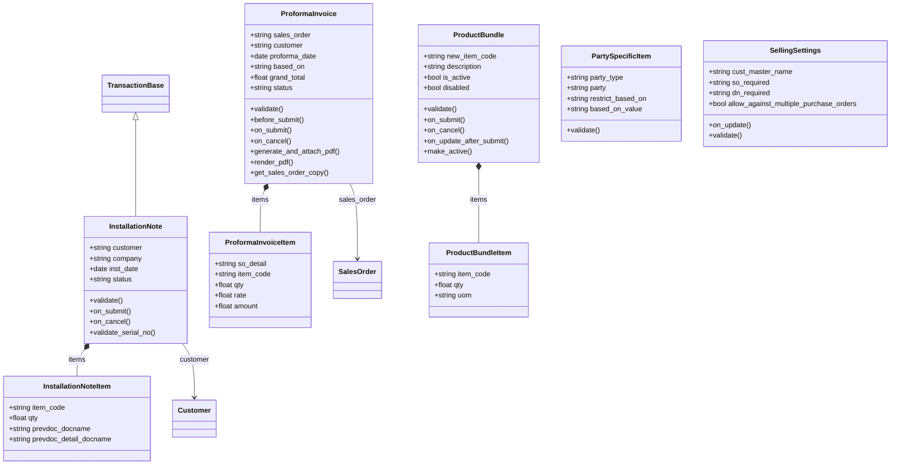

## Sequence diagram

### Lưu Customer và nối với Lead

Khi Customer mới có `lead_name`, Lead chuyển sang Converted và các Quotation, Opportunity của Lead được trỏ lại sang Customer.

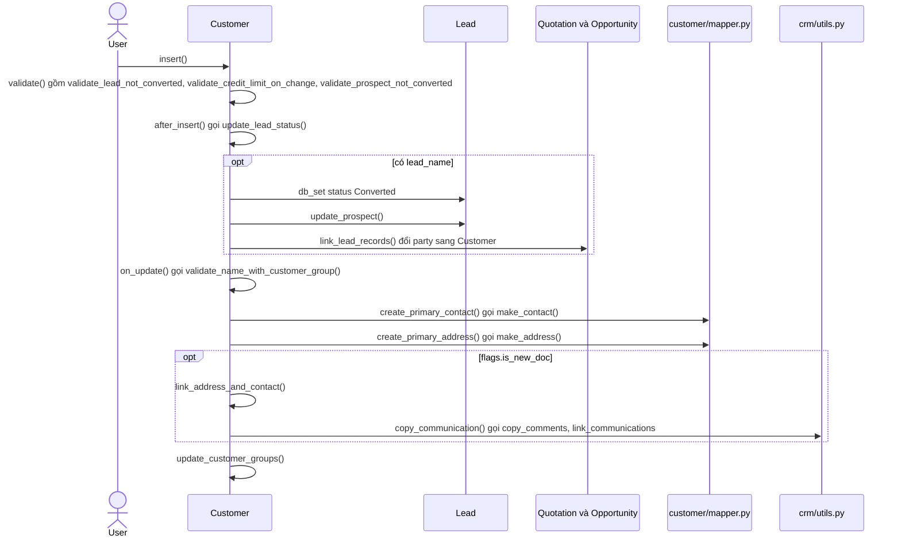

Nguồn: [customer.py:361](../../apps/erpnext/erpnext/selling/doctype/customer/customer.py#L361), [customer.py:303](../../apps/erpnext/erpnext/selling/doctype/customer/customer.py#L303)

### Kiểm tra hạn mức tín dụng

Sales Order gọi lúc submit và lúc mở lại; Delivery Note và Sales Invoice cũng dùng chung hàm module-level `check_credit_limit`.

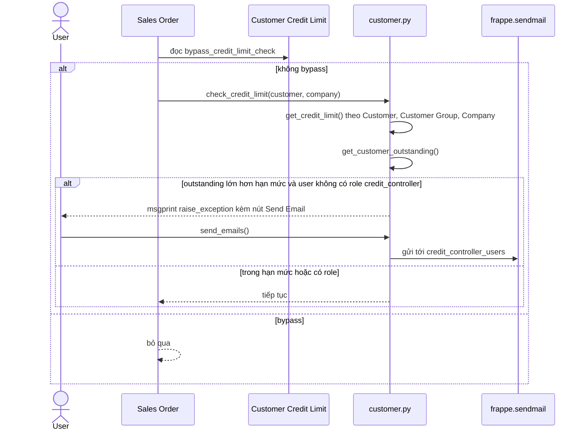

Nguồn: [sales_order.py:644](../../apps/erpnext/erpnext/selling/doctype/sales_order/sales_order.py#L644), [customer.py:594](../../apps/erpnext/erpnext/selling/doctype/customer/customer.py#L594)

### Submit Quotation

Submit Quotation kiểm tra thẩm quyền rồi đồng bộ trạng thái Opportunity, Lead và các phiên bản khác của báo giá.

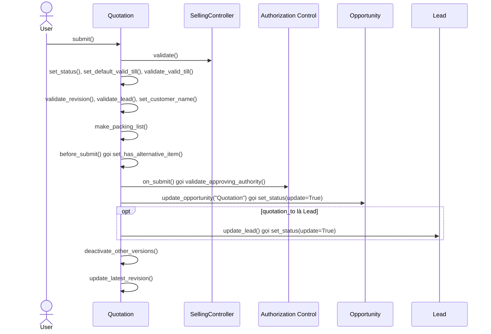

Nguồn: [quotation.py:170](../../apps/erpnext/erpnext/selling/doctype/quotation/quotation.py#L170), [quotation.py:417](../../apps/erpnext/erpnext/selling/doctype/quotation/quotation.py#L417)

### Tạo revision Quotation

Revision là bản Quotation mới có `revision_of` trỏ về bản gốc, tên dạng `<gốc>-R<n>`, và tại mỗi thời điểm chỉ một phiên bản `is_active`.

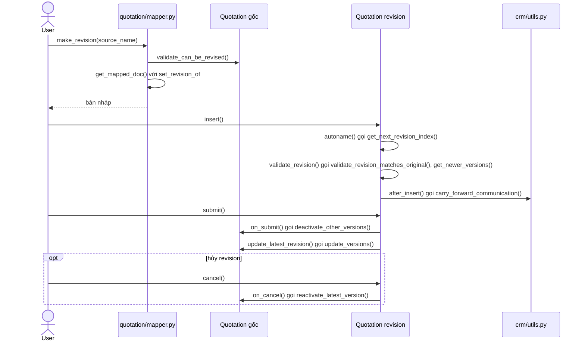

Nguồn: [mapper.py:243](../../apps/erpnext/erpnext/selling/doctype/quotation/mapper.py#L243), [quotation.py:210](../../apps/erpnext/erpnext/selling/doctype/quotation/quotation.py#L210), [quotation.py:511](../../apps/erpnext/erpnext/selling/doctype/quotation/quotation.py#L511)

### Declare Lost cho Quotation

Chỉ Quotation đã submit và chưa có đơn bán nào mới đánh dấu Lost được; các phiên bản khác cũng bị Lost theo.

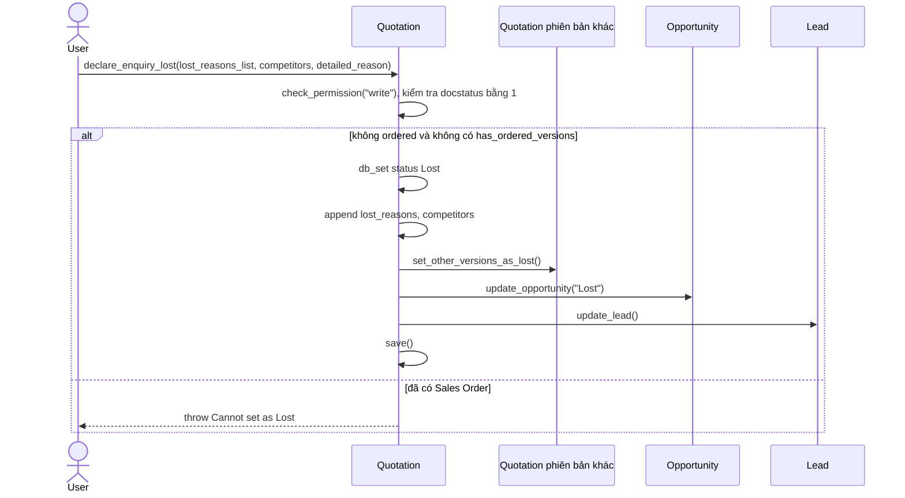

Nguồn: [quotation.py:366](../../apps/erpnext/erpnext/selling/doctype/quotation/quotation.py#L366)

### Hết hạn Quotation theo lịch

Job `daily_maintenance` chuyển Quotation quá `valid_till` và chưa có Sales Order sang Expired rồi tính lại Opportunity.

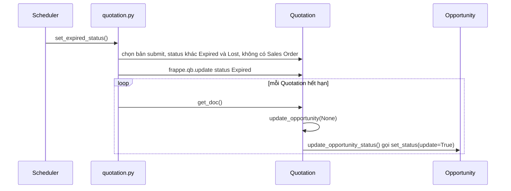

Nguồn: [quotation.py:617](../../apps/erpnext/erpnext/selling/doctype/quotation/quotation.py#L617)

### Quotation sang Sales Order

`make_sales_order` tự tạo Customer nếu Quotation đang gắn với Lead hoặc Prospect chưa chuyển đổi, rồi map các dòng còn lại.

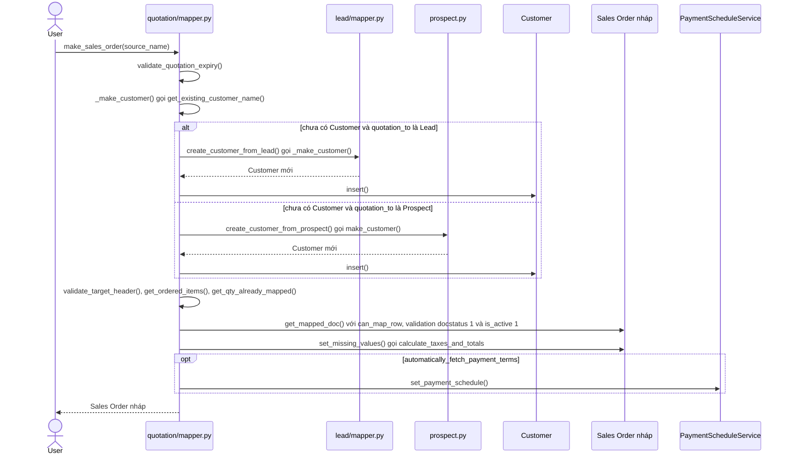

Nguồn: [mapper.py:55](../../apps/erpnext/erpnext/selling/doctype/quotation/mapper.py#L55), [mapper.py:62](../../apps/erpnext/erpnext/selling/doctype/quotation/mapper.py#L62)

### Submit Sales Order

Submit Sales Order chỉ cập nhật số lượng giữ chỗ và chứng từ trước, không ghi `GL Entry` hay `Stock Ledger Entry`.

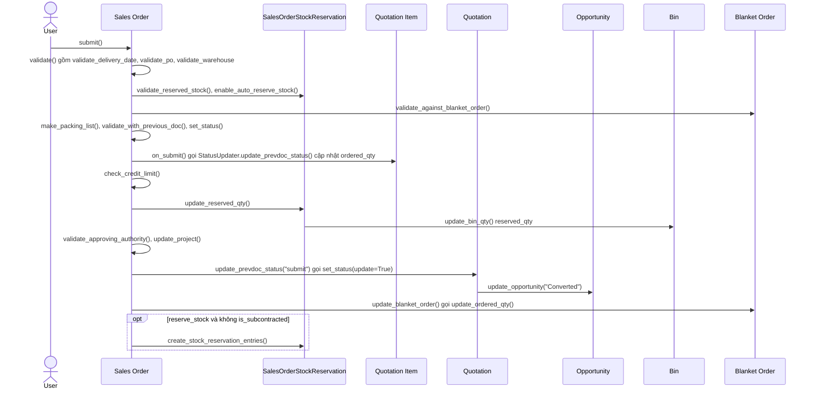

Nguồn: [sales_order.py:269](../../apps/erpnext/erpnext/selling/doctype/sales_order/sales_order.py#L269), [sales_order.py:577](../../apps/erpnext/erpnext/selling/doctype/sales_order/sales_order.py#L577), [reservation.py:35](../../apps/erpnext/erpnext/selling/doctype/sales_order/services/reservation.py#L35)

### Sales Order sang Delivery Note

`make_delivery_note` map các dòng còn phải giao; Delivery Note khi submit mới ghi sổ kho và sổ cái, đồng thời đẩy `delivered_qty` ngược về Sales Order.

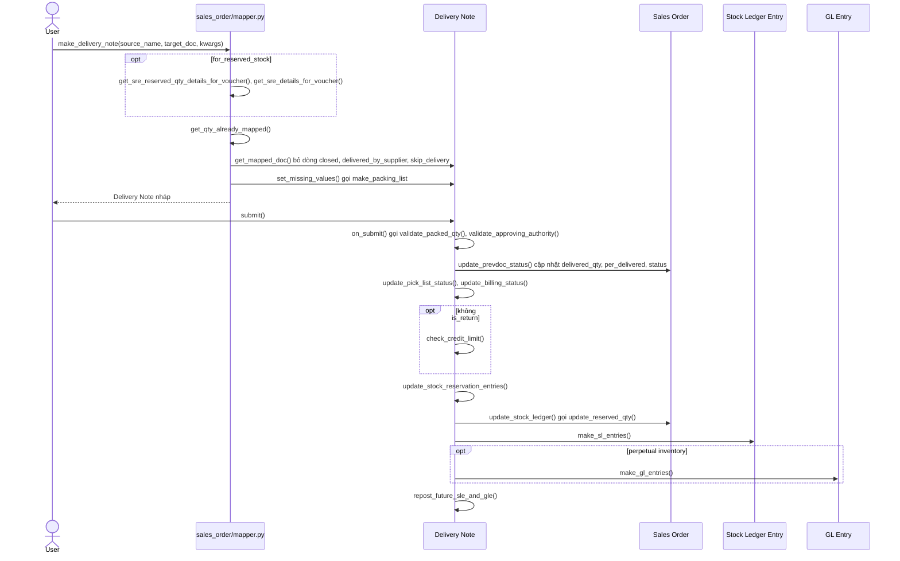

Nguồn: [mapper.py:235](../../apps/erpnext/erpnext/selling/doctype/sales_order/mapper.py#L235), [delivery_note.py:542](../../apps/erpnext/erpnext/stock/doctype/delivery_note/delivery_note.py#L542), [selling_controller.py:773](../../apps/erpnext/erpnext/controllers/selling_controller.py#L773)

### Sales Order sang Sales Invoice

`make_sales_invoice` tính phần còn phải xuất hóa đơn theo số lượng và số tiền; Sales Invoice khi submit luôn ghi GL, chỉ ghi kho nếu `update_stock`.

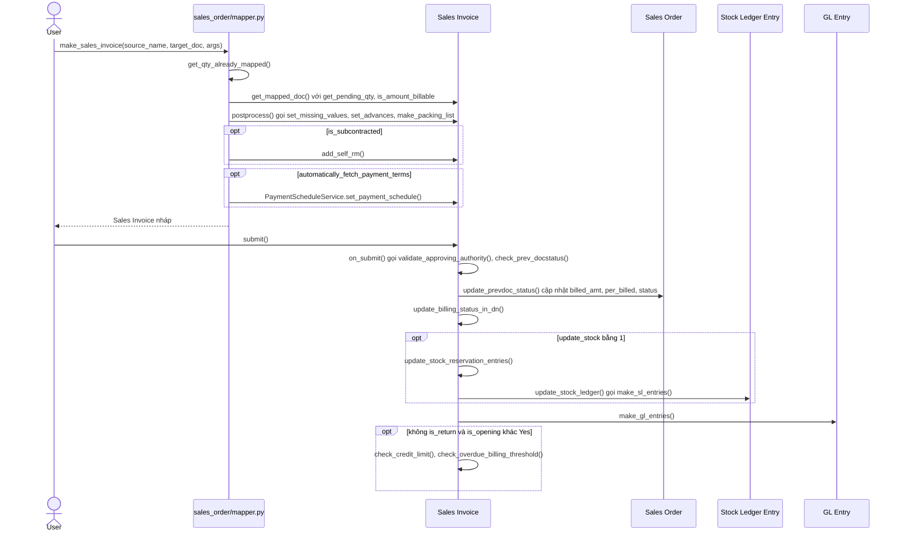

Nguồn: [mapper.py:452](../../apps/erpnext/erpnext/selling/doctype/sales_order/mapper.py#L452), [sales_invoice.py:443](../../apps/erpnext/erpnext/accounts/doctype/sales_invoice/sales_invoice.py#L443), [sales_invoice.py:1135](../../apps/erpnext/erpnext/accounts/doctype/sales_invoice/sales_invoice.py#L1135)

### Sales Order sang Purchase Order

`make_purchase_order` tạo mỗi Supplier một Purchase Order từ các dòng được chọn; bản nào đã có `supplier` thì insert luôn.

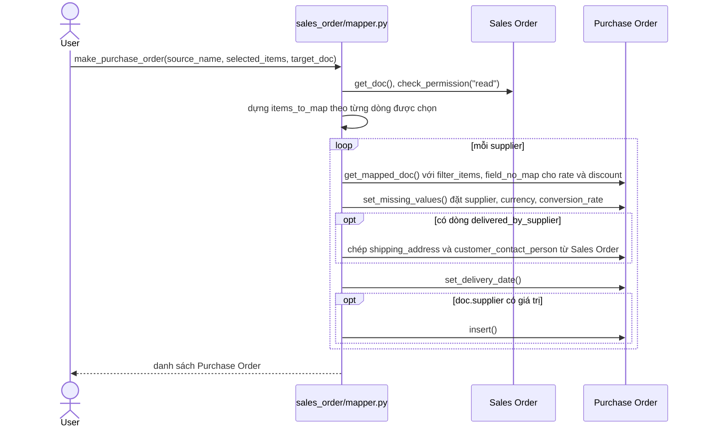

Nguồn: [mapper.py:755](../../apps/erpnext/erpnext/selling/doctype/sales_order/mapper.py#L755)

### Đổi trạng thái Sales Order

Close, On Hold và mở lại đi qua `StatusService`, tính lại giữ chỗ, đơn gia công và Blanket Order.

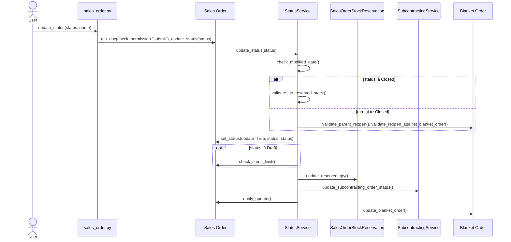

Nguồn: [sales_order.py:900](../../apps/erpnext/erpnext/selling/doctype/sales_order/sales_order.py#L900), [status.py:30](../../apps/erpnext/erpnext/selling/doctype/sales_order/services/status.py#L30)

### Proforma Invoice

Proforma Invoice được tạo và submit ngay từ dialog của Sales Order, chỉ sinh PDF và gửi mail, không ghi sổ.

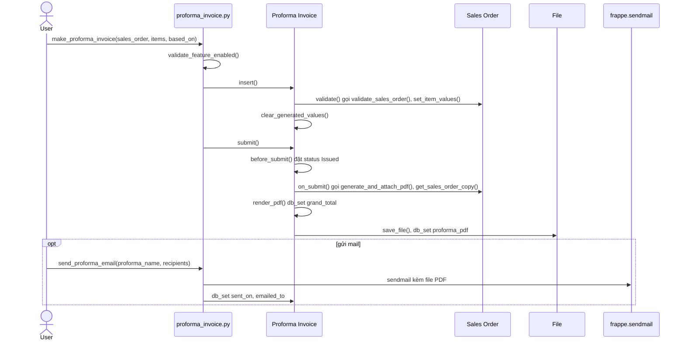

Nguồn: [proforma_invoice.py:249](../../apps/erpnext/erpnext/selling/doctype/proforma_invoice/proforma_invoice.py#L249), [proforma_invoice.py:135](../../apps/erpnext/erpnext/selling/doctype/proforma_invoice/proforma_invoice.py#L135), [proforma_invoice.py:298](../../apps/erpnext/erpnext/selling/doctype/proforma_invoice/proforma_invoice.py#L298)

## Giới hạn

- Blanket Order nằm ở `manufacturing/doctype/blanket_order/`, không vẽ riêng ở đây. Trong các luồng trên nó chỉ xuất hiện qua `validate_against_blanket_order`, `update_blanket_order`, `validate_reopen_against_blanket_order`.
- Không vẽ: Industry Type, Sales Partner Type (danh mục), SMS Center. Selling Settings, Party Specific Item và Product Bundle có trong class diagram nhưng không có sequence riêng vì là cấu hình hoặc không nối chứng từ khác; Product Bundle có versioning qua `make_new_version` và `make_active`.
- Installation Note chỉ đọc lướt `on_submit`, `on_cancel`, không có sequence.
- `sales_order/mapper.py` còn các hàm chưa vẽ: `make_material_request`, `make_project`, `make_work_orders`, `make_production_plan`, `create_pick_list`, `make_maintenance_schedule`, `make_maintenance_visit`, `make_subcontracting_inward_order`, `make_inter_company_purchase_order`. `quotation/mapper.py` có `make_sales_invoice` chưa vẽ.
- `selling/page/` (point_of_sale, sales_funnel), `report/`, `customer_overview.py` không đọc.
- `get_customer_outstanding`, `update_stock_reservation_entries`, `BillingStatusService`, `StockLedgerService` và `general_ledger.make_gl_entries` chỉ đọc lướt: sơ đồ dừng ở tên hàm, không đi vào chi tiết.
- `SalesOrder.on_cancel` không có sơ đồ riêng; thứ tự hook khác `on_submit` (thêm `check_nextdoc_docstatus`, `cancel_stock_reservation_entries`, `unlink_inter_company_doc`).
- Thứ tự `after_insert` trước `on_update` trong luồng Customer dựa trên vòng đời Frappe, không đọc lại trong `frappe/model/document.py`.
- `get_existing_customer_name` tra `Customer.crm_deal` và `set_customer_name` xử lý `quotation_to == "CRM Deal"`, nhưng `customer.json` không có field `crm_deal`. Có thể là custom field do app Frappe CRM thêm, chưa xác nhận.
- Trong `Submit Sales Order`, `update_prevdoc_status` ở `SalesOrder` là override có tham số `flag`; bản không tham số là `StatusUpdater.update_prevdoc_status` gọi qua `super()`. Hai lời gọi đều chạy trong `on_submit`.
