# Module Setup

Module `setup` chứa dữ liệu nền của toàn hệ thống: Company và các cây danh mục (Item Group, Customer Group, Territory...), Employee, setup wizard, xóa giao dịch theo Company, Email Digest và kiểm tra thẩm quyền duyệt. Khi tạo Company, module gọi sang `accounts` (chart of accounts, tax template), `stock` (Warehouse) và `regional` (fixture theo quốc gia). Các chứng từ của `selling`, `buying`, `stock`, `accounts` gọi ngược lại `Authorization Control` khi submit.

## Phạm vi

Đọc được 40 doctype trong `setup/doctype/`. Doctype `Transaction Deletion Record Details` là bảng con của Transaction Deletion Record nhưng nằm ở `accounts/doctype/`.

| Nhóm chức năng | Doctype/file chính | Sơ đồ |
|---|---|---|
| Khởi tạo site | `setup_wizard/setup_wizard.py`, `setup_wizard/operations/install_fixtures.py`, `setup_wizard/operations/taxes_setup.py` | Sequence: Setup wizard |
| Company | `Company`, `Department`, `Global Defaults` | Class: Company và tổ chức. Sequence: Tạo Company, Cache doanh số Company |
| Xóa giao dịch | `Transaction Deletion Record` và 3 bảng con, `demo.py` | Class: Transaction Deletion Record. Sequence: 3 luồng xóa, Xóa dữ liệu demo |
| Nhân sự | `Employee`, `Employee Group`, `Holiday List`, `Sales Person` | Class: Company và tổ chức. Sequence: Lưu Employee, Tạo User từ Employee |
| Thông báo định kỳ | `Email Digest` | Class: Email Digest và thẩm quyền. Sequence: Gửi Email Digest |
| Thẩm quyền duyệt | `Authorization Rule`, `Authorization Control` | Class: Email Digest và thẩm quyền. Sequence: Kiểm tra thẩm quyền khi submit |
| Cây danh mục | `Item Group`, `Customer Group`, `Supplier Group`, `Territory` | Class: Cây danh mục. Sequence: Lưu và dùng Item Group |
| Danh mục CRUD | `Brand`, `UOM`, `Currency Exchange`, `Incoterm`, `Terms and Conditions`, `Vehicle`, `Driver`... | Không vẽ, xem Giới hạn |

## Class diagram

### Company và tổ chức

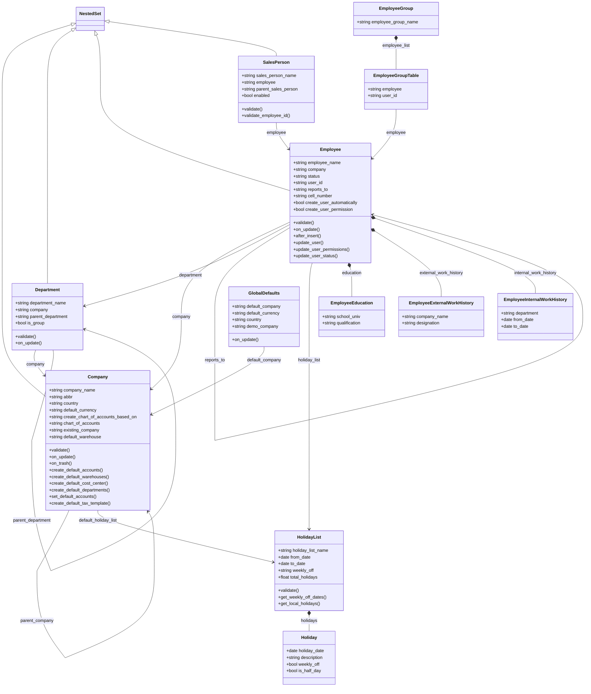

### Transaction Deletion Record

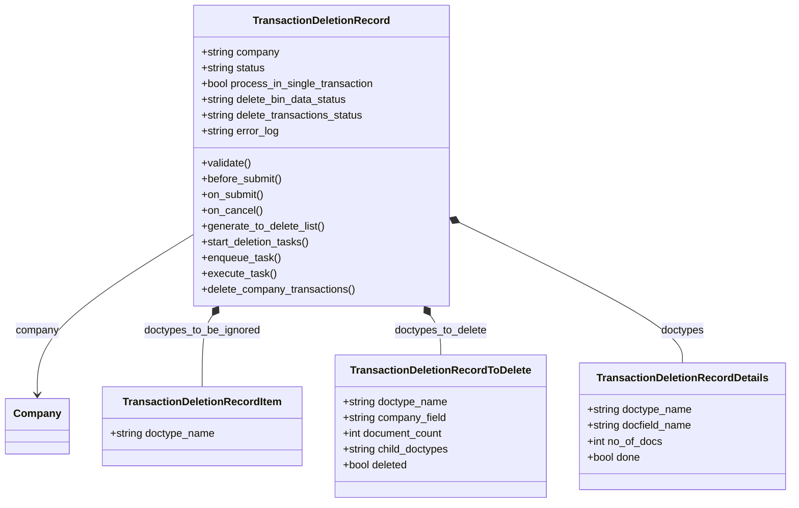

### Email Digest và thẩm quyền

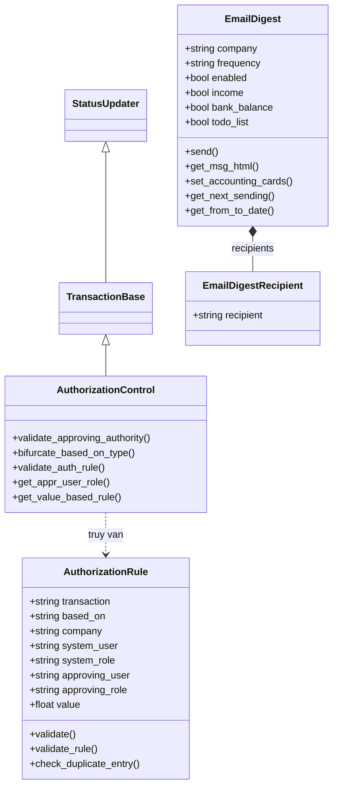

### Cây danh mục

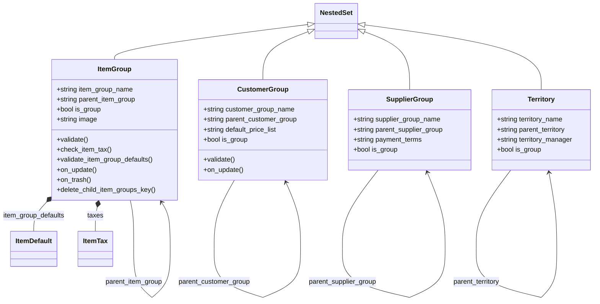

## Sequence diagram

### Setup wizard

Frappe chạy tuần tự 4 stage của ERPNext, đăng ký qua hook `setup_wizard_stages`; stage thứ hai tạo Fiscal Year và Company đầu tiên.

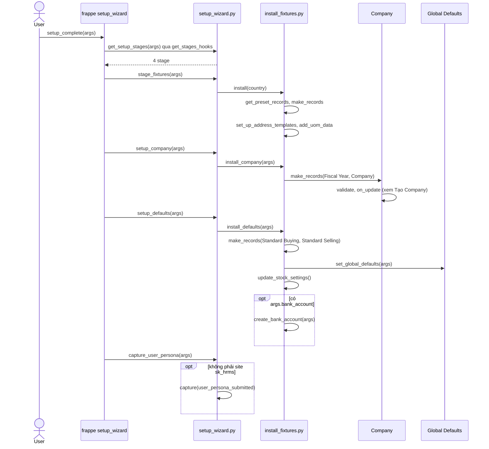

Nguồn: [setup_wizard.py:12](../../apps/erpnext/erpnext/setup/setup_wizard/setup_wizard.py#L12), [install_fixtures.py:463](../../apps/erpnext/erpnext/setup/setup_wizard/operations/install_fixtures.py#L463)

### Tạo Company

Lần lưu đầu của Company sinh chart of accounts, kho mặc định, cost center, tax template, phòng ban và gán các tài khoản mặc định; tất cả nằm trong `on_update`.

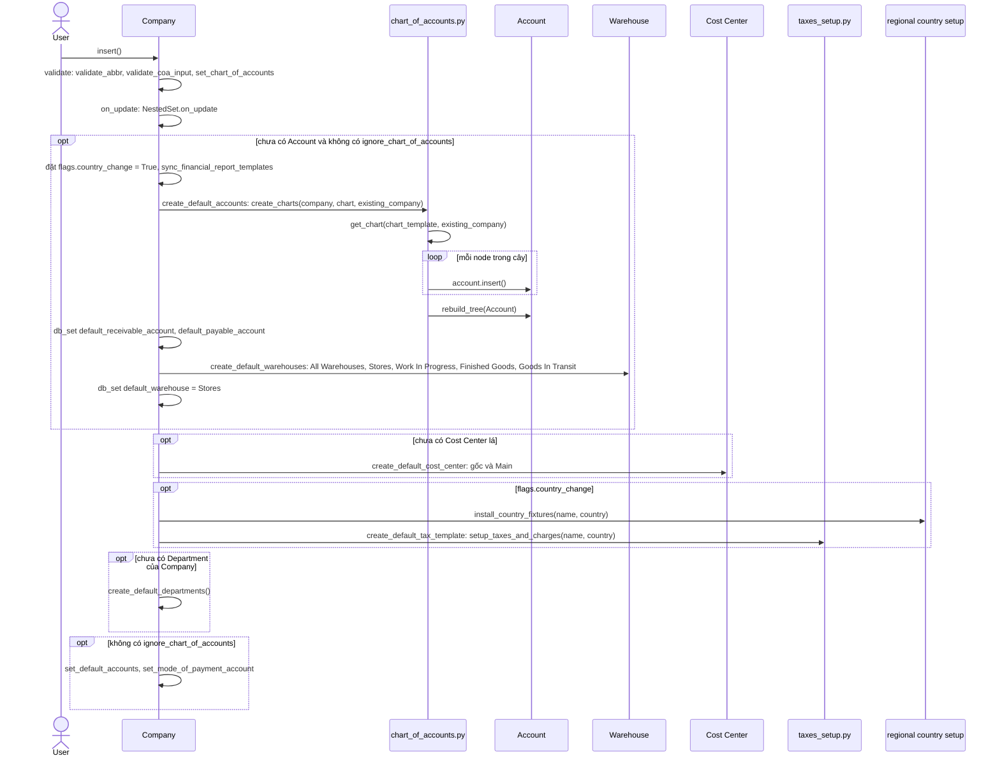

Nguồn: [company.py:455](../../apps/erpnext/erpnext/setup/doctype/company/company.py#L455), [chart_of_accounts.py:13](../../apps/erpnext/erpnext/accounts/doctype/account/chart_of_accounts/chart_of_accounts.py#L13)

### Yêu cầu xóa giao dịch của Company

Nút xóa trên form Company gọi hàm tạo Transaction Deletion Record, sinh danh sách doctype rồi submit ngay; submit khởi động chuỗi tác vụ nền.

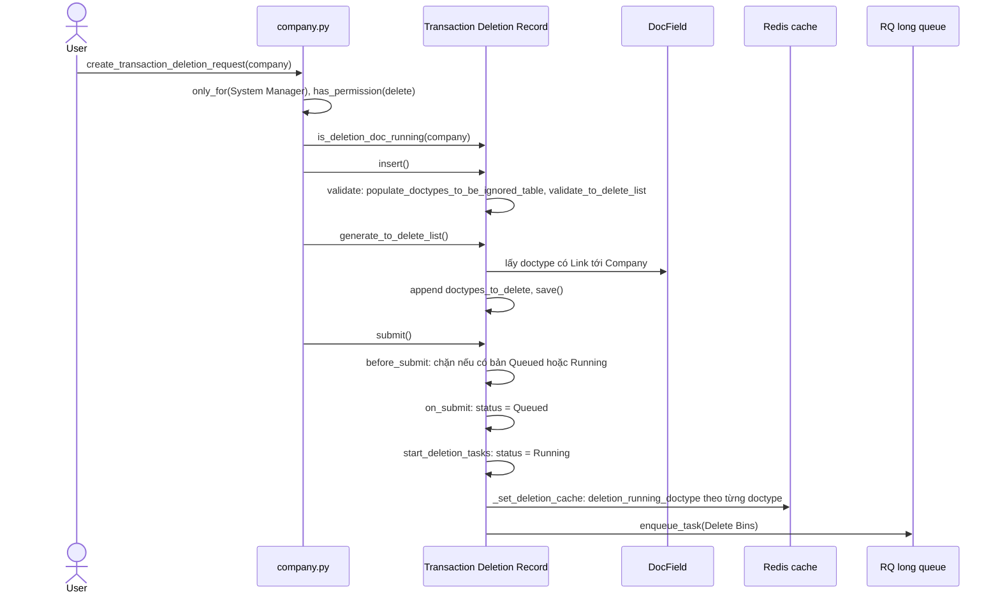

Nguồn: [company.py:1240](../../apps/erpnext/erpnext/setup/doctype/company/company.py#L1240), [transaction_deletion_record.py:662](../../apps/erpnext/erpnext/setup/doctype/transaction_deletion_record/transaction_deletion_record.py#L662)

### Chuỗi tác vụ xóa giao dịch

Mỗi tác vụ chạy trong một job riêng và tự enqueue tác vụ kế; bước cuối xóa theo lô 5000 bản ghi và tự enqueue lại đến khi hết doctype.

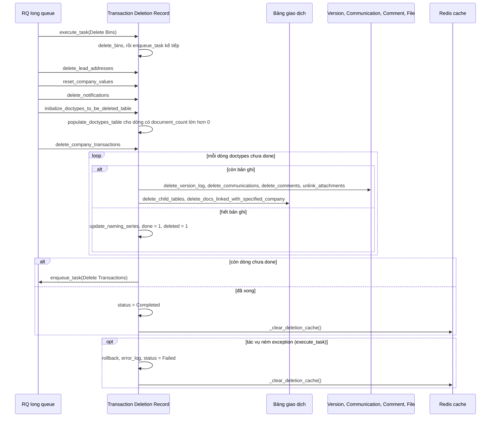

Nguồn: [transaction_deletion_record.py:612](../../apps/erpnext/erpnext/setup/doctype/transaction_deletion_record/transaction_deletion_record.py#L612), [transaction_deletion_record.py:788](../../apps/erpnext/erpnext/setup/doctype/transaction_deletion_record/transaction_deletion_record.py#L788)

### Chặn lưu chứng từ trong lúc xóa

Hook `doc_events["*"]["validate"]` chặn lưu mọi doctype đang có trong danh sách xóa, dựa trên cờ Redis (TTL 4 giờ).

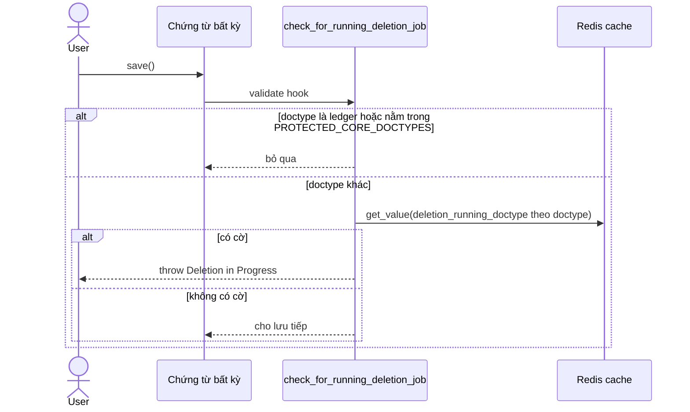

Nguồn: [transaction_deletion_record.py:1129](../../apps/erpnext/erpnext/setup/doctype/transaction_deletion_record/transaction_deletion_record.py#L1129)

### Xóa dữ liệu demo

Dùng Transaction Deletion Record ở chế độ `process_in_single_transaction` (không qua queue), sau đó xóa master demo và Company demo.

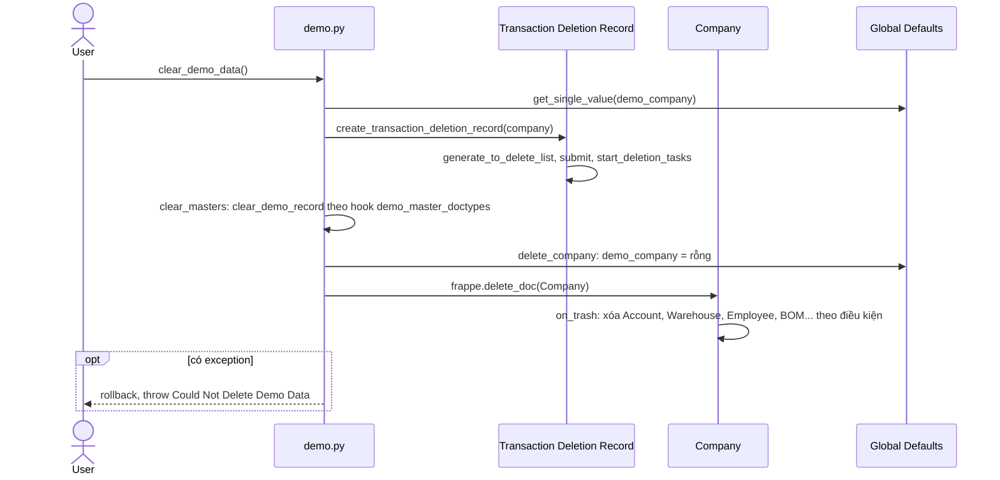

Nguồn: [demo.py:12](../../apps/erpnext/erpnext/setup/demo.py#L12), [company.py:898](../../apps/erpnext/erpnext/setup/doctype/company/company.py#L898)

### Cache doanh số Company

Job `daily_maintenance` ghi cache doanh số và lịch sử giao dịch lên Company để dashboard đọc.

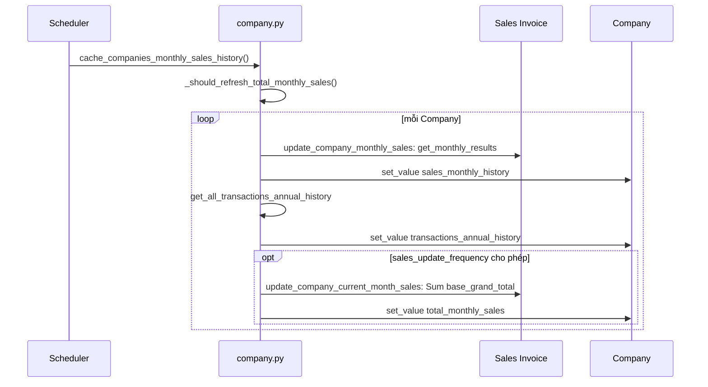

Nguồn: [company.py:1068](../../apps/erpnext/erpnext/setup/doctype/company/company.py#L1068)

### Lưu Employee

Khi lưu, Employee kiểm tra dữ liệu và đồng bộ sang User đã liên kết: vai trò Employee, thông tin cá nhân, User Permission, trạng thái enabled.

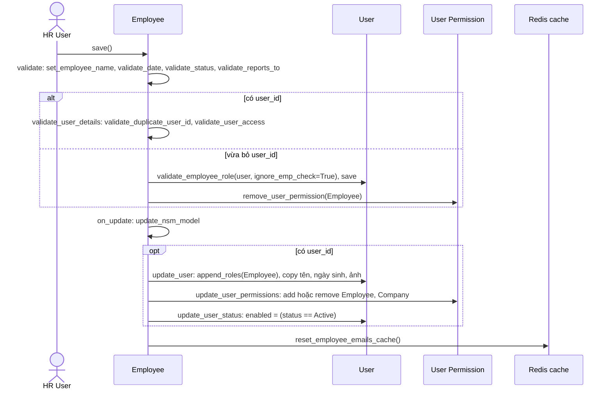

Nguồn: [employee.py:121](../../apps/erpnext/erpnext/setup/doctype/employee/employee.py#L121), [employee.py:196](../../apps/erpnext/erpnext/setup/doctype/employee/employee.py#L196)

### Tạo User từ Employee

Chạy tự động trong `after_insert` nếu bật `create_user_automatically`, hoặc gọi trực tiếp qua API `create_user`.

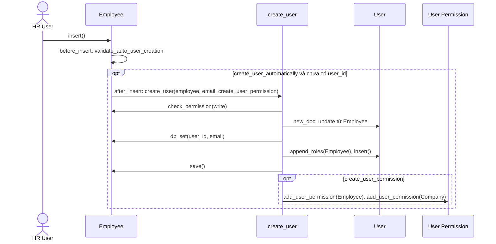

Nguồn: [employee.py:207](../../apps/erpnext/erpnext/setup/doctype/employee/employee.py#L207), [employee.py:485](../../apps/erpnext/erpnext/setup/doctype/employee/employee.py#L485)

### Gửi Email Digest

Job `daily_maintenance` duyệt các digest đang bật, chỉ gửi khi `get_next_sending()` trùng hôm nay: hằng ngày, thứ Hai đầu tuần hoặc ngày 1 đầu tháng theo `frequency`.

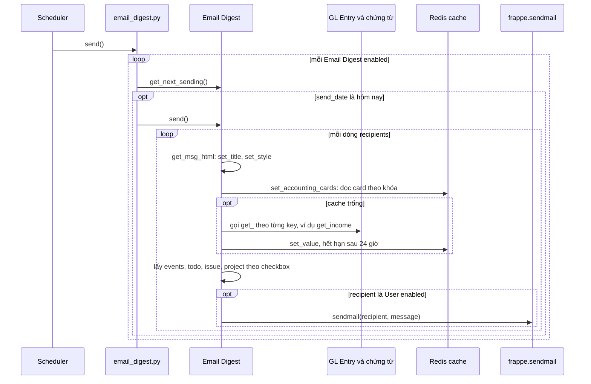

Nguồn: [email_digest.py:952](../../apps/erpnext/erpnext/setup/doctype/email_digest/email_digest.py#L952), [email_digest.py:124](../../apps/erpnext/erpnext/setup/doctype/email_digest/email_digest.py#L124)

### Kiểm tra thẩm quyền khi submit

Chứng từ gọi `Authorization Control` trong `on_submit`. Rule theo user được xét trước, rồi theo role, cuối cùng rule toàn cục; không đủ quyền thì throw và hủy submit. Ví dụ dưới đây là Sales Order.

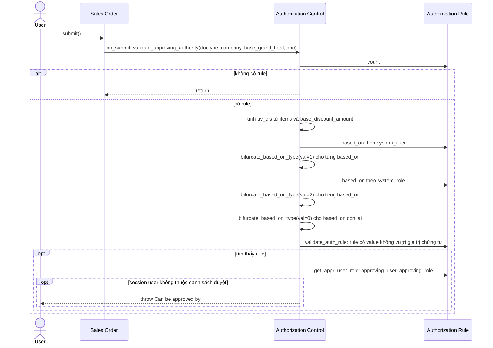

Nguồn: [authorization_control.py:158](../../apps/erpnext/erpnext/setup/doctype/authorization_control/authorization_control.py#L158), [sales_order.py:583](../../apps/erpnext/erpnext/selling/doctype/sales_order/sales_order.py#L583)

### Lưu và dùng Item Group

Item Group là cây NestedSet; `item_group_defaults` được `get_item_details` dùng làm mức dự phòng khi lấy giá trị mặc định cho Item trên chứng từ.

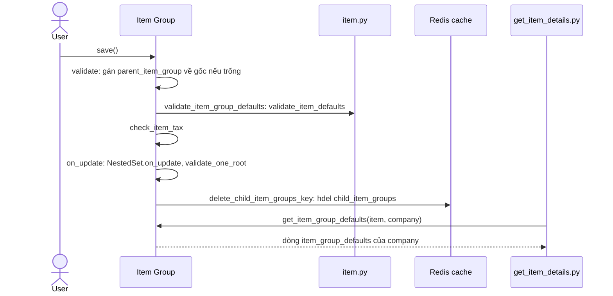

Nguồn: [item_group.py:33](../../apps/erpnext/erpnext/setup/doctype/item_group/item_group.py#L33), [item_group.py:89](../../apps/erpnext/erpnext/setup/doctype/item_group/item_group.py#L89)

## Giới hạn

- Không vẽ vì chỉ là danh mục hoặc validate đơn giản: `Brand`, `Branch`, `Designation`, `UOM`, `UOM Conversion Factor`, `Currency Exchange`, `Incoterm`, `Terms and Conditions`, `Vehicle`, `Driver`, `Driving License Category`, `Party Type`, `Quotation Lost Reason`, `Sales Partner`, `Target Detail`, `Website Item Group`.
- `Holiday List`, `Sales Person`, `Department`, `Customer Group`, `Supplier Group`, `Territory`, `Global Defaults` chỉ đọc lướt danh sách method; không có luồng riêng.
- `setup/utils.py` (`get_exchange_rate`, `welcome_email`) và `setup/install.py` (`after_install`, tạo role, custom field, navbar) không có sơ đồ: chỉ là chuỗi bước cài đặt tuần tự, không có rẽ nhánh nghiệp vụ.
- Import/export CSV danh sách xóa (`process_import_template`, `export_to_delete_template`) không vẽ. Nút Retry trên form Failed gọi lại `start_deletion_tasks`.
- `get_value_based_rule` của Authorization Control không có nơi gọi trong app này (đã grep trong `erpnext/`); trong Authorization Control, field `to_emp`, `to_designation` chỉ được hàm đó đọc.
- `setup_wizard/operations/company_setup.py` và `defaults_setup.py` không được file Python nào trong app import; có vẻ là code cũ. Sơ đồ wizard dùng `install_fixtures.py`.
- Chưa chắc: `clear_demo_data` gọi `start_deletion_tasks` lần hai sau `submit()` trong khi `on_submit` đã gọi rồi. Theo code, lần hai thấy các status không còn Pending nên không xóa thêm, nhưng status có thể giữ Running đến khi `on_trash` của Company xóa bản ghi. Chưa chạy thử.
- Chưa chắc: `EmailDigest.get_users` đọc `self.recipient_list`, field này không có trong JSON hiện tại.
- Bên trong `Warehouse.insert`, `Account.insert` và `sync_financial_report_templates` không đọc sâu.
