# Module Stock

Module `stock` quản lý danh mục hàng hóa, kho và mọi biến động tồn: nhập, xuất, chuyển kho, kiểm kê, serial và batch, tính giá trị tồn. Mọi chứng từ kho ghi xuống `Stock Ledger Entry` qua `stock_ledger.py`, và khi bật perpetual inventory thì ghi `GL Entry` qua `accounts/general_ledger.py`. Module nối với `buying` (Purchase Order), `selling` (Sales Order), `manufacturing` (Work Order, Job Card, BOM), `subcontracting`, `accounts` và `assets`.

## Phạm vi

Đọc được 78 doctype trong `stock/doctype/`: 45 doctype chính (không phải bảng con) và 33 bảng con. Nhiều logic đã tách khỏi file doctype sang `services/` và `mapper.py`.

| Nhóm chức năng | Doctype / file chính | Class diagram | Sequence diagram |
|---|---|---|---|
| Item và danh mục | `Item`, `Item Attribute`, `Item Price`, `Price List`, `Warehouse`, `Bin`, `controllers/item_variant.py` | Item và danh mục | Tạo Item và tồn đầu kỳ; Tạo Item variant |
| Purchase Receipt | `Purchase Receipt`, `Purchase Receipt Item`, `purchase_receipt/services/` | Purchase Receipt và Delivery Note | Submit Purchase Receipt |
| Delivery Note | `Delivery Note`, `Delivery Note Item`, `Packed Item`, `delivery_note/services/` | Purchase Receipt và Delivery Note | Submit Delivery Note |
| Stock Entry | `Stock Entry`, `Stock Entry Detail`, `Stock Entry Type`, `stock_entry/services/` | Stock Entry | Submit Stock Entry |
| Stock Reconciliation | `Stock Reconciliation`, `Stock Reconciliation Item` | Sổ kho và repost | Submit Stock Reconciliation |
| Sổ kho và repost | `stock_ledger.py`, `Stock Ledger Entry`, `Repost Item Valuation`, `Stock Reposting Settings`, `services/stock_ledger_service.py` | Sổ kho và repost | Ghi sổ make_sl_entries; Tính giá update_entries_after; Tạo và lập lịch repost; Chạy repost |
| Serial and Batch Bundle | `Serial and Batch Bundle`, `Serial and Batch Entry`, `Serial No`, `Batch`, `serial_batch_bundle.py` | Serial và Batch | Serial and Batch Bundle trong vòng đời chứng từ |
| Material Request | `Material Request`, `Material Request Item`, `material_request/mapper.py` | Material Request và Pick List | Material Request |
| Pick List | `Pick List`, `Pick List Item`, `pick_list/mapper.py` | Material Request và Pick List | Pick List phân bổ và submit; Pick List sang Delivery Note và Stock Entry |
| Packing Slip, Shipment | `Packing Slip`, `Shipment`, `delivery_note/mapper.py`, `delivery_note/services/packing.py` | Packing Slip và Shipment | Packing Slip và Shipment |
| Landed Cost Voucher | `Landed Cost Voucher` và 4 bảng con | Landed Cost Voucher | Submit Landed Cost Voucher |
| Quality Inspection | `Quality Inspection`, `Quality Inspection Template`, `services/quality_inspection_service.py` | Quality Inspection | Quality Inspection |
| Reorder tự động | `reorder_item.py`, `Item Reorder` | Item và danh mục | Reorder tự động |

## Class diagram

Hầu hết class là doctype. Các class không phải doctype (service trong `services/`, `update_entries_after`, `SerialBatchBundle`, `SerialBatchCreation`) được đưa vào vì chứa luồng chính. Sơ đồ chỉ vẽ Link tới doctype trong module; Link ra module khác (`Supplier`, `Customer`, `Sales Order`, `Work Order`...) chỉ ghi ở field.

### Controller nền

`SubcontractingInwardController` là mixin không kế thừa `Document`. `StockEntry` kế thừa đồng thời `StockController` và mixin này.

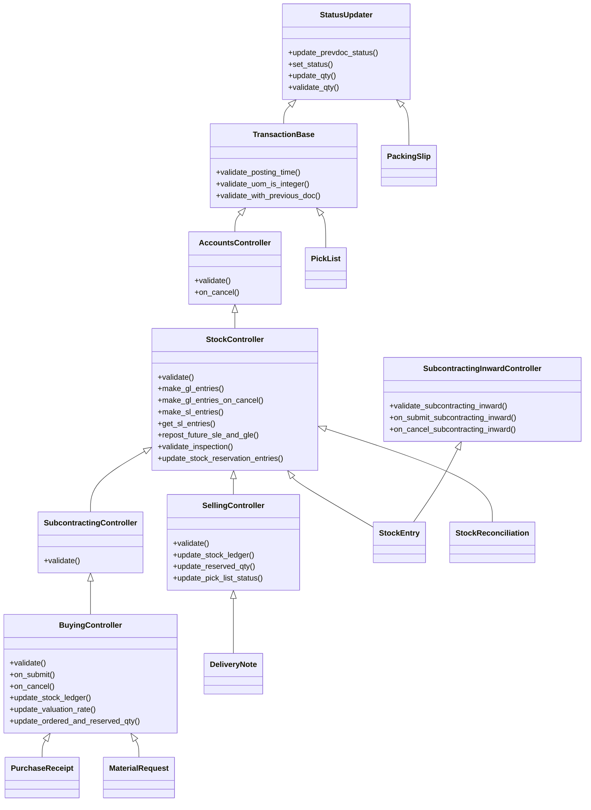

### Item và danh mục

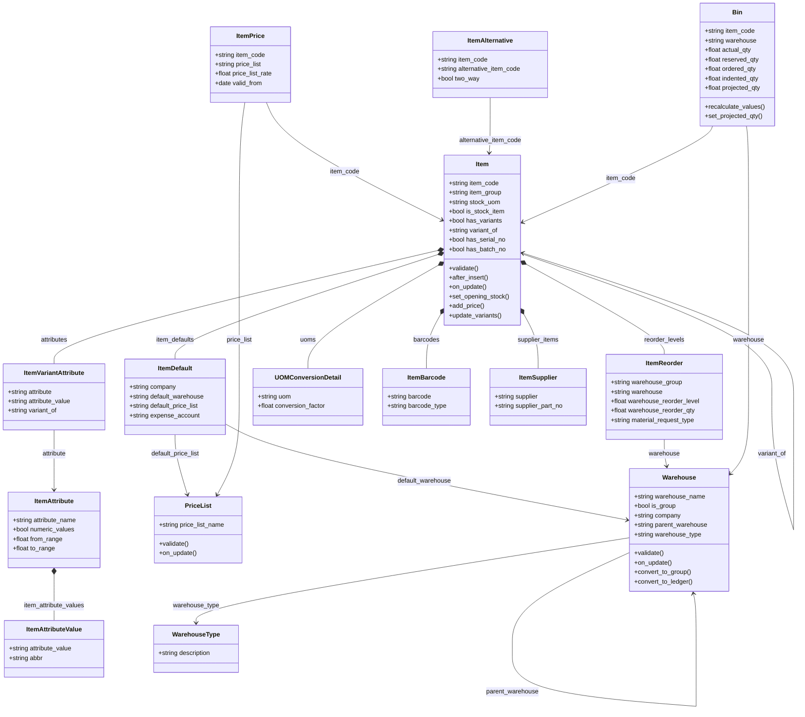

### Purchase Receipt và Delivery Note

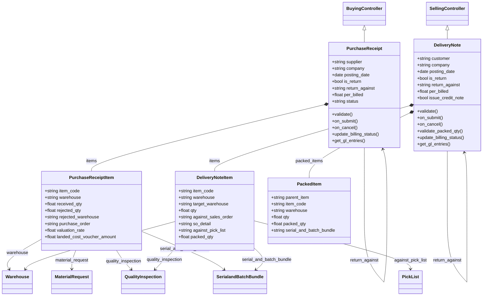

### Stock Entry

`StockEntry` giữ logic chung; logic theo `purpose` nằm ở class dịch vụ trong `stock_entry/services/`. `_configure_purpose_class()` chọn class qua `purpose_map` rồi lưu vào `purpose_cls`, nên quan hệ này không phải Link và không vẽ trong sơ đồ. Một số class con khác của `BaseStockEntry` được lược bớt, xem mục Giới hạn.

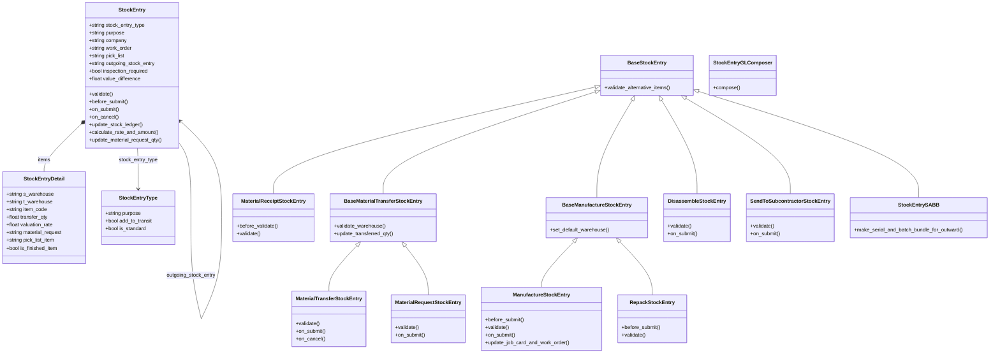

### Sổ kho và repost

```mermaid
classDiagram
    class StockController
    class StockReconciliation {
        +string purpose
        +string company
        +date posting_date
        +string expense_account
        +float difference_amount
        +submit()
        +cancel()
        +validate()
        +on_submit()
        +on_cancel()
        +update_stock_ledger()
    }
    class StockReconciliationItem {
        +string item_code
        +string warehouse
        +float qty
        +float valuation_rate
        +float current_qty
        +float amount_difference
        +string serial_and_batch_bundle
    }
    class StockLedgerEntry {
        +string item_code
        +string warehouse
        +string voucher_type
        +string voucher_no
        +float actual_qty
        +float qty_after_transaction
        +float stock_value_difference
        +bool is_cancelled
        +validate()
        +on_submit()
        +on_cancel()
    }
    class RepostItemValuation {
        +string based_on
        +string voucher_type
        +string voucher_no
        +string item_code
        +string warehouse
        +string status
        +int current_index
        +bool repost_only_accounting_ledgers
        +validate()
        +on_submit()
        +set_status()
        +restart_reposting()
        +deduplicate_similar_repost()
    }
    class StockRepostingSettings {
        +bool item_based_reposting
        +bool enable_parallel_reposting
        +int no_of_parallel_reposting
        +bool limit_reposting_timeslot
        +bool enable_separate_reposting_for_gl
    }
    class StockLedgerService {
        +get_sl_entries()
        +make_sl_entries()
        +repost_future_sle_and_gle()
    }
    class update_entries_after {
        +build()
        +repost_stock_ledgers()
        +process_sle()
        +validate_negative_stock()
        +update_bin()
    }
    class Item
    class Warehouse
    class SerialandBatchBundle
    StockController <|-- StockReconciliation
    StockReconciliation *-- StockReconciliationItem : items
    StockReconciliationItem --> Item : item_code
    StockReconciliationItem --> Warehouse : warehouse
    StockLedgerEntry --> Item : item_code
    StockLedgerEntry --> Warehouse : warehouse
    StockLedgerEntry --> SerialandBatchBundle : serial_and_batch_bundle
    RepostItemValuation --> Item : item_code
    RepostItemValuation --> Warehouse : warehouse
```

### Serial và Batch

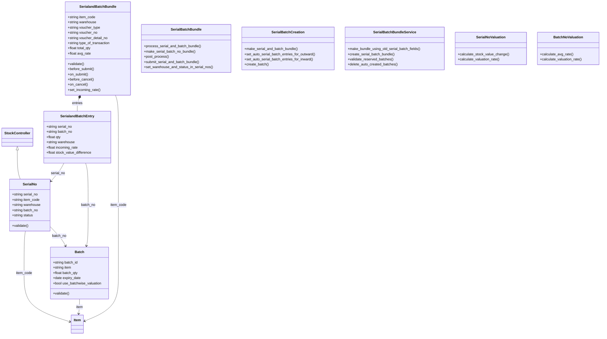

### Material Request và Pick List

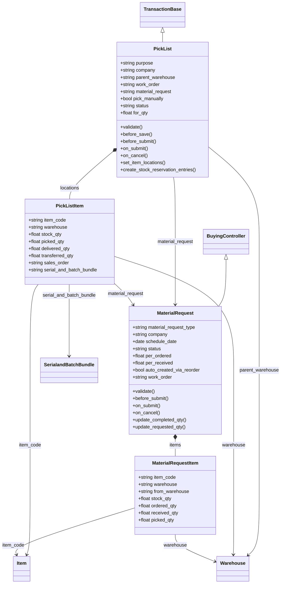

### Packing Slip và Shipment

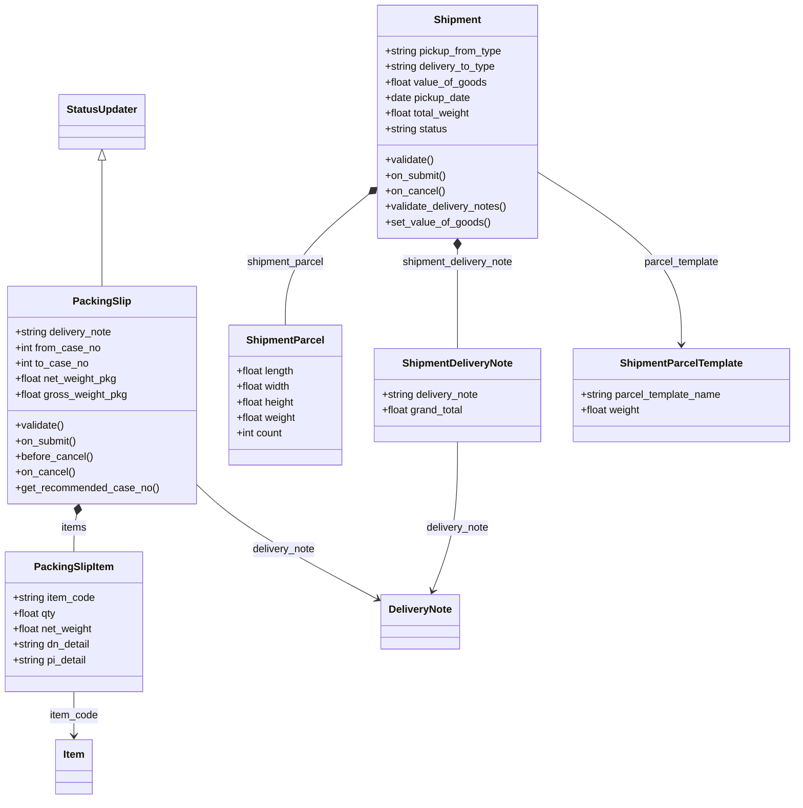

### Landed Cost Voucher

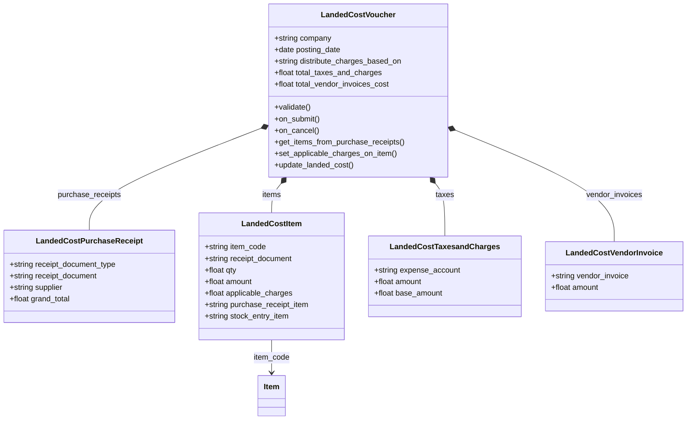

### Quality Inspection

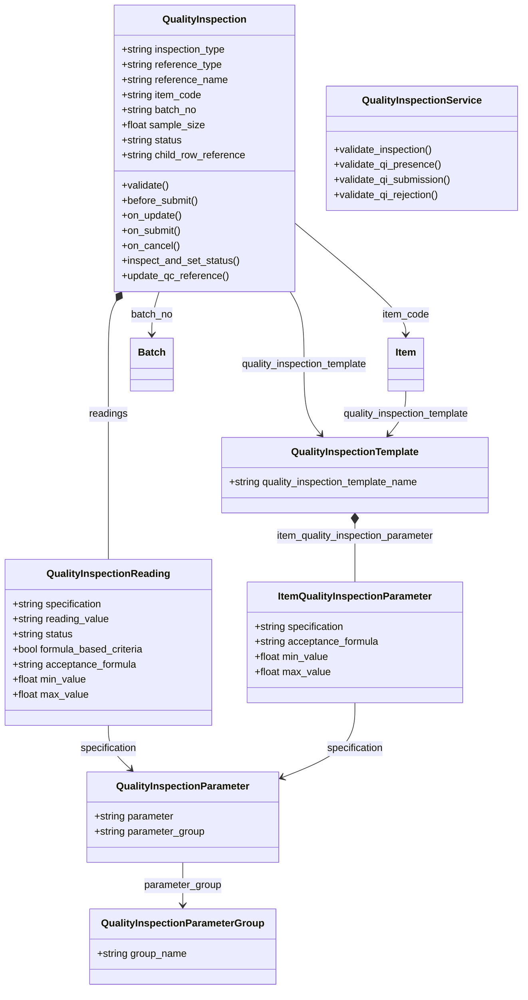

## Sequence diagram

Quy ước: `Stock Ledger Entry` và `GL Entry` là sổ cái. `make_gl_entries` chỉ tạo bút toán khi có hàng kho hoặc packed item và perpetual inventory bật, hoặc có provisional accounting, hoặc là phiếu nhận tài sản ([stock_controller.py:190](../../apps/erpnext/erpnext/controllers/stock_controller.py#L190)).

### Tạo Item và tồn đầu kỳ

Khi insert Item, hệ thống có thể tự tạo `Item Price` và `Stock Reconciliation` tồn đầu kỳ, chạy nền khi item serial có tồn đầu kỳ trên 10000.

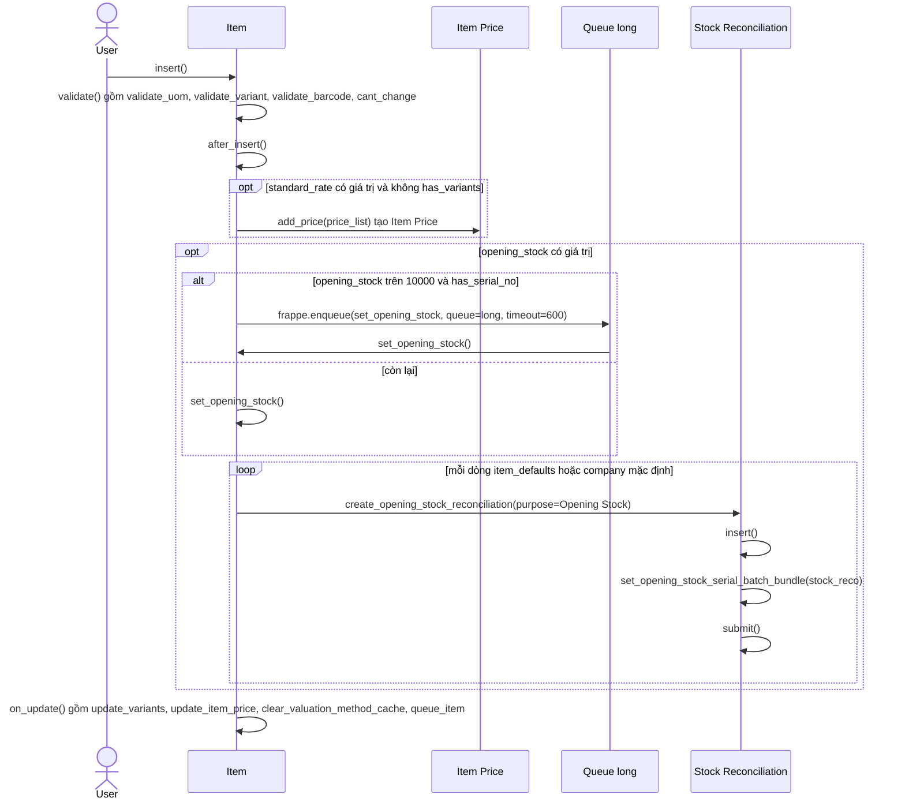

Nguồn: [item.py:187](../../apps/erpnext/erpnext/stock/doctype/item/item.py#L187)

### Tạo Item variant

Tạo nhiều variant từ template theo tổ hợp thuộc tính, đưa vào queue khi từ 10 tổ hợp trở lên. Khi sửa template, `update_variants` cũng rẽ nhánh nền nếu trên 30 variant.

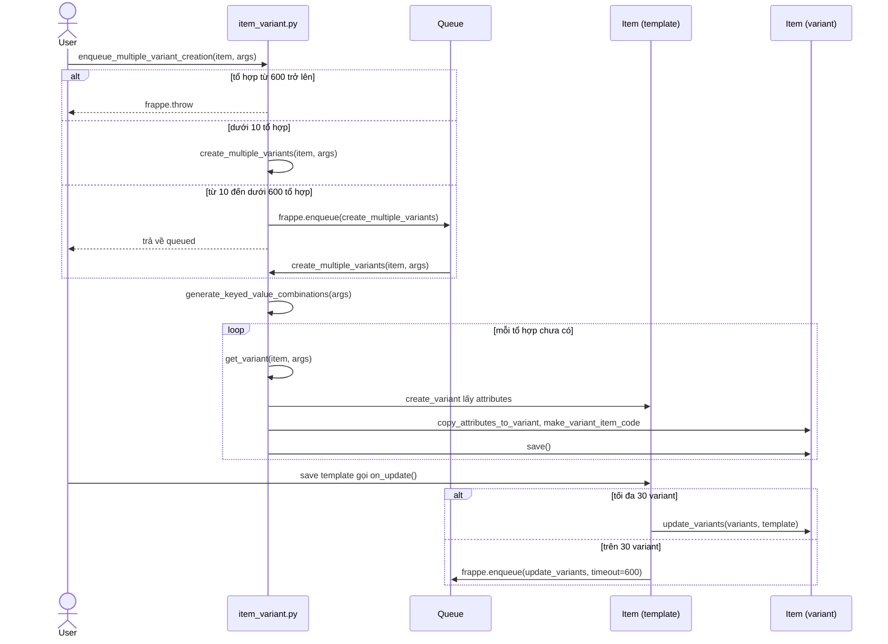

Nguồn: [item_variant.py:401](../../apps/erpnext/erpnext/controllers/item_variant.py#L401), [item.py:955](../../apps/erpnext/erpnext/stock/doctype/item/item.py#L955)

### Submit Purchase Receipt

Nhập hàng từ nhà cung cấp: cập nhật chứng từ nguồn, ghi sổ kho, ghi GL, rồi kiểm tra repost. Thứ tự prevdoc trước, sổ kho sau là bắt buộc theo comment trong code. Khi cancel, `on_cancel` đi lại các bước này với `docstatus` bằng 2.

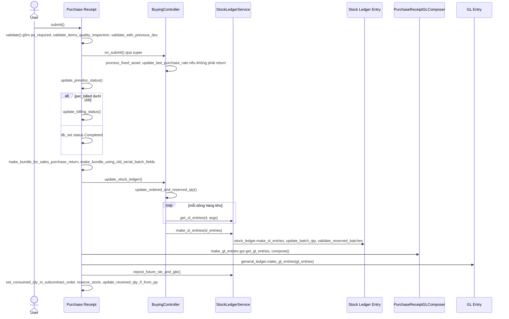

Nguồn: [purchase_receipt.py:373](../../apps/erpnext/erpnext/stock/doctype/purchase_receipt/purchase_receipt.py#L373), [buying_controller.py:1179](../../apps/erpnext/erpnext/controllers/buying_controller.py#L1179)

### Submit Delivery Note

Xuất hàng cho khách: kiểm tra packed qty, cập nhật Sales Order và Pick List, kiểm tra hạn mức tín dụng, rồi ghi sổ kho từ `items` và `packed_items`.

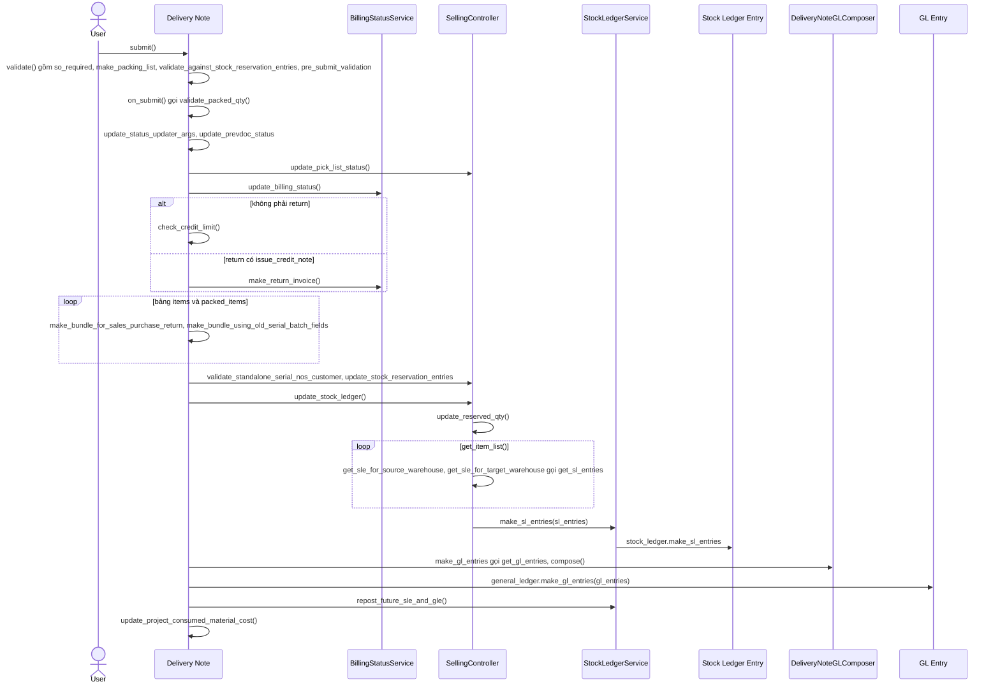

Nguồn: [delivery_note.py:542](../../apps/erpnext/erpnext/stock/doctype/delivery_note/delivery_note.py#L542), [selling_controller.py:773](../../apps/erpnext/erpnext/controllers/selling_controller.py#L773)

### Submit Stock Entry

Chứng từ chuyển động kho đa mục đích: `purpose_cls` xử lý phần riêng theo `purpose`, `StockEntry` xử lý ghi sổ theo hai chặng, nguồn trước rồi đích.

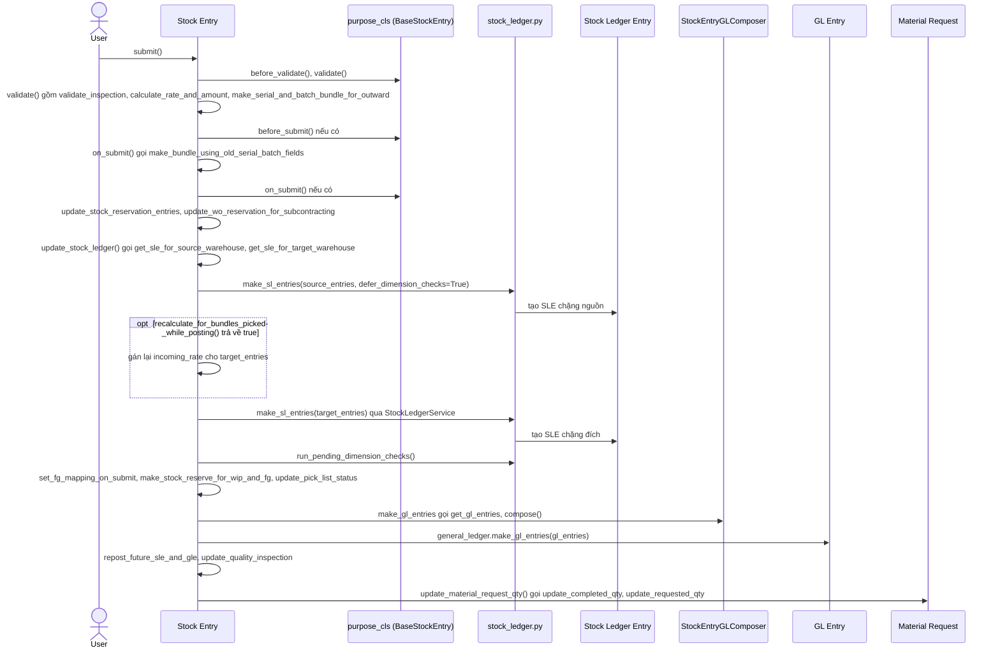

Nguồn: [stock_entry.py:415](../../apps/erpnext/erpnext/stock/doctype/stock_entry/stock_entry.py#L415), [stock_entry.py:1169](../../apps/erpnext/erpnext/stock/doctype/stock_entry/stock_entry.py#L1169)

### Submit Stock Reconciliation

Kiểm kê điều chỉnh tồn về số đếm. Lớp này ghi đè `submit` và `cancel`: trên 100 dòng thì chạy nền. Cancel dùng cùng cách với `queue_action("cancel", timeout=2000)`. Nếu job lỗi, `execute_action` rollback và thêm comment vào chứng từ.

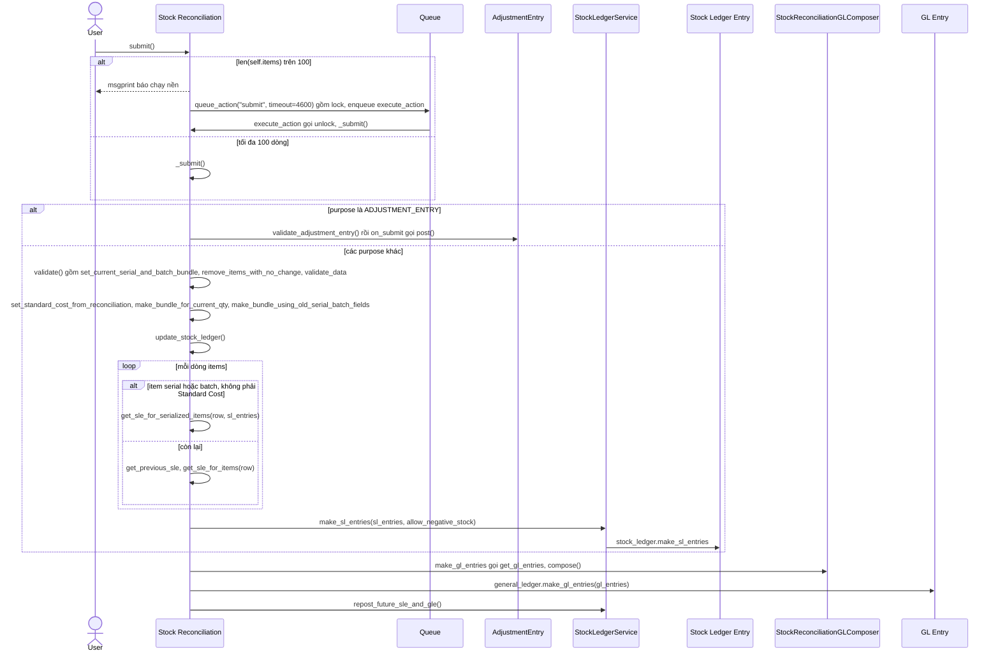

Nguồn: [stock_reconciliation.py:1535](../../apps/erpnext/erpnext/stock/doctype/stock_reconciliation/stock_reconciliation.py#L1535), [stock_reconciliation.py:152](../../apps/erpnext/erpnext/stock/doctype/stock_reconciliation/stock_reconciliation.py#L152)

### Ghi sổ make_sl_entries

Điểm ghi sổ kho chung của mọi chứng từ: kiểm tra chốt sổ, tạo từng SLE, tính giá cho chính chứng từ, dồn qty cho các SLE tương lai, rồi cập nhật `Bin`.

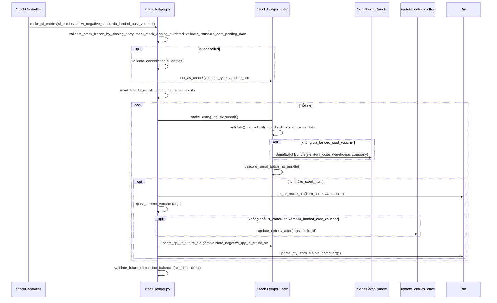

Nguồn: [stock_ledger.py:206](../../apps/erpnext/erpnext/stock/stock_ledger.py#L206)

### Tính giá update_entries_after

Class `update_entries_after` tính lại số dư và giá trị tồn. Có `sle_id` thì chỉ xử lý chứng từ hiện tại, không có thì quét các SLE tương lai để repost. Phương pháp giá được chọn theo từng SLE trong `process_sle`.

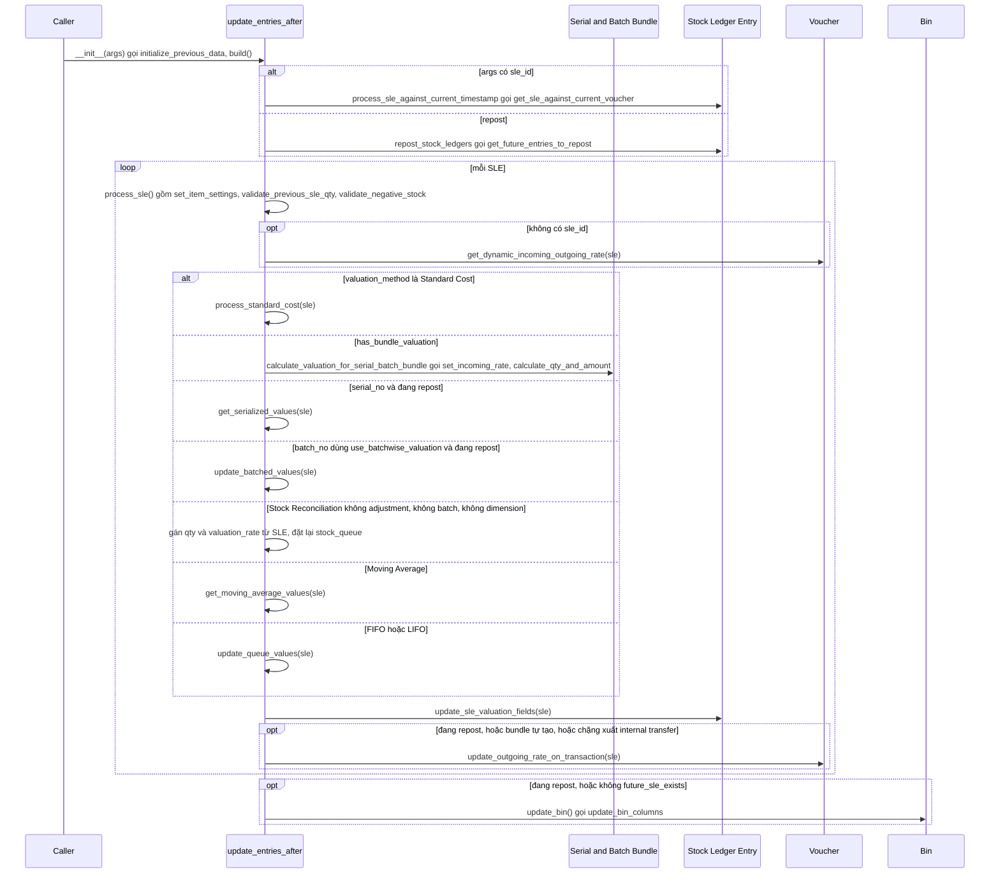

Nguồn: [stock_ledger.py:883](../../apps/erpnext/erpnext/stock/stock_ledger.py#L883), [stock_ledger.py:1242](../../apps/erpnext/erpnext/stock/stock_ledger.py#L1242)

### Tạo và lập lịch repost

Chứng từ chỉ tạo `Repost Item Valuation` khi cần (có SLE tương lai, FIFO trùng item-kho, hoặc cancel). Job theo lịch mới chạy thật: `repost_entries` nằm ở `hourly_maintenance`, `run_parallel_reposting` ở cron 15 phút, và chỉ một trong hai có tác dụng tùy `enable_parallel_reposting`.

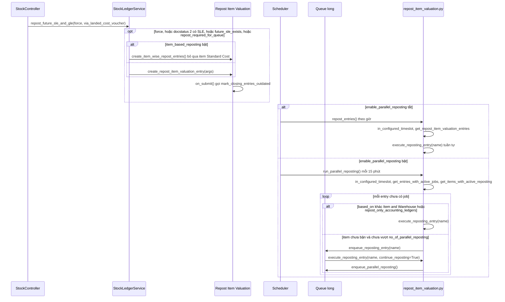

Nguồn: [stock_ledger_service.py:219](../../apps/erpnext/erpnext/stock/services/stock_ledger_service.py#L219), [repost_item_valuation.py:936](../../apps/erpnext/erpnext/stock/doctype/repost_item_valuation/repost_item_valuation.py#L936), [repost_item_valuation.py:1018](../../apps/erpnext/erpnext/stock/doctype/repost_item_valuation/repost_item_valuation.py#L1018)

### Chạy repost

Hàm `repost` tính lại SLE rồi GL cho các chứng từ bị ảnh hưởng, lưu tiến độ để chạy tiếp được. Lỗi có thể phục hồi (deadlock, timeout) giữ trạng thái `In Progress` để lần sau chạy lại, lỗi khác thành `Failed`.

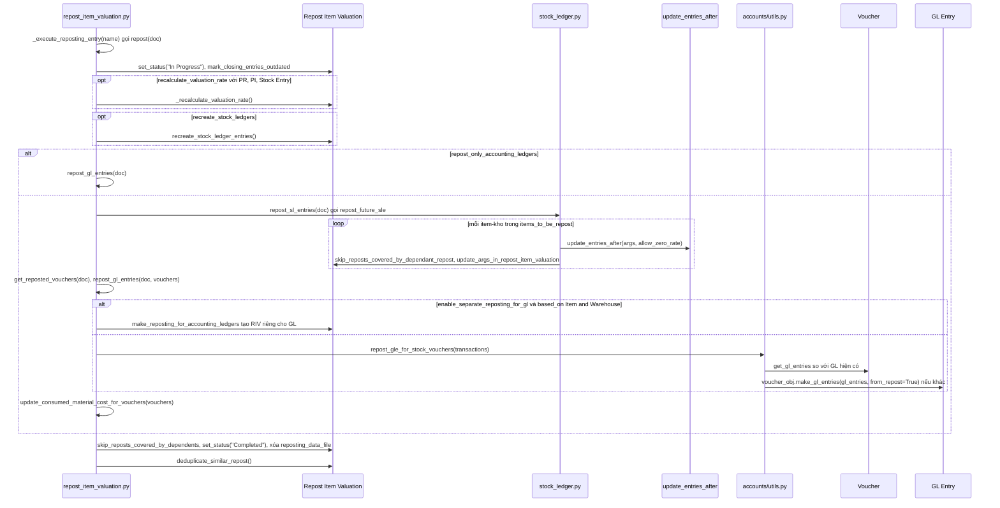

Nguồn: [repost_item_valuation.py:667](../../apps/erpnext/erpnext/stock/doctype/repost_item_valuation/repost_item_valuation.py#L667), [stock_ledger.py:406](../../apps/erpnext/erpnext/stock/stock_ledger.py#L406)

### Serial and Batch Bundle trong vòng đời chứng từ

Bundle tạo ở dạng draft từ field serial và batch kiểu cũ, hoặc do SLE tự tạo khi thiếu, rồi được submit trong lúc ghi SLE. Sau khi ghi sổ, `StockLedgerService` cập nhật `batch_qty`.

```mermaid
sequenceDiagram
    participant V as Voucher
    participant SVC as SerialBatchBundleService
    participant SBC as SerialBatchCreation
    participant SBB as Serial and Batch Bundle
    participant SLE as Stock Ledger Entry
    participant SB as SerialBatchBundle
    participant SN as Serial No
    V->>SVC: make_bundle_using_old_serial_batch_fields(table_name)
    loop dòng có use_serial_batch_fields và chưa có bundle
        SVC->>SBC: create_serial_batch_bundle gọi make_serial_and_batch_bundle(), do_not_submit
        SBC->>SBC: set_auto_serial_batch_entries_for_outward hoặc set_auto_serial_batch_entries_for_inward, set_serial_batch_entries
        SBC->>SBB: doc.save() chạy validate()
        SVC->>V: row.db_set(serial_and_batch_bundle)
    end
    V->>SLE: stock_ledger.make_entry() gọi sle.submit()
    SLE->>SB: on_submit() khởi tạo SerialBatchBundle(sle)
    SB->>SB: process_serial_and_batch_bundle() gọi process_serial_no hoặc process_batch_no
    opt SLE chưa có bundle và đủ điều kiện tự tạo
        SB->>SBC: make_serial_batch_no_bundle() gọi make_serial_and_batch_bundle()
        SBC->>SBB: doc.save(), doc.submit()
    end
    opt is_cancelled
        SB->>SB: delink_serial_and_batch_bundle()
    end
    SB->>SB: post_process()
    opt bundle còn docstatus 0
        SB->>SBB: submit_serial_and_batch_bundle() chạy before_submit, on_submit
    end
    opt item có has_serial_no
        SB->>SN: set_warehouse_and_status_in_serial_nos()
    end
    opt is_cancelled và SLE có bundle
        SB->>SBB: cancel_serial_and_batch_bundle() chạy before_cancel, on_cancel
    end
```

Nguồn: [serial_batch_bundle.py:82](../../apps/erpnext/erpnext/stock/serial_batch_bundle.py#L82), [serial_batch_bundle.py:1238](../../apps/erpnext/erpnext/stock/serial_batch_bundle.py#L1238), [serial_batch_bundle_service.py:214](../../apps/erpnext/erpnext/stock/services/serial_batch_bundle_service.py#L214)

### Material Request

Yêu cầu vật tư không ghi sổ kho, chỉ cập nhật `indented_qty` trong `Bin` rồi được map sang chứng từ đích theo `material_request_type`.

```mermaid
sequenceDiagram
    actor User
    participant MR as Material Request
    participant B as Bin
    participant M as material_request/mapper.py
    participant PO as Purchase Order
    participant SE as Stock Entry
    participant WO as Work Order
    User->>MR: submit()
    MR->>MR: validate(), before_submit() gồm set_status, validate_pending_qty_in_job_card, validate_pending_qty_in_work_order
    MR->>MR: on_submit() gọi update_requested_qty_in_production_plan
    MR->>B: update_requested_qty() gọi update_bin_qty(indented_qty)
    MR->>MR: update_requested_qty_in_work_order, update_requested_qty_in_job_card, update_prevdoc_status
    opt Purchase và có Budget áp dụng cho Material Request
        MR->>MR: validate_budget()
    end
    alt tạo mua hàng
        User->>M: make_purchase_order(source_name)
        M->>PO: get_mapped_doc
    else tạo xuất hoặc chuyển kho
        User->>M: make_stock_entry(source_name)
        M->>SE: get_mapped_doc, set_transfer_qty, calculate_rate_and_amount
        SE->>MR: on_submit gọi update_material_request_qty()
        MR->>MR: update_completed_qty(mr_item_rows)
        MR->>B: update_requested_qty(mr_item_rows)
    else tạo sản xuất
        User->>MR: raise_work_orders(material_request, company)
        MR->>WO: frappe.new_doc("Work Order") cho từng dòng còn pending_qty
    end
```

Nguồn: [material_request.py:351](../../apps/erpnext/erpnext/stock/doctype/material_request/material_request.py#L351), [mapper.py:369](../../apps/erpnext/erpnext/stock/doctype/material_request/mapper.py#L369), [material_request.py:710](../../apps/erpnext/erpnext/stock/doctype/material_request/material_request.py#L710)

### Pick List phân bổ và submit

Pick List chọn vị trí lấy hàng khi lưu (`before_save`, trừ khi `pick_manually`), kiểm tra tồn lúc validate, rồi cập nhật số lượng đã nhặt ở chứng từ nguồn lúc submit. Bản thân Pick List không ghi sổ kho.

```mermaid
sequenceDiagram
    actor User
    participant PL as Pick List
    participant A as get_available_item_locations
    participant SBC as SerialBatchCreation
    participant SO as Sales Order
    participant WO as Work Order
    User->>PL: save()
    PL->>PL: validate() gồm set_stock_qty, validate_stock_qty, check_serial_no_status
    PL->>PL: before_save() gọi update_status
    opt không pick_manually
        PL->>PL: set_item_locations() gọi aggregate_item_qty, get_picked_items_details
        loop mỗi item
            PL->>A: get_available_item_locations(item_code, from_warehouses, required_qty, company)
            A->>A: chọn hàm theo has_serial_no và has_batch_no
            A->>A: remove_stock_reserved_for_others hoặc remove_serial_nos_reserved_for_others
            A-->>PL: locations
            PL->>PL: get_items_with_location_and_quantity()
        end
    end
    PL->>PL: validate_sales_order_percentage, validate_warehouses
    User->>PL: submit()
    PL->>PL: before_submit() gồm validate_sales_order, validate_picked_items, validate_pending_qty_in_work_order
    PL->>PL: on_submit() gọi validate_serial_and_batch_bundle
    PL->>SBC: make_bundle_using_old_serial_batch_fields() gọi make_serial_and_batch_bundle
    PL->>PL: update_status, update_bundle_picked_qty
    PL->>SO: update_reference_qty, update_sales_order_picking_status
    PL->>WO: update_picked_qty_in_work_order() qua RequiredItemsService
    PL->>PL: update_prevdoc_status()
```

Nguồn: [pick_list.py:723](../../apps/erpnext/erpnext/stock/doctype/pick_list/pick_list.py#L723), [pick_list.py:407](../../apps/erpnext/erpnext/stock/doctype/pick_list/pick_list.py#L407)

### Pick List sang Delivery Note và Stock Entry

Từ Pick List đã submit, mapper tạo Delivery Note (lưu draft, mỗi nhóm header Sales Order một phiếu) hoặc trả về dict Stock Entry. Khi chứng từ đích submit, trạng thái Pick List được cập nhật lại.

```mermaid
sequenceDiagram
    actor User
    participant M as pick_list/mapper.py
    participant PL as Pick List
    participant DN as Delivery Note
    participant SE as Stock Entry
    alt giao hàng
        User->>M: create_delivery_note(source_name)
        M->>M: create_delivery() gọi validate_item_locations, get_sales_order_headers
        opt có location gắn Sales Order
            M->>DN: create_delivery_with_so gọi create_delivery_from_so, map_pl_locations
            M->>DN: document.save()
        end
        opt có location không gắn Sales Order
            M->>DN: create_delivery_wo_so gọi map_pl_locations, target_doc.save()
        end
        User->>DN: submit()
        DN->>PL: update_prevdoc_status() cập nhật Pick List Item delivered_qty
        DN->>PL: update_pick_list_status() cho từng against_pick_list
    else chuyển kho hoặc sản xuất
        User->>M: create_stock_entry(pick_list)
        alt Material Request có job_card
            M->>SE: update_stock_entry_based_on_job_card
        else có work_order
            M->>SE: update_stock_entry_based_on_work_order
        else có material_request
            M->>SE: update_stock_entry_based_on_material_request
        else không có tham chiếu
            M->>SE: update_stock_entry_items_with_no_reference
        end
        M->>SE: set_stock_entry_type, set_missing_values, as_dict
        M-->>User: dict Stock Entry
        User->>SE: submit()
        SE->>PL: update_pick_list_status() gọi update_qty
    end
    PL->>PL: update_bundle_delivered_qty, run_method("update_status"), update_picked_qty_in_work_order
```

Nguồn: [mapper.py:32](../../apps/erpnext/erpnext/stock/doctype/pick_list/mapper.py#L32), [mapper.py:374](../../apps/erpnext/erpnext/stock/doctype/pick_list/mapper.py#L374), [pick_list.py:1221](../../apps/erpnext/erpnext/stock/doctype/pick_list/pick_list.py#L1221)

### Packing Slip và Shipment

Packing Slip chỉ tạo được khi Delivery Note còn draft và ghi `packed_qty` về dòng DN. Shipment nhận DN đã submit, tổng hợp giá trị và trọng lượng, không gọi nhà vận chuyển trong code doctype này. Cả hai không ghi sổ kho.

```mermaid
sequenceDiagram
    actor User
    participant M as delivery_note/mapper.py
    participant PS as Packing Slip
    participant DN as Delivery Note
    participant PKS as PackingService
    participant SH as Shipment
    User->>M: make_packing_slip(source_name)
    M->>PS: get_mapped_doc, set_missing_values
    User->>PS: submit()
    PS->>PS: validate() gồm validate_delivery_note, validate_case_nos, validate_items, calculate_net_total_pkg
    PS->>DN: on_submit() gọi update_prevdoc_status, ghi packed_qty
    User->>DN: submit()
    DN->>PKS: validate_packed_qty()
    opt cancel Delivery Note
        DN->>PKS: cancel_packing_slips()
        PKS->>PS: flags.cancelled_by_delivery_note, ps.cancel()
        PS->>DN: on_cancel() gọi update_prevdoc_status
    end
    User->>M: make_shipment(source_name)
    M->>SH: get_mapped_doc, postprocess thêm shipment_delivery_note
    User->>SH: submit()
    SH->>SH: validate_weight, validate_pickup_time, validate_parties
    loop mỗi shipment_delivery_note
        SH->>DN: validate_delivery_note_row() yêu cầu docstatus 1, get_other_shipment
    end
    SH->>SH: set_value_of_goods, set_total_weight
    SH->>SH: on_submit() kiểm tra shipment_parcel, value_of_goods, db_set status Submitted
```

Nguồn: [mapper.py:301](../../apps/erpnext/erpnext/stock/doctype/delivery_note/mapper.py#L301), [packing_slip.py:72](../../apps/erpnext/erpnext/stock/doctype/packing_slip/packing_slip.py#L72), [mapper.py:359](../../apps/erpnext/erpnext/stock/doctype/delivery_note/mapper.py#L359), [shipment.py:76](../../apps/erpnext/erpnext/stock/doctype/shipment/shipment.py#L76)

### Submit Landed Cost Voucher

Phân bổ chi phí mua thêm vào giá trị tồn của chứng từ nhập đã submit. Với mỗi chứng từ nhập, hệ thống đổi tạm `docstatus` thành 2 để đảo sổ rồi về 1 để ghi lại với `via_landed_cost_voucher=True`. `on_cancel` gọi cùng `update_landed_cost`.

```mermaid
sequenceDiagram
    actor User
    participant LCV as Landed Cost Voucher
    participant RD as Receipt Document
    participant SLE as Stock Ledger Entry
    participant GL as GL Entry
    participant RIV as Repost Item Valuation
    User->>LCV: submit()
    LCV->>LCV: validate() gồm validate_receipt_documents, set_applicable_charges_on_item, validate_vendor_invoice_claims
    LCV->>LCV: on_submit() gọi validate_applicable_charges_for_item, update_landed_cost
    loop mỗi purchase_receipts, tính lại giá
        LCV->>RD: validate_asset_qty_and_status, set_landed_cost_voucher_amount(doc)
        alt Subcontracting Receipt
            LCV->>RD: calculate_items_qty_and_amount()
        else
            LCV->>RD: update_valuation_rate(reset_outgoing_rate=False)
        end
        LCV->>RD: item.db_update()
        opt không phải Stock Entry hoặc Subcontracting Receipt
            LCV->>RD: update_rate_in_serial_no_for_non_asset_items(doc)
        end
    end
    loop mỗi purchase_receipts, ghi lại sổ
        LCV->>RD: docstatus=2, update_stock_ledger(allow_negative_stock=True, via_landed_cost_voucher=True)
        RD->>SLE: make_sl_entries đảo SLE
        LCV->>GL: make_gl_entries_on_cancel(from_repost=True)
        LCV->>RD: docstatus=1, make_bundle_using_old_serial_batch_fields, update_stock_ledger
        RD->>SLE: make_sl_entries tạo SLE mới
        LCV->>GL: make_gl_entries()
        LCV->>RIV: repost_future_sle_and_gle(via_landed_cost_voucher=True)
    end
    LCV->>LCV: update_claimed_landed_cost, update_project_purchase_cost
```

Nguồn: [landed_cost_voucher.py:464](../../apps/erpnext/erpnext/stock/doctype/landed_cost_voucher/landed_cost_voucher.py#L464), [landed_cost_voucher.py:513](../../apps/erpnext/erpnext/stock/doctype/landed_cost_voucher/landed_cost_voucher.py#L513)

### Quality Inspection

Phiếu kiểm tra gắn với dòng chứng từ qua `update_qc_reference`. Thời điểm gắn phụ thuộc `action_if_quality_inspection_is_not_submitted`. Khi chứng từ submit, `QualityInspectionService` chặn hoặc cảnh báo theo Stock Settings. Cài đặt `allow_to_make_quality_inspection_after_purchase_or_delivery` không áp dụng cho Stock Entry.

```mermaid
sequenceDiagram
    actor User
    participant SC as stock_controller.py
    participant QI as Quality Inspection
    participant R as Dòng chứng từ
    participant V as Voucher
    participant QS as QualityInspectionService
    User->>SC: make_quality_inspections(company, doctype, docname, items, inspection_type)
    SC->>QI: frappe.get_doc, save()
    QI->>QI: validate() gồm get_item_specification_details, inspect_and_set_status, validate_inspection_required, set_child_row_reference
    opt action rỗng hoặc Warn
        QI->>R: on_update() gọi update_qc_reference()
    end
    User->>QI: submit()
    QI->>QI: before_submit() gồm validate_sample_size, validate_readings_status_mandatory
    opt action là Stop
        QI->>R: on_submit() gọi update_qc_reference()
    end
    User->>V: submit chứng từ
    V->>QS: validate_inspection()
    loop mỗi dòng items
        QS->>QS: validate_qi_reference(doc, row)
        opt dòng cần kiểm tra và không bật allow_to_make_quality_inspection_after_purchase_or_delivery
            QS->>QS: validate_qi_presence(row)
            opt docstatus là 1
                QS->>QI: validate_qi_submission, validate_qi_rejection
            end
        end
    end
    opt cancel Quality Inspection
        User->>QI: cancel()
        QI->>QI: before_cancel() gọi validate_not_used_by_submitted_document
        QI->>R: on_cancel() gọi update_qc_reference(), db_set status Cancelled
    end
```

Nguồn: [stock_controller.py:753](../../apps/erpnext/erpnext/controllers/stock_controller.py#L753), [quality_inspection.py:76](../../apps/erpnext/erpnext/stock/doctype/quality_inspection/quality_inspection.py#L76), [quality_inspection_service.py:84](../../apps/erpnext/erpnext/stock/services/quality_inspection_service.py#L84)

### Reorder tự động

Job hằng ngày (`daily_maintenance`) tạo Material Request khi `projected_qty` tại kho hoặc nhóm kho không vượt mức reorder. Chạy khi Stock Settings bật `auto_indent`. Mỗi cặp loại yêu cầu và company tạo một Material Request, lỗi được rollback theo savepoint.

```mermaid
sequenceDiagram
    participant S as Scheduler
    participant RI as reorder_item.py
    participant IR as Item Reorder
    participant B as Bin
    participant MR as Material Request
    participant E as Email
    S->>RI: reorder_item()
    opt có Company, Fiscal Year và auto_indent bật
        RI->>RI: _reorder_item()
        RI->>IR: get_items_for_reorder() gọi get_reorder_levels_for_variants
        RI->>B: get_item_warehouse_projected_qty(items_to_consider)
        loop mỗi item và mức reorder, bỏ qua has_variants
            RI->>RI: add_to_material_request() nếu projected_qty không vượt reorder_level
        end
        RI->>RI: create_material_request(material_requests)
        loop mỗi request_type và company
            RI->>MR: frappe.new_doc, auto_created_via_reorder=1, append items
            alt thành công
                RI->>MR: insert(), submit()
            else có exception
                RI->>RI: rollback(save_point=reorder_mr), frappe.log_error
            end
        end
        opt có MR và reorder_email_notify bật
            RI->>E: send_email_notification(company_wise_mr)
        end
        opt có exceptions_list
            RI->>E: notify_errors(exceptions_list)
        end
    end
```

Nguồn: [reorder_item.py:15](../../apps/erpnext/erpnext/stock/reorder_item.py#L15), [reorder_item.py:213](../../apps/erpnext/erpnext/stock/reorder_item.py#L213)

## Giới hạn

- Doctype chỉ có danh mục, cấu hình hoặc CRUD, không vẽ sequence: `Item Alternative`, `Item Attribute`, `Item Price`, `Price List`, `Manufacturer`, `Item Manufacturer`, `Customs Tariff Number`, `UOM Category`, `Warehouse Type`, `Stock Settings`, `Delivery Settings`, `Item Variant Settings`, `Shipment Parcel Template`, `Quick Stock Balance`, `Item Lead Time`.
- Doctype có luồng nghiệp vụ thật nhưng ngoài nhóm được yêu cầu và không đọc đủ thân hàm nên không vẽ: `Stock Reservation Entry`, `Stock Closing Entry`, `Stock Closing Balance`, `Delivery Trip`, `Item Standard Cost`, `Putaway Rule`, `Inventory Dimension`, `Company Restriction`. Trong sơ đồ chúng chỉ xuất hiện dưới dạng tên hàm gọi tới.
- Stock Entry: chỉ đọc kỹ `stock_entry.py`, `material_transfer.py` phần submit và `gl_composer.py` phần `compose`. `manufacturing.py`, `disassemble.py`, `subcontracting.py`, `batch_split.py` chỉ đọc lướt nên không vẽ luồng riêng theo `purpose`. Class diagram lược `SourceOnlyStockEntry`, `MaterialIssueStockEntry`, `MaterialTransferForManufactureStockEntry`, `MaterialConsumptionForManufactureStockEntry`.
- GL composer: chỉ đọc khung `BaseStockGLComposer.compose` và `StockEntryGLComposer.compose`, không vẽ từng bút toán. `PurchaseReceiptGLComposer`, `DeliveryNoteGLComposer`, `StockReconciliationGLComposer` chỉ xác nhận điểm gọi.
- Sequence gộp nhiều lời gọi trên một nhãn để giữ giới hạn số bước; thứ tự trong nhãn theo thân hàm nhưng không liệt kê đủ các lệnh `validate_*`. Chuỗi `validate` kế thừa của `BuyingController` và `SellingController` không vẽ chi tiết.
- Submit Stock Entry: bước `before_validate()` của `purpose_cls` chạy trong `StockEntry.before_validate` khi class có method này; `validate()` chạy đầu `StockEntry.validate`. Vẽ gộp một bước.
- Submit Stock Reconciliation: nhánh `AdjustmentEntry` (`valuation_adjustment.py`) chỉ xác nhận điểm gọi, không đọc thân `post()`. Nhánh này `validate` theo `validate_adjustment_entry` và trả về sớm.
- Frappe chạy `on_update` trước `on_submit` khi submit (`Document.run_post_save_methods`). Các sơ đồ submit chỉ vẽ `on_update` ở Quality Inspection, nơi nó ảnh hưởng tới kết quả.
- Code này khác bản ERPNext công khai ở nhiều chỗ (service, mapper). Tài liệu chỉ phản ánh commit `a7971f4b1e`.
