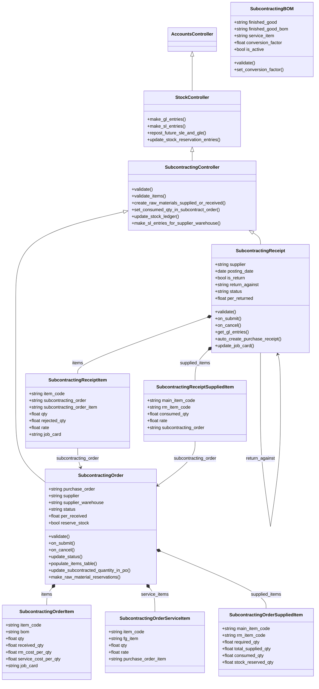
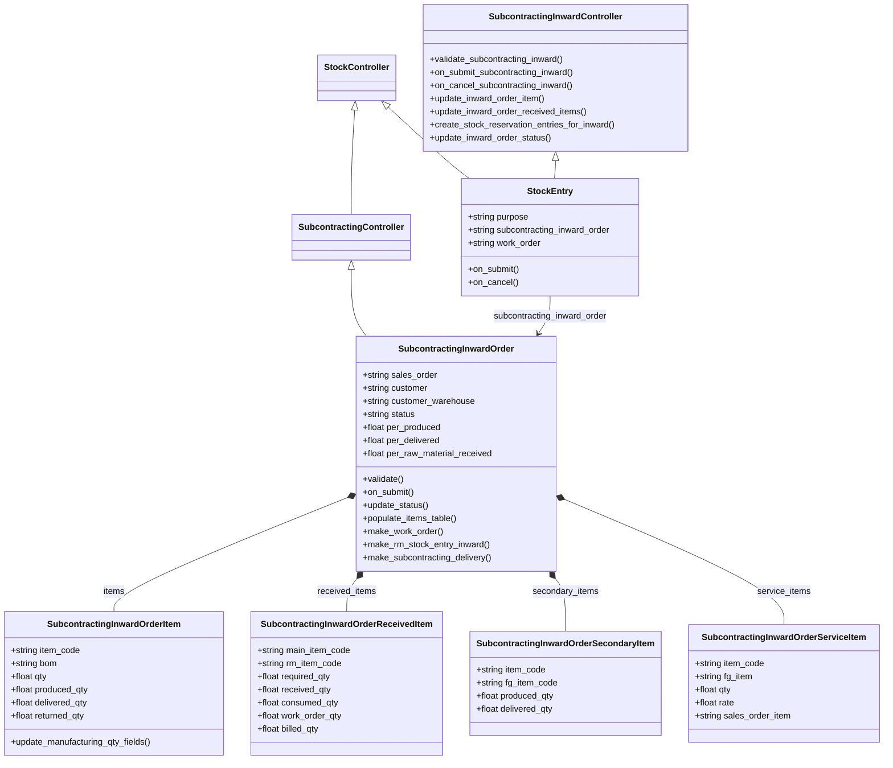
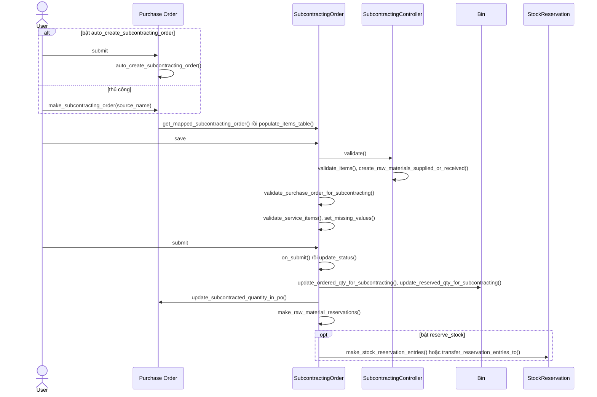
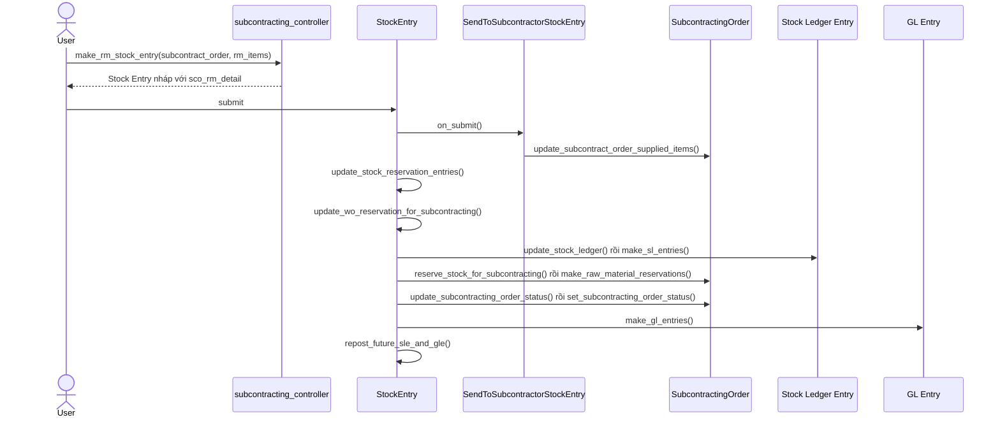
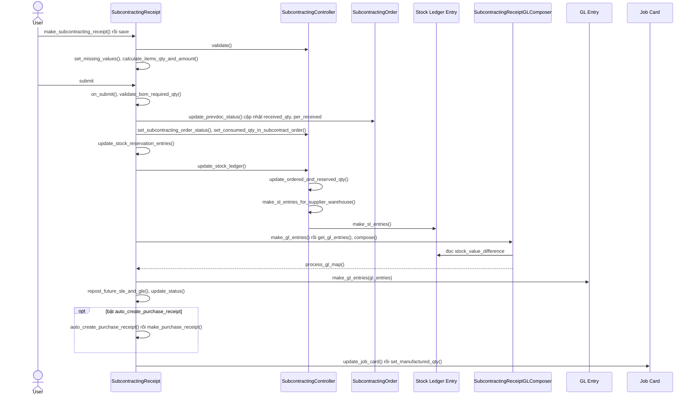
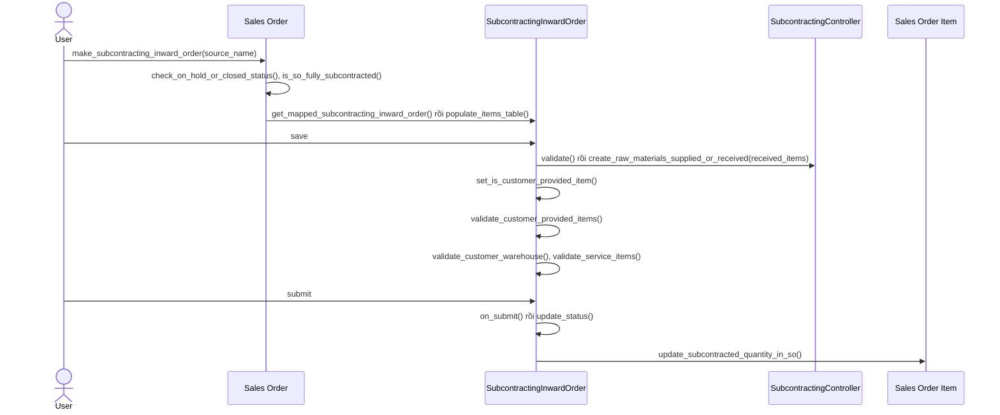
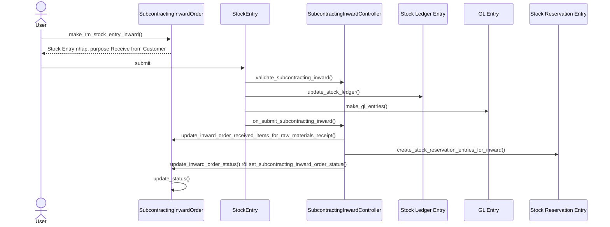
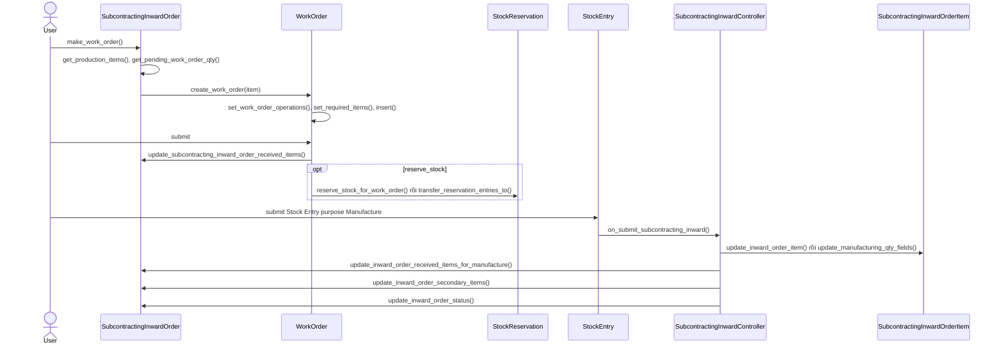
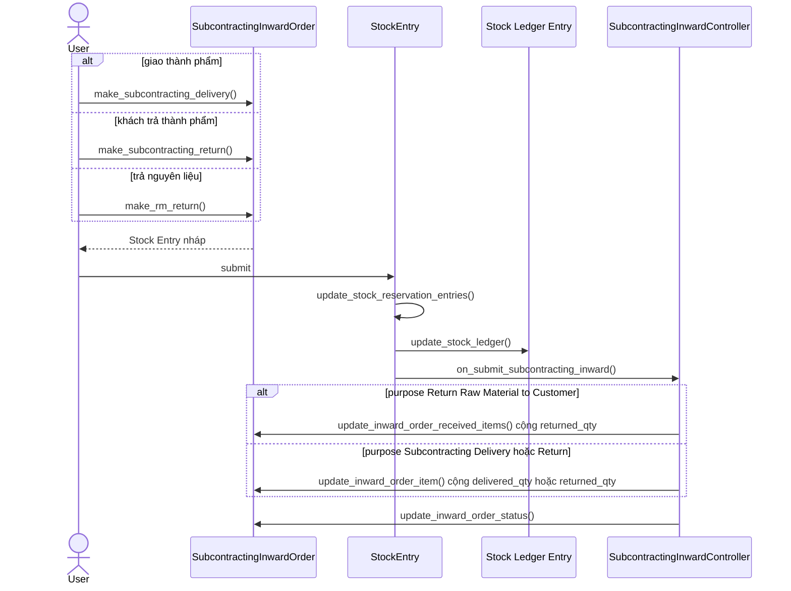

# Module Subcontracting

Module quản lý gia công theo hai chiều: thuê ngoài (Subcontracting Order, Subcontracting Receipt) và nhận gia công cho khách (Subcontracting Inward Order). Module nối với `buying` (Purchase Order, Purchase Receipt), `selling` (Sales Order), `stock` (Stock Entry, Stock Reservation Entry, sổ kho), `manufacturing` (BOM, Work Order, Job Card) và `accounts` (GL Entry).

## Phạm vi

Đọc được 13 doctype trong `subcontracting/doctype/`. Logic dùng chung nằm ở `controllers/subcontracting_controller.py` và `controllers/subcontracting_inward_controller.py`.

| Nhóm chức năng | Doctype / file chính | Sơ đồ |
|---|---|---|
| Danh mục | Subcontracting BOM | Class diagram |
| Thuê gia công | Subcontracting Order và 3 bảng con (`subcontracting_order.py`) | Class diagram; Sequence: tạo và submit, chuyển nguyên liệu |
| Nhận hàng gia công | Subcontracting Receipt và 2 bảng con, `services/gl_composer.py`, `mapper.py` | Class diagram; Sequence: submit Subcontracting Receipt |
| Nhận gia công | Subcontracting Inward Order và 4 bảng con, `SubcontractingInwardController` | Class diagram; Sequence: tạo và submit, nhận nguyên liệu, sản xuất, giao và trả |

## Class diagram

`StockEntry` là class ngoài module, kế thừa thật `StockController` và `SubcontractingInwardController`, nên được đưa vào để thể hiện đường gọi của Inward Order. `SubcontractingBOM` và các bảng con kế thừa trực tiếp `Document`.

### Thuê gia công

### Nhận gia công

## Sequence diagram

### Tạo và submit Subcontracting Order

Subcontracting Order được tạo từ Purchase Order đã bật `is_subcontracted`, thủ công hoặc tự động khi bật `auto_create_subcontracting_order`. Khi submit, đơn cập nhật `subcontracted_qty` trên Purchase Order và có thể giữ chỗ nguyên liệu. Chứng từ này không ghi sổ.

Nguồn: [mapper.py:236](../../apps/erpnext/erpnext/buying/doctype/purchase_order/mapper.py#L236), [subcontracting_order.py:127](../../apps/erpnext/erpnext/subcontracting/doctype/subcontracting_order/subcontracting_order.py#L127), [subcontracting_order.py:141](../../apps/erpnext/erpnext/subcontracting/doctype/subcontracting_order/subcontracting_order.py#L141)

### Chuyển nguyên liệu cho bên gia công

`make_rm_stock_entry` tạo Stock Entry mục đích `Send to Subcontractor`, chuyển từ kho nguồn sang `supplier_warehouse`. Khi submit, Stock Entry ghi sổ và cập nhật `supplied_items`, trạng thái đơn.

Nguồn: [subcontracting_controller.py:1445](../../apps/erpnext/erpnext/controllers/subcontracting_controller.py#L1445), [stock_entry.py:415](../../apps/erpnext/erpnext/stock/doctype/stock_entry/stock_entry.py#L415), [subcontracting.py:189](../../apps/erpnext/erpnext/stock/doctype/stock_entry/services/subcontracting.py#L189)

### Submit Subcontracting Receipt

Đây là bước ghi sổ chính của thuê gia công: tăng kho thành phẩm, giảm nguyên liệu tại `supplier_warehouse`, và lập bút toán qua `SubcontractingReceiptGLComposer`. Sau đó đơn gốc, Job Card và Purchase Receipt (nếu bật) được cập nhật.

Nguồn: [subcontracting_receipt.py:209](../../apps/erpnext/erpnext/subcontracting/doctype/subcontracting_receipt/subcontracting_receipt.py#L209), [subcontracting_controller.py:1277](../../apps/erpnext/erpnext/controllers/subcontracting_controller.py#L1277), [gl_composer.py:20](../../apps/erpnext/erpnext/subcontracting/doctype/subcontracting_receipt/services/gl_composer.py#L20)

### Tạo và submit Subcontracting Inward Order

Đơn nhận gia công được tạo từ Sales Order. Khi lưu, đơn kiểm tra ít nhất một nguyên liệu do khách cung cấp và kho khách thuộc đúng khách hàng. Khi submit, đơn cập nhật `subcontracted_qty` trên Sales Order Item.

Nguồn: [mapper.py:1179](../../apps/erpnext/erpnext/selling/doctype/sales_order/mapper.py#L1179), [subcontracting_inward_order.py:69](../../apps/erpnext/erpnext/subcontracting/doctype/subcontracting_inward_order/subcontracting_inward_order.py#L69), [subcontracting_inward_order.py:78](../../apps/erpnext/erpnext/subcontracting/doctype/subcontracting_inward_order/subcontracting_inward_order.py#L78)

### Nhận nguyên liệu từ khách

`make_rm_stock_entry_inward` tạo Stock Entry mục đích `Receive from Customer`. Khi submit, nguyên liệu vào kho, `received_qty` được cập nhật và mỗi dòng sinh một Stock Reservation Entry gắn với Inward Order.

Nguồn: [subcontracting_inward_order.py:343](../../apps/erpnext/erpnext/subcontracting/doctype/subcontracting_inward_order/subcontracting_inward_order.py#L343), [subcontracting_inward_controller.py:20](../../apps/erpnext/erpnext/controllers/subcontracting_inward_controller.py#L20), [subcontracting_inward_controller.py:1067](../../apps/erpnext/erpnext/controllers/subcontracting_inward_controller.py#L1067)

### Sản xuất cho Inward Order

Số lượng Work Order bị chặn theo nguyên liệu đã nhận. Reservation chuyển từ Inward Order sang Work Order. Stock Entry `Manufacture` cập nhật lại sản lượng trên đơn.

Nguồn: [subcontracting_inward_order.py:236](../../apps/erpnext/erpnext/subcontracting/doctype/subcontracting_inward_order/subcontracting_inward_order.py#L236), [work_order.py:751](../../apps/erpnext/erpnext/manufacturing/doctype/work_order/work_order.py#L751), [subcontracting_inward_controller.py:685](../../apps/erpnext/erpnext/controllers/subcontracting_inward_controller.py#L685)

### Giao hàng và trả hàng Inward Order

Thành phẩm giao qua Stock Entry `Subcontracting Delivery`, trả về qua `Subcontracting Return`, nguyên liệu thừa trả khách qua `Return Raw Material to Customer`. Ba nhánh dùng cùng khung `on_submit` của Stock Entry.

Nguồn: [subcontracting_inward_order.py:454](../../apps/erpnext/erpnext/subcontracting/doctype/subcontracting_inward_order/subcontracting_inward_order.py#L454), [subcontracting_inward_order.py:531](../../apps/erpnext/erpnext/subcontracting/doctype/subcontracting_inward_order/subcontracting_inward_order.py#L531), [subcontracting_inward_controller.py:685](../../apps/erpnext/erpnext/controllers/subcontracting_inward_controller.py#L685)

## Giới hạn

- Không vẽ sequence cho Subcontracting BOM vì là danh mục. Hàm tra cứu chính là `get_finished_good_bom`.
- Trả hàng thuê gia công (`make_subcontract_return`, `make_subcontract_return_against_rejected_warehouse`) chỉ gọi `make_return_doc` trong `controllers/sales_and_purchase_return.py`, không đọc tiếp. `make_return_stock_entry_for_subcontract` và `get_materials_from_supplier` cũng không vẽ.
- Hủy chứng từ (`on_cancel`) không vẽ riêng. Thứ tự gọi gần như đối xứng nhưng có khác biệt, xem code khi cần.
- Đọc lướt `SubcontractingController` (1660 dòng): phần tính nguyên liệu `__set_supplied_or_received_items`, backflush, serial và batch không vẽ chi tiết. Đọc lướt `SubcontractingInwardController` (1279 dòng): phần validate theo `purpose` và `adjust_inward_reservations` không vẽ.
- `make_purchase_receipt` trong `subcontracting_receipt/mapper.py` chỉ đọc phần đầu nên sơ đồ dừng ở tên hàm.
- `SalesInvoice.update_billed_qty_in_scio` cập nhật `billed_qty` của Received Item. Luồng lập hóa đơn cho nguyên liệu khách cấp không đọc đủ nên không vẽ.
- Điểm nghi vấn trong code: `SubcontractingController.set_subcontracting_order_status` có dòng `self.__get_subcontract_orders` thiếu dấu gọi hàm, nên dòng đó không có tác dụng. Chưa chạy thử để xác nhận ảnh hưởng.
- `SubcontractingInwardOrder.update_status` chia cho `total_to_be_received` và `total_to_be_produced` không kèm kiểm tra bằng 0. `validate_customer_provided_items` có thể khiến trường hợp này không xảy ra, nhưng chưa xác minh.
- `make_rm_stock_entry` mặc định `order_doctype` là Subcontracting Order, và còn có nhánh Purchase Order. Sơ đồ chỉ vẽ nhánh mặc định.
