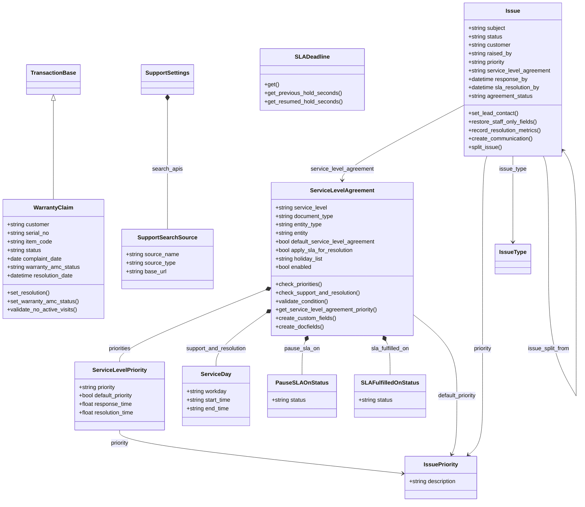
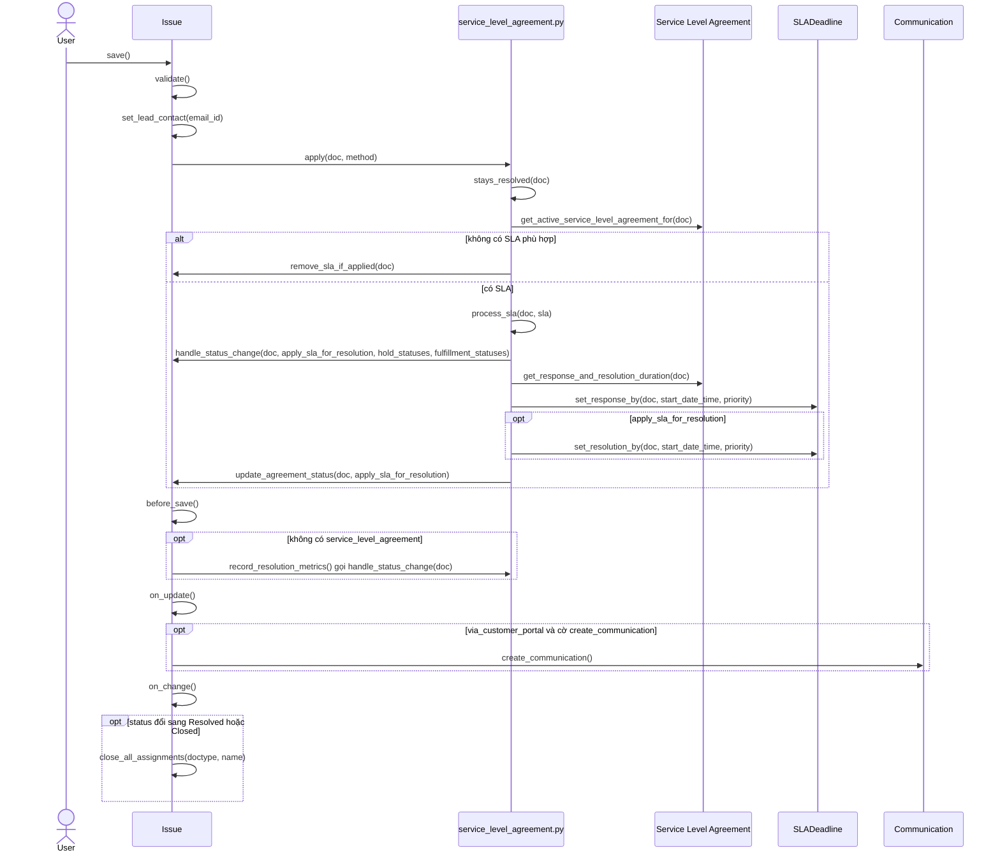
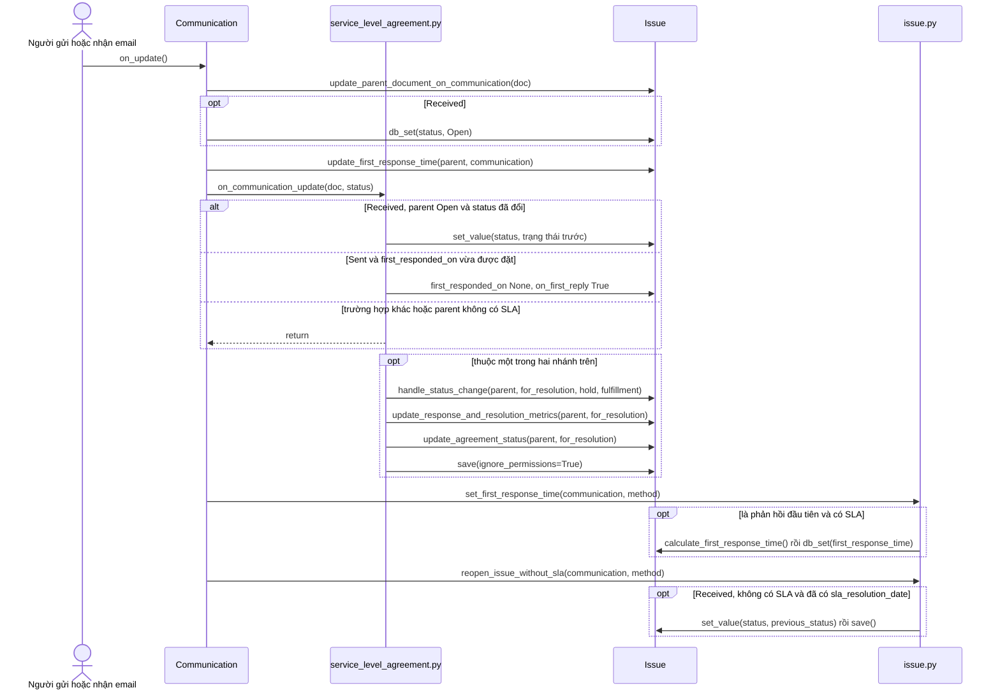
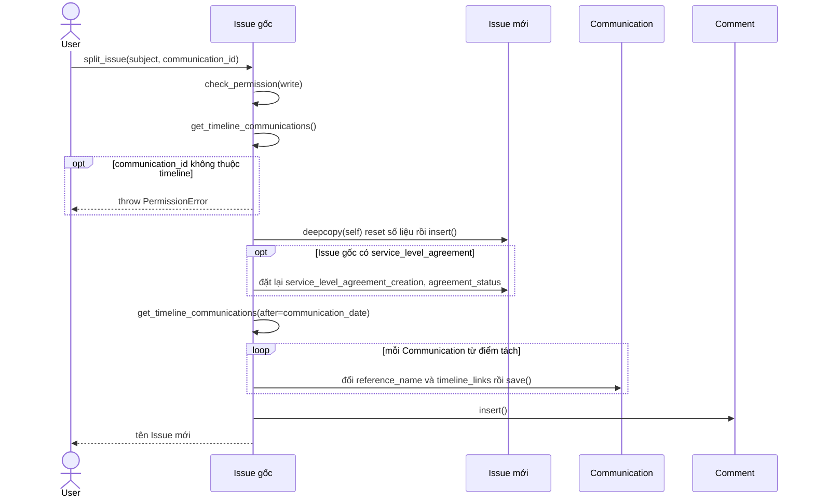
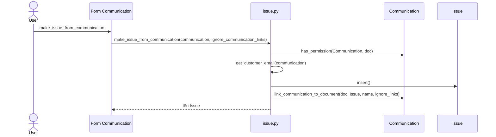
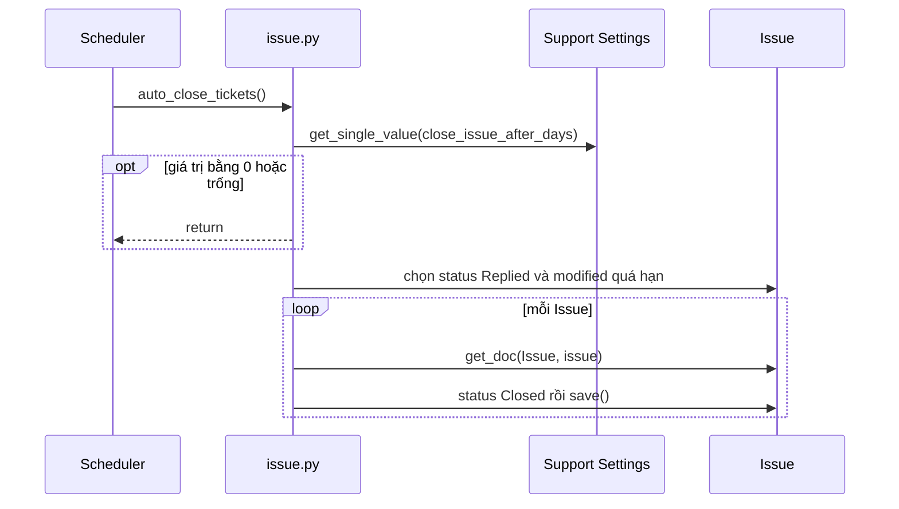
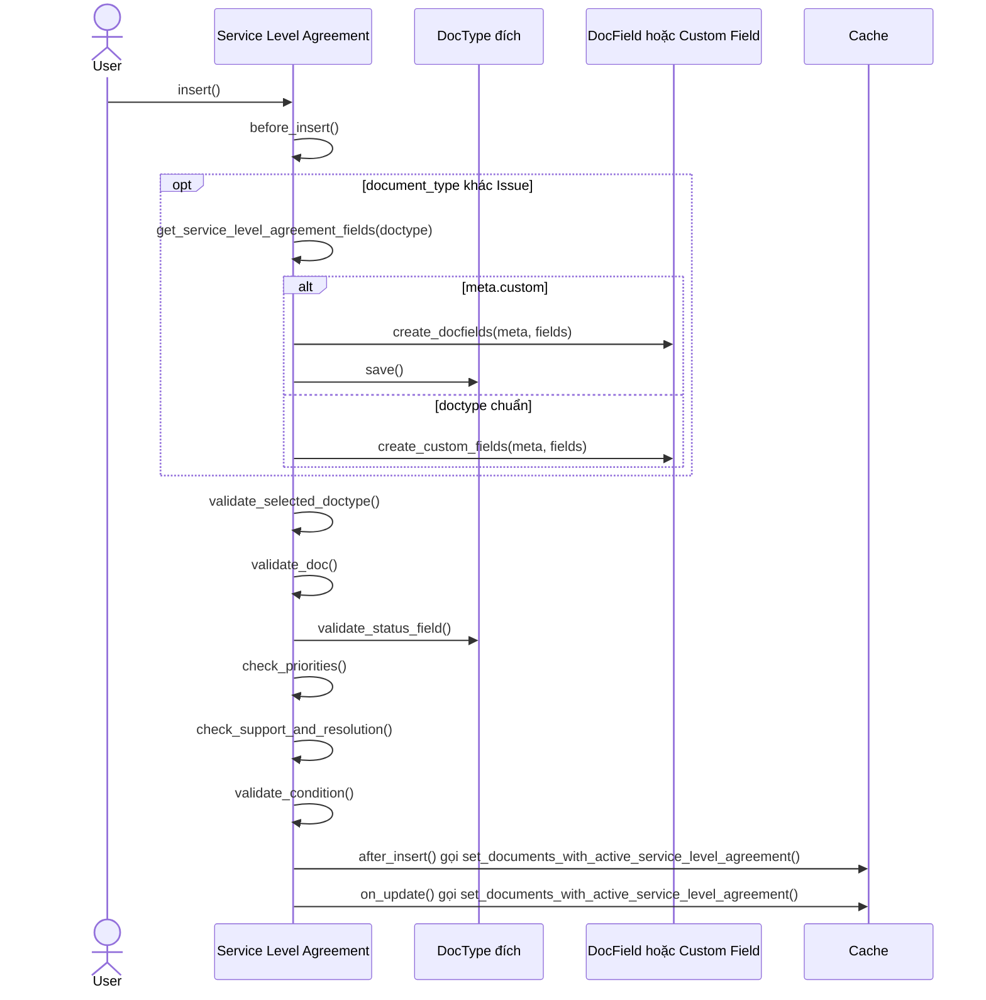
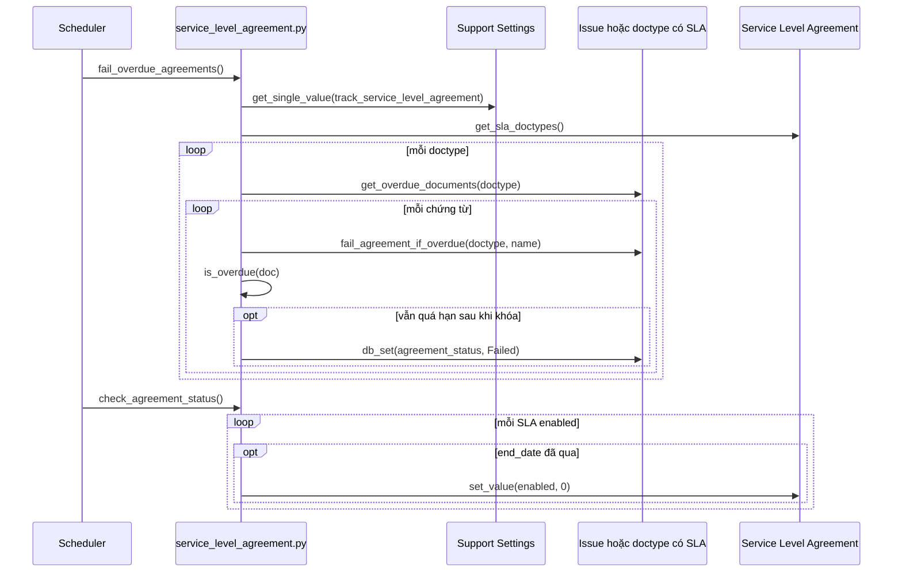
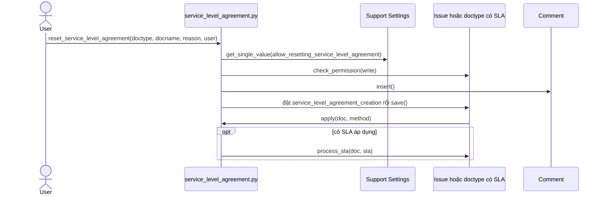
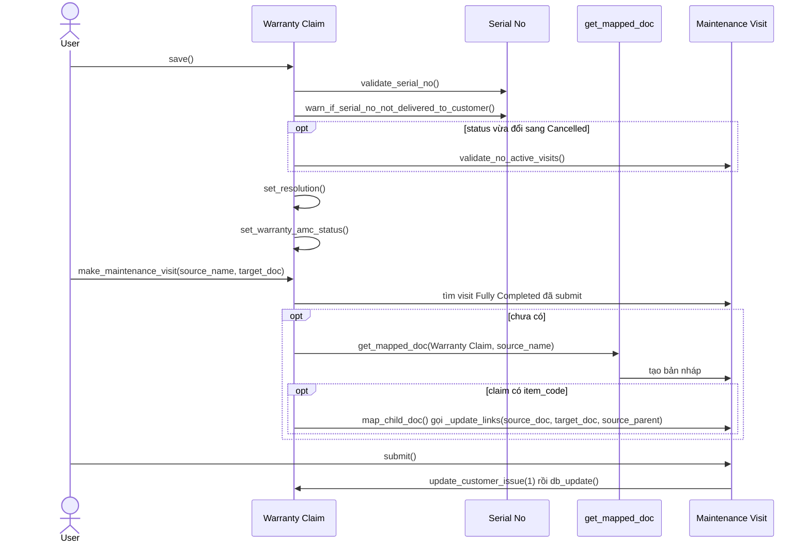

# Module Support

Xử lý yêu cầu hỗ trợ (`Issue`), khiếu nại bảo hành (`Warranty Claim`) và cam kết mức dịch vụ (`Service Level Agreement`). SLA gắn được vào nhiều doctype khác `Issue` qua hook `validate` toàn cục. Module nối với `Communication` (frappe), `Maintenance Visit` (maintenance), `Serial No` (stock), `Task` (projects).

## Phạm vi

Đọc được 11 doctype trong `support/doctype/`.

| Nhóm chức năng | Doctype/file chính | Sơ đồ |
| --- | --- | --- |
| Yêu cầu hỗ trợ | `Issue`, `Issue Priority`, `Issue Type`, `Support Settings`, `Support Search Source` | Class diagram. Sequence: Lưu Issue và áp SLA, Communication cập nhật Issue, Tách Issue, Tạo Issue từ Communication, Tự đóng Issue |
| Mức dịch vụ | `Service Level Agreement`, `Service Level Priority`, `Service Day`, `Pause SLA On Status`, `SLA Fulfilled On Status` | Class diagram. Sequence: Cấu hình SLA, Đánh dấu SLA quá hạn, Reset SLA |
| Bảo hành | `Warranty Claim` | Class diagram. Sequence: Warranty Claim và tạo Maintenance Visit |

## Class diagram

## Sequence diagram

### Lưu Issue và áp SLA

Hook `doc_events["*"]["validate"]` gọi `apply` cho mọi doctype, chạy sau `Issue.validate`. Không có SLA thì `before_save` vẫn ghi số liệu giải quyết.

Nguồn: [service_level_agreement.py:523](../../apps/erpnext/erpnext/support/doctype/service_level_agreement/service_level_agreement.py#L523), [service_level_agreement.py:568](../../apps/erpnext/erpnext/support/doctype/service_level_agreement/service_level_agreement.py#L568), [service_level_agreement.py:584](../../apps/erpnext/erpnext/support/doctype/service_level_agreement/service_level_agreement.py#L584), [issue.py:77](../../apps/erpnext/erpnext/support/doctype/issue/issue.py#L77)

### Communication cập nhật Issue

Frappe đổi `status` và `first_responded_on` của Issue bằng `db_set`. Các hook của ERPNext đảo lại thay đổi đó để `handle_status_change` đọc được trạng thái trước, rồi lưu Issue.

Nguồn: [service_level_agreement.py:869](../../apps/erpnext/erpnext/support/doctype/service_level_agreement/service_level_agreement.py#L869), [issue.py:414](../../apps/erpnext/erpnext/support/doctype/issue/issue.py#L414), [issue.py:422](../../apps/erpnext/erpnext/support/doctype/issue/issue.py#L422), [communication.py:673](../../apps/frappe/frappe/core/doctype/communication/communication.py#L673)

### Tách Issue

Từ một Communication trên timeline, sao Issue thành Issue mới, reset số liệu và SLA, rồi chuyển các Communication từ điểm tách trở đi sang Issue mới.

Nguồn: [issue.py:201](../../apps/erpnext/erpnext/support/doctype/issue/issue.py#L201), [issue.py:168](../../apps/erpnext/erpnext/support/doctype/issue/issue.py#L168)

### Tạo Issue từ Communication

Nút trên form Communication tạo Issue mới và liên kết email vào đó.

Nguồn: [issue.py:374](../../apps/erpnext/erpnext/support/doctype/issue/issue.py#L374), [issue.py:399](../../apps/erpnext/erpnext/support/doctype/issue/issue.py#L399)

### Tự đóng Issue

Job `daily_maintenance` đóng Issue ở trạng thái Replied quá `close_issue_after_days` ngày không đổi.

Nguồn: [issue.py:326](../../apps/erpnext/erpnext/support/doctype/issue/issue.py#L326)

### Cấu hình Service Level Agreement

Insert SLA cho doctype khác `Issue` sẽ thêm các field SLA vào doctype đó. Mọi thay đổi cập nhật cache danh sách doctype có SLA, được `apply` đọc.

Nguồn: [service_level_agreement.py:69](../../apps/erpnext/erpnext/support/doctype/service_level_agreement/service_level_agreement.py#L69), [service_level_agreement.py:230](../../apps/erpnext/erpnext/support/doctype/service_level_agreement/service_level_agreement.py#L230), [service_level_agreement.py:509](../../apps/erpnext/erpnext/support/doctype/service_level_agreement/service_level_agreement.py#L509)

### Đánh dấu SLA quá hạn

Job `hourly` đánh dấu `Failed` cho chứng từ đang mở đã quá hạn, không tính chứng từ đang giữ. Job `daily_maintenance` tắt SLA đã qua `end_date`.

Nguồn: [service_level_agreement.py:1146](../../apps/erpnext/erpnext/support/doctype/service_level_agreement/service_level_agreement.py#L1146), [service_level_agreement.py:1171](../../apps/erpnext/erpnext/support/doctype/service_level_agreement/service_level_agreement.py#L1171), [service_level_agreement.py:331](../../apps/erpnext/erpnext/support/doctype/service_level_agreement/service_level_agreement.py#L331)

### Reset Service Level Agreement

Nút Reset trên form tính lại thời hạn tính từ thời điểm hiện tại, nếu `Support Settings` cho phép.

Nguồn: [service_level_agreement.py:836](../../apps/erpnext/erpnext/support/doctype/service_level_agreement/service_level_agreement.py#L836)

### Warranty Claim và tạo Maintenance Visit

`Warranty Claim` không submit được, trạng thái thay đổi bằng lưu tay hoặc qua `Maintenance Visit`. Khi đã có visit `Fully Completed`, mapper không trả bản nháp nào.

Nguồn: [warranty_claim.py:53](../../apps/erpnext/erpnext/support/doctype/warranty_claim/warranty_claim.py#L53), [warranty_claim.py:147](../../apps/erpnext/erpnext/support/doctype/warranty_claim/warranty_claim.py#L147), [maintenance_visit.py:202](../../apps/erpnext/erpnext/maintenance/doctype/maintenance_visit/maintenance_visit.py#L202)

## Giới hạn

- `Issue Type`, `Issue Priority`, `Support Settings`, `Support Search Source` chỉ là cấu hình, không có sequence. Thư mục `page`, `web_form`, `report` chưa đọc.
- `Issue` kế thừa `Document` và `ServiceLevelAgreement` cũng vậy, nên không vẽ quan hệ `<|--` với class ngoài module. Vì các field SLA có thể thêm vào doctype bất kỳ, sơ đồ dùng tên chung `Issue hoặc doctype có SLA`.
- `handle_status_change` có sáu nhánh chuyển trạng thái (open, hold, fulfilled) và `SLADeadline` tính hold theo giờ làm việc. Sơ đồ chỉ vẽ lời gọi, không vẽ từng nhánh. `add_working_seconds` và `calculate_first_response_time` chỉ đọc qua.
- Thứ tự giữa `update_parent_document_on_communication` và ba hook `on_update` lấy từ `Document.hook` trong `frappe/model/document.py` (controller chạy trước, `doc_events` sau) và thứ tự danh sách trong `hooks.py`. `Communication.on_update` có thêm bước khác ở đầu hàm, không vẽ.
- Frappe gọi `parent.run_method("handle_hold_time", "Replied")` trong `communication.py`, nhưng trong `.py` của ERPNext và Frappe đã tìm không có method này, nên không vẽ.
- Bước `chọn status Replied`, `đổi reference_name`, `tìm visit Fully Completed`, `tạo bản nháp` là mô tả truy vấn hoặc phép gán, không phải tên hàm.
