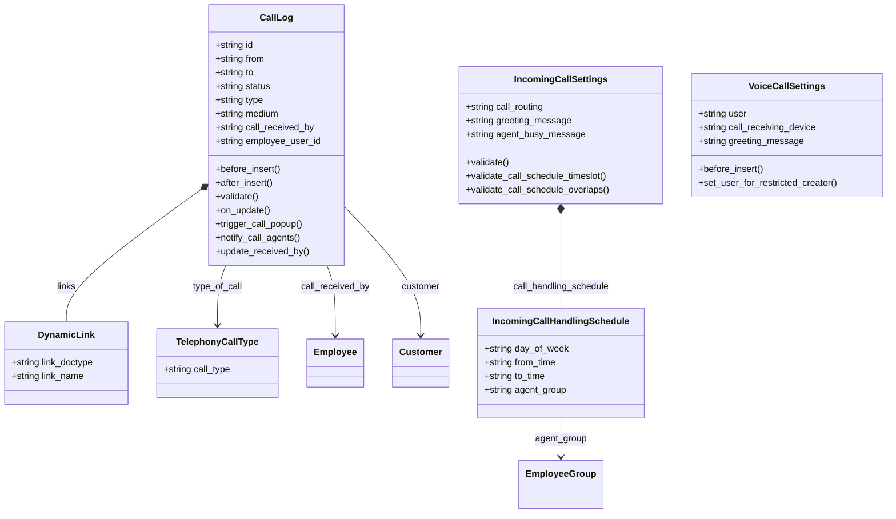
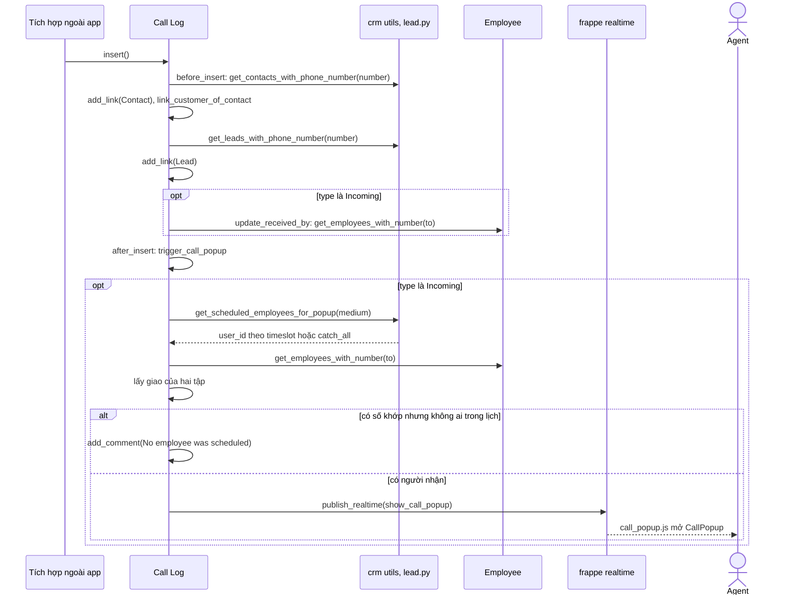
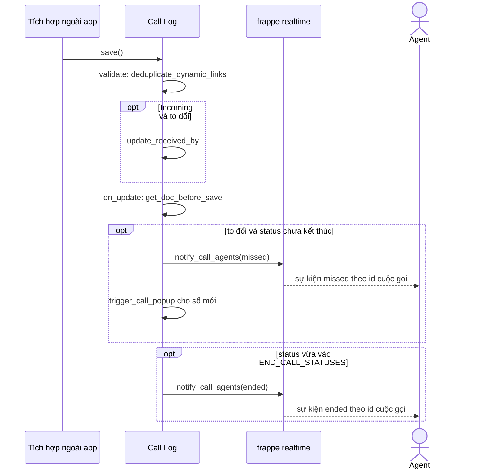
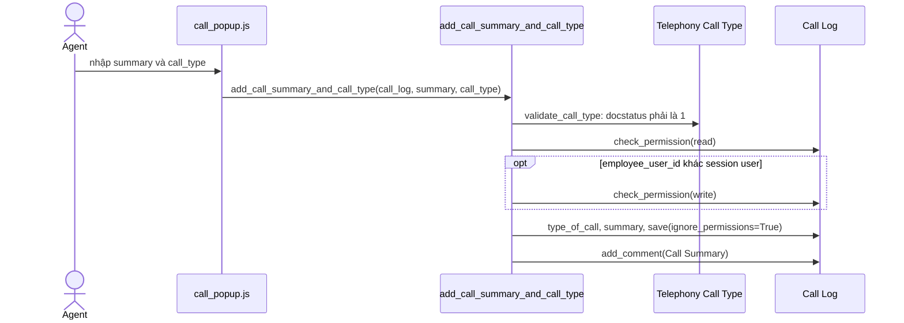
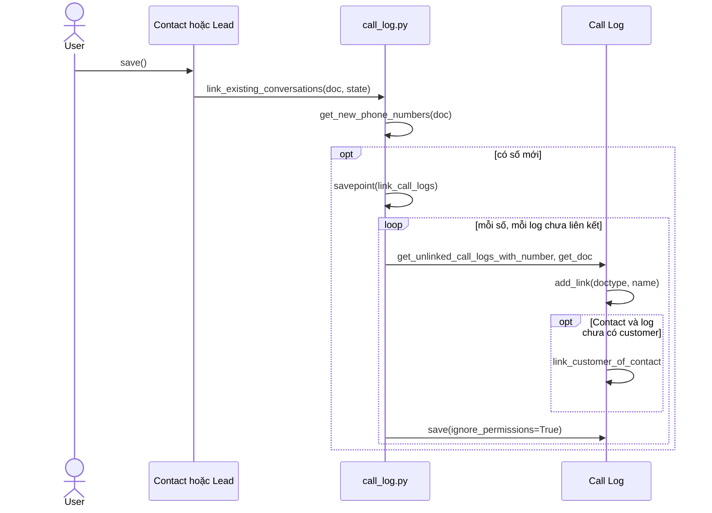

# Module Telephony

Module `telephony` lưu lịch sử cuộc gọi (`Call Log`), tự liên kết cuộc gọi với Contact, Lead, Customer theo số điện thoại và đẩy popup realtime cho nhân viên. Module nối với `crm` (tra số điện thoại), `communication` (lịch trực) và `setup` (Employee). Trong app này không có code tạo Call Log; bản ghi đến từ bên ngoài, ví dụ app tích hợp tổng đài.

## Phạm vi

Đọc được 5 doctype trong `telephony/doctype/`.

| Nhóm chức năng | Doctype/file chính | Sơ đồ |
|---|---|---|
| Cuộc gọi | `Call Log`, `Telephony Call Type` | Class. Sequence: 3 luồng cuộc gọi |
| Liên kết hội thoại cũ | `call_log.py` (`link_existing_conversations`) | Sequence: Liên kết cuộc gọi cũ |
| Cấu hình | `Incoming Call Settings`, `Incoming Call Handling Schedule`, `Voice Call Settings` | Class |

## Class diagram

## Sequence diagram

### Cuộc gọi đến và popup

Khi Call Log được tạo, controller liên kết các bên theo số điện thoại rồi đẩy `show_call_popup` cho nhân viên vừa khớp số `to` vừa nằm trong lịch trực của medium.

Nguồn: [call_log.py:60](../../apps/erpnext/erpnext/telephony/doctype/call_log/call_log.py#L60), [call_log.py:118](../../apps/erpnext/erpnext/telephony/doctype/call_log/call_log.py#L118)

### Cập nhật trạng thái cuộc gọi

Khi Call Log được lưu lại, `on_update` so với bản trước để phát hiện cuộc gọi nhỡ hoặc đã kết thúc. Sự kiện gửi cho nhân viên theo số cũ, không xét lịch trực.

Nguồn: [call_log.py:78](../../apps/erpnext/erpnext/telephony/doctype/call_log/call_log.py#L78)

### Ghi tóm tắt cuộc gọi

Nhân viên nghe cuộc gọi được ghi tóm tắt mà không cần quyền write; người khác phải có quyền write.

Nguồn: [call_log.py:157](../../apps/erpnext/erpnext/telephony/doctype/call_log/call_log.py#L157)

### Liên kết cuộc gọi cũ

Hook `on_update` của Contact và Lead tìm các Call Log trùng số mới thêm và gắn link; lỗi được rollback về savepoint và ghi log, không chặn việc lưu Contact hay Lead.

Nguồn: [call_log.py:227](../../apps/erpnext/erpnext/telephony/doctype/call_log/call_log.py#L227)

## Giới hạn

- Điểm tạo và cập nhật Call Log không có trong app này: grep `erpnext/` không thấy code Python tạo Call Log ngoài test. Participant "Tích hợp ngoài app" được suy ra, không đọc từ code cụ thể.
- `Incoming Call Settings`, `Voice Call Settings`: trong `erpnext/` không có Python nào đọc các giá trị này ngoài controller, test và patch, nên chỉ có class diagram. Nơi dùng có thể nằm ở app khác, chưa xác nhận.
- Phân quyền `has_permission`, `get_permission_query_conditions` (Call Log, Voice Call Settings) và `get_linked_call_logs` (hook `additional_timeline_content`) không vẽ vì không phải luồng nhiều bước.
- `public/js/telephony.js` và phần giao diện của `call_popup.js` chỉ đọc lướt.
- `_is_call_missed` trong code có ghi chú `FIXME`: logic này chỉ đúng với Exotel.
