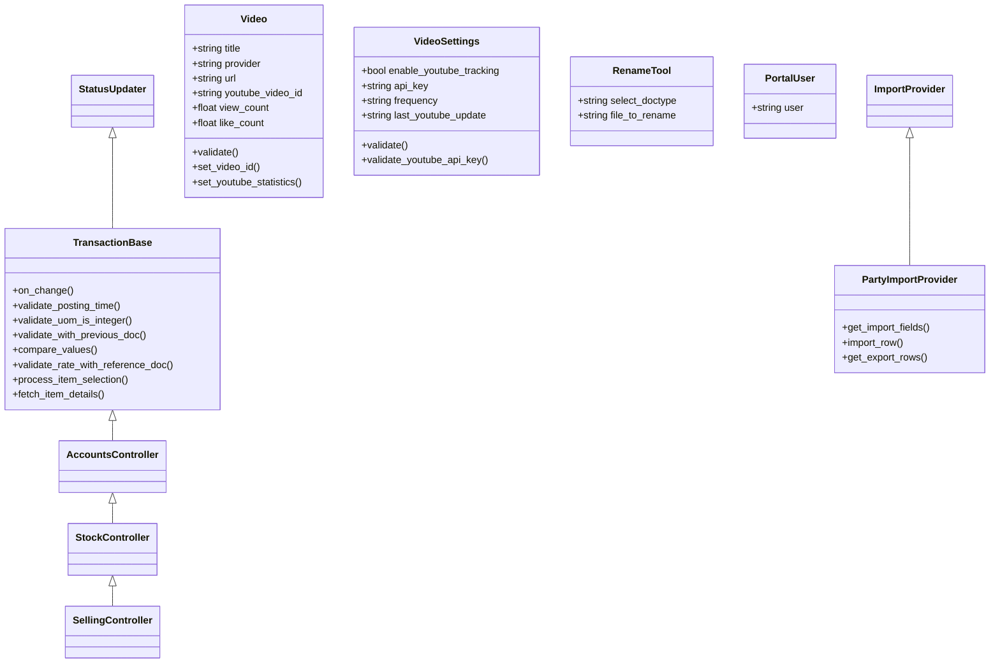
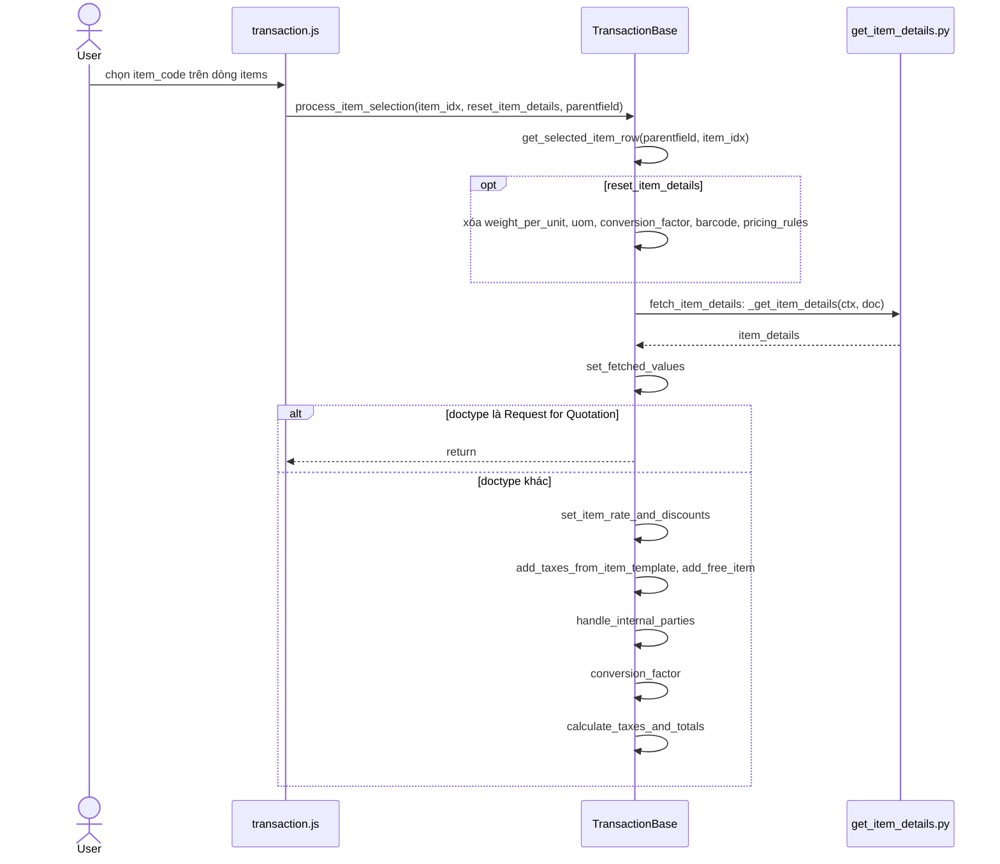
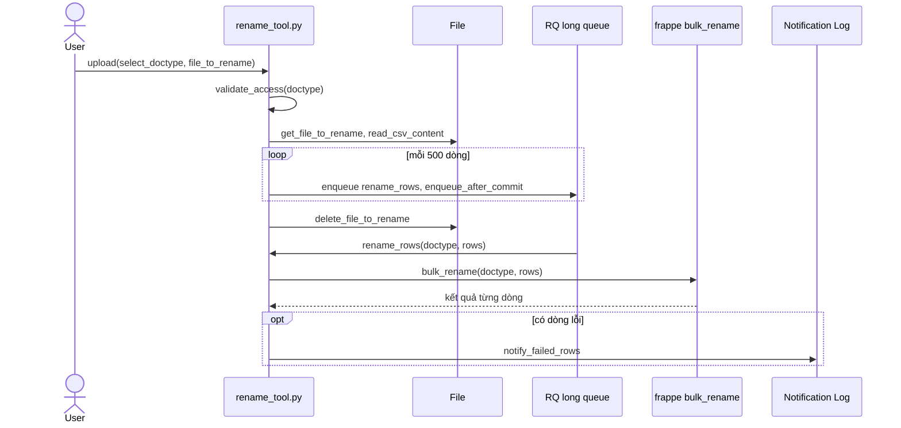
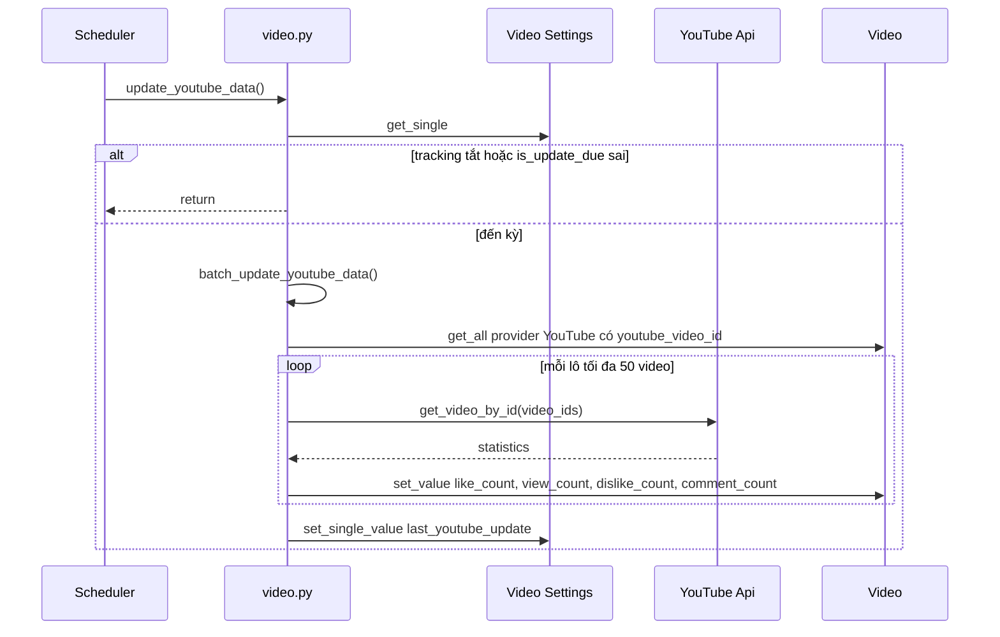
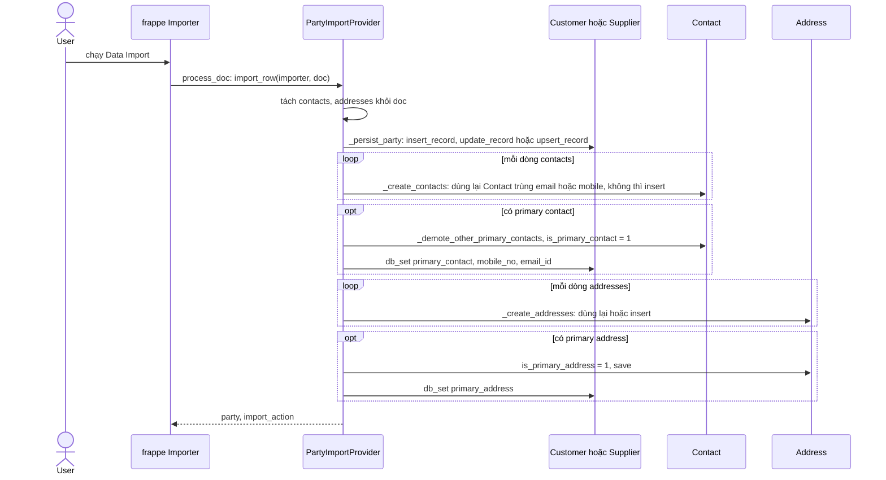

# Module Utilities

Module `utilities` là phần dùng chung, trong đó quan trọng nhất là `TransactionBase`, lớp cha của mọi controller giao dịch trong `controllers/`. Phần còn lại là các tiện ích nhỏ: đổi tên hàng loạt, đồng bộ thống kê YouTube, import Customer/Supplier kèm liên hệ, và các hàm dùng lại ở module khác.

## Phạm vi

Đọc được 4 doctype trong `utilities/doctype/`.

| Nhóm chức năng | Doctype/file chính | Sơ đồ |
|---|---|---|
| Lớp cha giao dịch | `transaction_base.py` | Class. Sequence: Chọn item trên chứng từ |
| Đổi tên hàng loạt | `Rename Tool` | Class. Sequence: Rename Tool |
| Video | `Video`, `Video Settings`, report `youtube_interactions` | Class. Sequence: Đồng bộ thống kê YouTube |
| Import party | `party_import_provider.py` | Class. Sequence: Import Customer/Supplier |
| Tạo chứng từ hàng loạt | `bulk_transaction.py` | Xem [bulk_transaction.md](bulk_transaction.md) |
| Portal | `Portal User` (bảng con) | Class |
| Hàm dùng chung | `activation.py`, `naming.py`, `query.py`, `product.py`, `regional.py`, `email_template.py` | Không vẽ, xem Giới hạn |

## Class diagram

## Sequence diagram

### Chọn item trên chứng từ

Khi người dùng chọn item trên form, phía client gọi method `process_item_selection` của server để lấy chi tiết item, tính lại giá và thuế trên chính document đó.

Nguồn: [transaction_base.py:361](../../apps/erpnext/erpnext/utilities/transaction_base.py#L361)

### Rename Tool

Đọc file CSV đính kèm và chia mỗi 500 dòng thành một job đổi tên; các dòng lỗi được báo qua Notification Log.

Nguồn: [rename_tool.py:45](../../apps/erpnext/erpnext/utilities/doctype/rename_tool/rename_tool.py#L45)

### Đồng bộ thống kê YouTube

Job `hourly_maintenance` kiểm tra đã đến kỳ theo `frequency` chưa, rồi cập nhật thống kê theo lô 50 video.

Nguồn: [video.py:75](../../apps/erpnext/erpnext/utilities/doctype/video/video.py#L75)

### Import Customer/Supplier

Đăng ký qua hook `data_import_providers`; Data Import của Frappe giao từng dòng cho provider để tạo party cùng Contact và Address liên kết.

Nguồn: [party_import_provider.py:40](../../apps/erpnext/erpnext/utilities/party_import_provider.py#L40)

## Giới hạn

- `bulk_transaction.py` nằm ở thư mục này nhưng được viết trong [bulk_transaction.md](bulk_transaction.md) để tránh trùng.
- `TransactionBase` chỉ vẽ một luồng; các hàm validate (`validate_with_previous_doc`, `validate_rate_with_reference_doc`, `validate_uom_is_integer`) được luồng của từng chứng từ gọi, xem tài liệu của module đó.
- `conversion_factor`, `calculate_taxes_and_totals` trong luồng chọn item gọi trên `self`; không đọc chi tiết `calculate_taxes_and_totals` và phần áp bảng giá trong `_apply_price_list`.
- Hàm dùng chung không vẽ vì không có luồng riêng: `activation.get_level`, `get_help_messages` (đo mức sử dụng), `naming.set_by_naming_series`, `query.py` (điều kiện truy vấn), `product.get_price`, `product.get_item_codes_by_attributes`, `regional.temporary_flag`, `email_template.get_email_subject_and_message`, `__init__.get_site_info`, `clear_logs_with_references`.
- `get_export_rows` của `PartyImportProvider`, report `youtube_interactions` và web form `addresses` không vẽ.
- `set_youtube_statistics` chạy khi lưu một Video nếu bật tracking; chỉ gọi API cho một video, không có luồng riêng.
- `Portal User` chỉ có field `user`. Đã thấy dùng trong field `portal_users` của Customer và Supplier.
